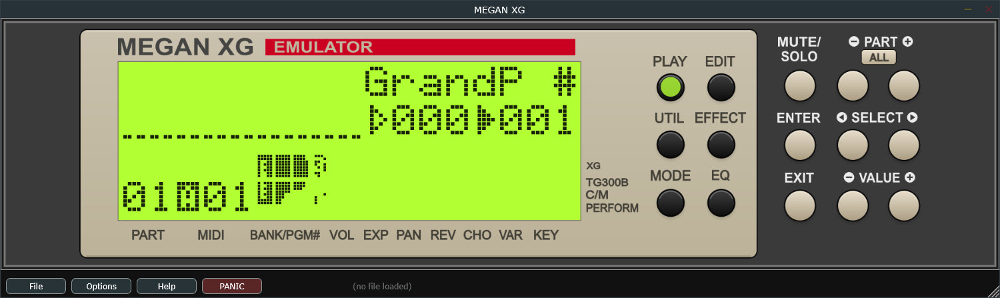
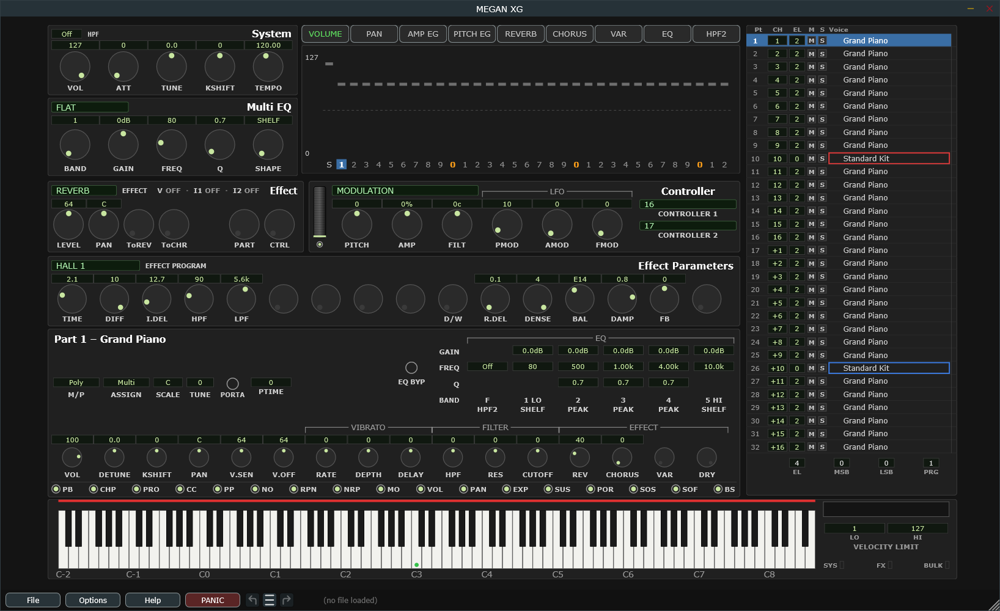

# 1 Getting started

## What you need

| | |
|---|---|
| **Operating system** | Windows 10 or 11, 64-bit |
| **Host** | Any VST3 host — Cubase, Bitwig, Reaper, Studio One and so on. Or none: the standalone runs on its own. **For the full feature set your DAW also needs to record and play back system-exclusive (SysEx) MIDI**, which is the form nearly every XG parameter travels in. Without it you are limited to the 4 939 parameters the plugin publishes as native DAW automation — a useful subset covering the mixer controls and every drum key, but still a fraction of the editor. **Cubase is the only DAW this has been tested in.** See [Recording your edits as MIDI](#recording-your-edits-as-midi). |
| **CPU** | The plugin emulates the MU100's processor and sound chip in software, so this is the one demanding requirement. Any modern desktop or laptop CPU handles one instance comfortably; a very old or very low-power machine may not. |
| **RAM** | Trivial by modern standards — the emulated module has 128 KB. |
| **Disk** | About 30 MB for the plugin, plus about 18 MB for the ROM zip you supply. |
| **ROM files** | **Required.** See below. |
| **Audio interface** | Anything. ASIO is worth having for the standalone. |

## Installing

1. Copy `MEGAN XG.vst3` to your VST3 folder, normally:

   ```
   C:\Program Files\Common Files\VST3\
   ```

   Windows will ask for administrator permission. If your DAW scans a different
   folder, use that one instead.

2. Put the ROM files where the plugin expects them (next section).

3. Start your DAW and let it rescan its plugins. **MEGAN XG** appears as an
   instrument.

The standalone is a single `.exe` and needs no installation — but it reads the
same ROM files, so step 2 applies either way.

## ROM files — what you need, and where to put them

The MU100's firmware and its 20 MB of instrument samples are Yamaha's copyrighted
property and **cannot be distributed with the plugin**. You have to supply them
from a machine you own.

Put a file called **`mu100.zip`** in:

```
Documents\MEGAN XG\
```

The plugin reads the ROMs straight out of the zip; do not unpack it. Inside it
needs these ten files, named exactly:

**Firmware** — one file:

```
xu50720.ic11
```

That is MU100 firmware v1.11. Other versions exist and your dump may be one of
them; the plugin asks for this one and will not start without it.

**Samples** — all six:

```
xs518b0.ic34        xs743b0.ic35        xt445a0-828.ic36
xt461a0-829.ic37    xt462a0.ic39        xt463a0.ic38
```

**Support** — all three:

```
sin-table.bin       hd44780u_b04.bin    mulcd.svg
```

The last two belong to the LCD and the first to the sound chip. They are easy to
overlook because they are not "the ROM", but a missing one stops the engine just
as firmly as a missing sample does.

One other file lives in the same folder, loose rather than in the zip:
**`settings.xml`**. The plugin writes it the first time you change a setting, so
you never have to create it.

> **Watch out** — if the ROMs are missing or incomplete, the plugin loads but
> makes no sound, and the Hardware view will tell you the engine stopped. That is
> the first thing to check if you get silence on a fresh install.

The plugin also writes a diagnostic log, `enginelog.txt`, in the same folder. You
can ignore it unless something goes wrong.

## First run

Open the plugin. It comes up showing the **Hardware view** — the picture of the
module's front panel, with a working LCD.


<!-- CAPTURE: Hardware view, freshly launched, LCD showing the normal play
     screen. Full window including the bottom bar. -->

Give it a few seconds. The emulated module boots exactly as the hardware does, and
the LCD lights up when it is ready.

Then switch to the editor: **Options ▸ View ▸ Dark Editor** (or **Light Editor**,
if you prefer a light interface — they are the same screen). The plugin remembers
which view you chose and opens there next time.


<!-- CAPTURE: Editor view, dark theme, freshly launched at defaults, full window. -->

## Checking that it works

Two quick tests, in order. Both are on the editor's on-screen keyboard, along the
bottom of the screen.

**Are you getting sound?** **Right-click and drag** across the keyboard. You
should hear a piano. (Right-drag plays notes; left-drag sets the part's note
range, which is not what you want here.)

If you hear nothing:

- Check your DAW is actually routing the plugin's output somewhere, or — in the
  standalone — that **Options ▸ Audio...** names your real sound card.
- Check the ROM files, as above.
- Look at the Hardware view. If it says the engine stopped, the ROMs are the
  problem.

**Is the editor talking to the sound engine?** With a note sounding, drag the
**VOL** knob at the left of the Part module up and down. The level should follow
it immediately.

If notes play but the knob does nothing, the sound engine is running but the
editor is not reaching it — which should not happen, and is worth reporting.

## Playing it

> **VST only** — your DAW sees **two** MIDI inputs for this plugin, named
> something like `MEGAN XG - A` and `MEGAN XG - B`. Port A drives parts 1–16, port B
> drives parts 17–32. A single MIDI track on port A gets you the normal sixteen
> channels; you only need port B if you want all 32 parts.

> **Standalone only** — go to **Options ▸ MIDI Input...**, tick **Active** next to
> your keyboard or interface, and choose whether it feeds port A or port B. See
> [Running standalone](#19-running-standalone).

## Bringing in something you already have

If you have `.syx` files from XGEdit or from a hardware module, **File ▸ Open
File...** will load them, and every panel in the editor will fill in with what was
in the file. That is the fastest way to see the editor doing something useful.

See [Working with existing XG material](#loading-a-syx-file-from-xgedit-or-hardware)
for what does and does not survive the trip.
