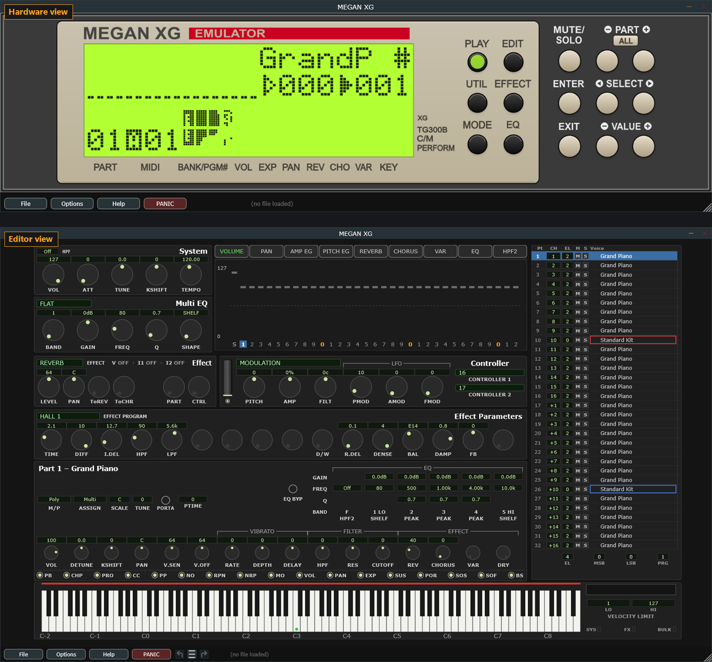
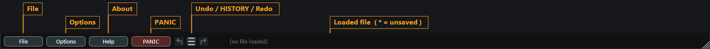
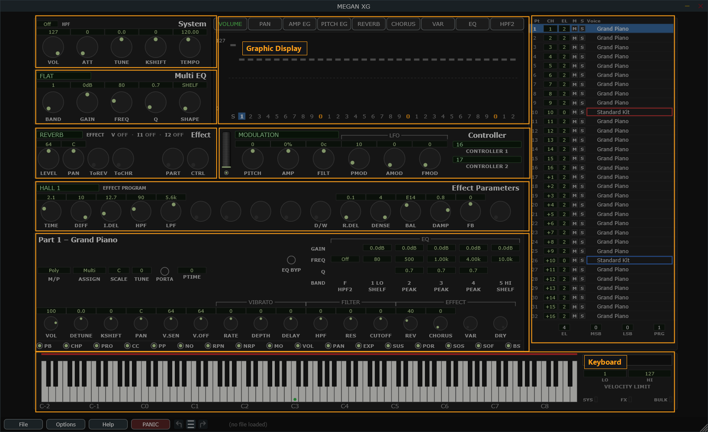

# 2 The main screen

The plugin has **two views** in one window, and one bar along the bottom that
belongs to both.

## The two views

**The Hardware view** is a picture of the MU100's front panel, with a live LCD
and working buttons. It is the module as you would meet it on a desk: every screen
and every menu the real firmware has, reached the way the real thing reaches
them.

**The Editor view** is the parameter editor — one dense screen with everything on
it at once, in the style of XGEdit. This is where you will spend nearly all your
time, and it is what most of this manual is about.

<!-- CAPTURE: Two shots side by side or stacked - Hardware view (LCD lit, showing
     the play screen) and Editor view (dark theme, defaults). Same window size. -->

Switch between them with **Options ▸ View**:

| | |
|---|---|
| **Dark Editor** | The editor, dark color scheme |
| **Light Editor** | The editor, light color scheme |
| **Hardware** | The front-panel picture |

One of the three is always ticked. Whichever you pick is also what the plugin
opens in next time — it is one setting, not two.

**Each view remembers its own window size.** The Hardware view is locked to the
picture's proportions; the editor is free. So you can leave the editor at 1600
pixels wide and the hardware picture at 800, and switching between them puts each
back where you had it.

They are not two separate windows. There is exactly one plugin window, and it
shows one view at a time — a second floating window is a bad idea inside a DAW.

> **Watch out** — the two views do not share edits. Anything you do on the front
> panel is invisible to the editor. This matters enough to have its own section:
> [Using both views on one project](#using-both-views-on-one-project). If you only
> ever use the editor, it will never come up.

## Resizing

Drag any edge or the corner grip. The editor is drawn on a fixed canvas that
scales to fit the window, so **everything grows together** — text, boxes, knobs,
the graphic display — and nothing can ever crowd or clip. Make it as large as your
screen allows; the editor is dense by design and benefits from the room.

The canvas is wider than it is tall, and in practice the *height* of your window
is what limits how big things get. A taller window buys more than a wider one; a
very wide, short window just gets empty margins at the sides.

If you want text larger than the window can give you, there are five percentage
settings in [settings.xml](#text-size-settings-only). They grow the text without
growing the boxes around it, so they are a modest top-up rather than a zoom
control.

## The bottom bar

<!-- CAPTURE: Editor view, dark theme, full-width crop of the bottom strip,
     annotated: File | Options | About | PANIC | undo - HISTORY - redo | path* -->

Left to right:

| | |
|---|---|
| **File** | Open, save, export, read from the device |
| **Options** | Every preference — see [Options and settings](#15-options-and-settings) |
| **Help** | This manual, and the About box (version and credits) |
| **PANIC** | Stops all sound. Press it when a note sticks. |
| **Undo · HISTORY · Redo** | Editor edits, twenty deep — see [Controls](#undo-and-redo) |
| **File path** | The setup you are working on. A trailing `*` means unsaved changes. |
| **MIDI OUT: CC badge** | Appears while edits are being sent as MIDI controllers rather than SysEx. Click it to switch back — see [the badge](#the-midi-out-cc-badge). |
| **Mute / Solo badge** | Appears at the far right only while parts are muted, soloed or [EQ-bypassed](#eq-byp-hearing-the-part-without-its-eq). Click it to clear them all — see [mute and solo](#m-and-s-mute-and-solo). |

The undo buttons are **hidden on the Hardware view**, because front-panel edits
are not undoable. Their space is left empty rather than closing up, so nothing on
the bar moves as you switch views.

The whole bar is covered in [Menus](#14-menus-and-the-bottom-bar).

## The editor at a glance

The editor screen is nine modules. Each has its own chapter; this is the map.

<!-- CAPTURE: Editor view, dark theme, full window, with each module outlined and
     labeled: System, Multi EQ, Graphic Display, Effect, Controller, Effect
     Parameters, Part, Voice, Keyboard. -->

| Module | Where | What it is |
|---|---|---|
| **System** | top left | Master volume, tuning, transpose, tempo |
| **Multi EQ** | below it | The module's five-band master EQ |
| **Graphic Display** | top center | The big screen — levels, pans, envelopes, EQ, across all parts |
| **Effect** | mid left | Which effect unit you are looking at, and its levels and routing |
| **Controller** | mid center | What the mod wheel, pitch bend and aftertouch do |
| **Effect Parameters** | center | The sixteen knobs of the selected effect |
| **Part** | lower center | The selected part's channel strip, filters and EQ |
| **Voice** | right column | All 32 parts, their channels and their voices |
| **Keyboard** | bottom | Note range, velocity limits, auditioning, drum key selection |

Two of these are the ones you steer with:

- **The Voice module** picks which part everything else is showing. Click a row
  and the Part module, the Graphic Display and the Keyboard all follow.
- **The Effect module** picks which effect unit the Effect Parameters knobs are
  editing. Its top strip also reports, at all times, which part each insertion is
  assigned to — see [the routing strip](#the-routing-strip).

Nothing else on screen changes what anything else is showing, which is the point
of a single-screen editor: what you see is the whole state.
