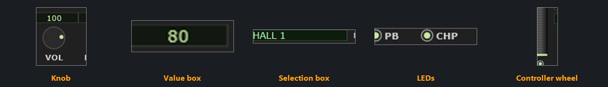
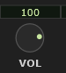
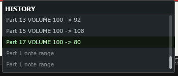

# 3 Controls

The editor has hundreds of controls, but only about six *kinds* of control, and
each kind behaves the same way everywhere it appears. Learning the rules once is
the fastest way to become fluent with the program — after this chapter, the rest
of the manual is mostly "what does this particular knob do".

<!-- CAPTURE: Editor view, dark theme. A composite or annotated crop showing one
     XgKnob, one standalone ValueBox, one XgSelector (Effect Program box), a row
     of DotToggle LEDs, and the controller wheel. Annotate each with its name. -->

## The universal rules

Five of these apply to nearly every editable control in the editor:

| Action | What it does |
|---|---|
| **Drag up / down** | Change the value. Up increases. |
| **Shift + drag** | Fine adjustment — roughly nine times slower, for landing on an exact value. |
| **Mouse wheel** | Nudge the value. The pointer has to be over the control. |
| **Shift + wheel** | Fine adjustment — exactly one step per click. |
| **Right-click** | Reset that control to its default. |

How far one click of the wheel goes depends on which half of a knob you point at.
Over the **value box** it is one step, so on an ordinary 0-127 parameter the number
moves by 1. Over the **dial** it is a fraction of the whole range instead — about
5 on that same parameter — which is quicker to travel with but will not land on a
number you have in mind. That is what **Shift + wheel** is for: hold Shift and every
click is one step, wherever you are pointing. On a control with a finer grid than 1,
Shift gives you that grid — the TEMPO knob moves 1 BPM a click and 0.1 with Shift.

A drag does not have to stay on the control. Once the button is down you can move
the mouse anywhere — right off the plugin window if you like — and the control
keeps following it. This matters more than it sounds: a full sweep of a knob is
250 pixels of travel, and with Shift held it is 2 200, which is taller than most
screens.

> **Watch out** — right-click resets **immediately**, with no confirmation. It is
> undoable (see [Undo and Redo](#undo-and-redo)), but it is easy to do by accident
> if you are used to right-clicking for a context menu. The only context menu in the
> editor is the **part menu**, on the rows of the Part Module and on the part numbers
> under the bar screens — see [Copying a part, and resetting one](#copying-a-part-and-resetting-one).
> Everywhere else, right-click resets.

**Invert knob/dial direction.** If you would rather drag *up* to decrease — the way a
rotary knob physically turns — switch on **Options ▸ Invert knob/dial direction**. It
reverses drag and wheel direction on knobs and value boxes only. It deliberately
does *not* affect the controller wheel, the Graphic Display, the selection boxes
or the Voice List, where "up" already means something unambiguous.

## Knobs

<!-- CAPTURE: Editor view, dark theme, close crop of one Part-module knob showing
     the label, the value box above the dial, and the dial's pointer dot. -->

A knob is three things stacked: a **name** at the bottom, a **dial** with a
pointer dot, and a **value box** above it showing the number.

The dial takes all four universal actions. The value box above it takes them too,
*and* one more: **click it without dragging and you can type a value**. Press
Enter to commit, Escape to abandon.

Typing is the only practical way to hit an exact number on a wide-ranging control
— frequencies especially. Where a value has a unit, type just the number; where a
frequency runs into the kilohertz you can type either `1400` or `1.4k`.

Many parameters do not offer every number in their range. The hardware gives them
a fixed set of steps — a frequency box that goes `1.0k`, `1.1k`, `1.3k` has
nothing in between — so a typed value that falls between two steps is taken to
**the nearest one the device can actually be set to**, and a value past either end
is taken to that limit. The number that appears after you press Enter is therefore
sometimes not the number you typed; what you are seeing is the control telling you
what the MU100 will really do.

A few knobs step in musically useful increments rather than by one raw unit — the
System module's TEMPO knob moves in whole BPM, or tenths with Shift held.

## Value boxes

The same compact green field also appears on its own, without a dial, wherever a
parameter is a list of choices or a number that does not want a knob — Mono/Poly,
the EQ grid, the note limits. These behave exactly like a knob's value box.

Where a box holds a **list of choices** rather than a number — Mono/Poly, Assign —
dragging and the wheel step through the choices and typing is switched off,
because there is nothing sensible to type.

### The changed marker

A small colored tab at the edge of a value box means **this value is not its
default**. It is bright yellow in the dark theme and violet in the light theme.

It is the fastest way to see, at a glance, what you have actually touched on a
part — and the fastest way to get back, since right-clicking any tabbed control
clears it.

The same marker turns up in four more places, all saying the one thing: a tab at
the far left of a row in the [Voice module](#the-two-row-markers), a yellow bar or
handle on the [Graphic Display](#the-bar-screens), and the upper row of the
[Keyboard's drum strip](#which-drum-keys-have-been-touched).

If you would rather not see any of them, **Options ▸ Show changed markers** turns
the whole set off — see [Show changed markers](#show-changed-markers). Nothing
moves when you do: the space each tab sits in is reserved either way, so values
stay exactly where they were.

### Gray and blank

Two different things, and the distinction is deliberate:

- **Gray** means *this control cannot be edited right now.* The value shown is
  real and is still in effect; something about the current context has locked it.
  A drum kit part grays the controls the device genuinely ignores; unticking
  **Options ▸ Enable plugin-only parameters** grays the controls that would not
  survive a `.syx` export; drum-edit mode grays the part-level receive switches.
- **Blank** means *there is no value here at all.* You will see this in drum-edit
  mode before you have picked a key: the boxes are empty because the numbers that
  would otherwise be sitting there belong to no key and would be misleading.

## Selection boxes

The wide green fields that name an effect program, a Multi EQ preset or a
controller source are **selection boxes**. They have no dropdown arrow, and they
work two ways:

- **Click** — a popup opens listing *every* option at once, in one or three
  columns, with no scrolling.
- **Wheel** — steps to the next or previous option without opening anything.

Wheeling through effect programs is a genuinely good way to audition them, and the
editor treats a whole wheel-flick as a single undo step so you can get back in one
click.

## LEDs

The small round lights — the Part module's row of receive switches, the PORTA
switch, the effect SYNC toggles — are simple on/off toggles. **Click to toggle.**
There is nothing to drag.

Unlike the continuous controls, these are sent to the sound engine the instant you
click, because an on/off change has no drag to wait for.

## The controller wheel

The Controller module's wheel is a live performance control, not a parameter:
**drag it** and it sends the selected controller's value to the device, exactly as
if you had moved a physical wheel. It is for hearing what a modulation setting
actually does while you edit its depth.

The **mouse wheel** moves it too, by 4 of the 127 controller values per click, or by
1 with **Shift** held — the same fine-adjust rule as everywhere else. The exception is
**Pitch Bend**, where the wheel does nothing: that mode is spring-loaded and snaps back
to center the moment you let go, so there would be nothing for a click to leave behind.
Drag it instead.

## The Graphic Display

The large screen's handles — the level bars, the envelope points, the EQ nodes —
are dragged directly. They take the universal rules plus a few of their own; see
[the Graphic Display chapter](#5-the-graphic-display) and
[the EQ display](#6-the-eq-display) for the details. Hover over any of them for a
moment and the exact value appears.

## The keyboard

The on-screen keyboard has **two different drags**, which is unusual enough to be
worth stating plainly:

- **Left-drag** sets the part's **note range** — the red bar above the keys. Start
  nearer the low end to move the lower limit, nearer the high end for the upper.
- **Right-drag** **plays** notes, at the velocity in the VELOCITY LIMIT HIGH box.

Right-dragging the keyboard is also the quickest way to check that the plugin is
making sound at all.

## Tooltips

Hover over almost anything and a description appears. The wording follows the XG
parameter names, so if you have used other XG editors much of it will look
familiar; where a bare name explained nothing on its own, the text says what the
control actually does instead.

**Options ▸ Tooltips** offers three placements:

| | |
|---|---|
| **Bottom bar** | The default. The text appears in the strip along the bottom of the window, after 0.15 s. Nothing ever covers what you are looking at, and the delay can be shorter because of it. |
| **Pop-ups near cursor** | A small box appears by the pointer after about 0.7 s. |
| **None** | No hover text. |

Tooltips stay out of the way while you are actually editing — once you press the
mouse or turn the wheel on a control, its tooltip will not pop back until you move
away and return.

## Automation markers

Two marks can sit by a control's name, and they mean different things:

| Mark | Means | Shown |
|---|---|---|
| a small orange **triangle** before the name | the control has its own **automation lane in your DAW** | VST only |
| an **underline** beneath the name | its edits record as a **MIDI controller (CC)** | only while [MIDI Out sends edits as](#midi-out-sends-edits-as) is on MIDI CC |

A control can carry both: VOL, PAN, REV, CHORUS, VAR, CUTOFF and RES have a DAW lane
*and* a controller. Every control without a triangle can still be automated as
recorded SysEx on a MIDI track; the triangle distinguishes the two kinds. See
[DAW automation parameters](#a3-daw-automation-parameters) and
[recording edits as controllers](#recording-edits-as-controllers-cc).

Where a whole group of controls qualifies, a mark goes once against the name that
covers them instead of on every one: on the Part module's EQ **GAIN** row label, and
on the [Graphic Display](#5-the-graphic-display)'s screen buttons. A marked
**VOLUME** button means every part's volume bar qualifies, rather than thirty-three
marks across the bars.

A grayed control never carries a mark, since there is nothing you can edit there —
in drum-edit mode before a key is picked, for example, the Part module shows none.
The Graphic Display's bar screens keep theirs in that state, because their bars still
edit the parts and stay live.

Each mark can be switched off: **Options ▸ Mark DAW-automatable parameters** and
**Options ▸ Mark parameters that send MIDI CC**.

## MIDI override marks

A cyan mark on a control means **incoming MIDI has moved that setting on the
module, and the value you set is still the one shown**. Nothing arriving over MIDI
changes your setup, so what you save is always what the panels show; the mark is
how you can see that the module has been taken somewhere else in the meantime.

Your value never moves. The cyan is a second reading beside it. On the value boxes
and knobs — anywhere in the editor, in every module — you choose what that reading
looks like, under **Options ▸ Display Animation… ▸ Mark them with**:

- **Horizontal bars** — a bar under every value box, whether or not the parameter
  has a knob, filling toward the device's value. The widest of the three, and the
  easiest to read at small amounts.
- **Horizontal bars and knob arcs** (the default) — the same bar under the boxes
  that have no knob, and an arc around the dial of the ones that do. The arc grows
  from where the parameter rests to where the device is, so it shows how far MIDI
  has moved the value rather than only where it landed.
- **Vertical bars and knob dots** — the most compact: a short bar inside the right
  edge of the value box, and a hollow ring on the dial beside the filled dot that is
  still yours.

A bar or an arc grows out of the parameter's **rest point**. For most controls that
is the bottom of the range; for a control that runs either side of a centre — pan,
note shift, detune, tune, the EQ gains — it is the centre, so the mark shows which
way MIDI has pushed it as well as how far.

Everywhere else the mark is the same in all three styles: a hollow node on the amp
envelope, a thin rule across a bar on the graphic display, a hollow node on the EQ
display, a thicker ring on a switch.

**A setting that holds a NAME takes a plain tab**, down the right inside edge, and
that covers the voice on a part, the effect program, the Multi EQ program and the
two controller assignments. A name is not a position in a range, so there is no
height that would mean anything, and the three styles have nothing to choose
between. It also means the mark can say only *that* the device is elsewhere.
**Hover the control and the bottom bar names where** — that is the one place the
device's own choice can appear, because the box itself has room for one name and
that name is yours. The Voice module carries two of its own — one
beside each part number summarizing the whole part, and one at the end of a row when
a program change has moved that part's voice. The bottom bar counts them all, and
clicking that count puts the module back on your values.

Note the two marks a value box can carry mean different things. The **yellow** tab
on the left says the value differs from the factory default. The **cyan** bar says
the device differs from the value — under the box, or inside its right edge in the
compact style.

In **drum-key editing** both marks follow the selected key rather than the part, and
the [strip above the keyboard](#which-drum-keys-have-been-touched) carries the same
two answers for every key of the kit at once.

**One control is deliberately never marked**: an effect knob that is showing a note
value because [SYNC](#tempo-synced-effects) is on. That knob is reading in note
values while the device is holding a time, so there is no position on its scale
where a mark could honestly go.

Full detail, including which messages are followed, is in
[changing sounds from a MIDI track](#changing-sounds-from-a-midi-track). Turn the
marks off under **Options ▸ Display Animation...**.

## Using the controls from the computer keyboard

Every value box, knob, selector and LED in the editor can be reached and changed
without touching the mouse. **"Keyboard" here means the computer keyboard** — this
plugin has two others, the piano keys on screen and whatever you have plugged in. This is off in a DAW until you switch keyboard
shortcuts on — see [Edit keyboard shortcuts...](#edit-keyboard-shortcuts) — and on by default in
the standalone.

| Key | What it does |
|---|---|
| **Tab** / **Shift + Tab** | Move to the next / previous **module** |
| **Left** / **Right** | Move to the next / previous **control** in that module |
| **Up** / **Down** | Increase / decrease the value |
| **Shift + Up** / **Shift + Down** | Fine: exactly one step |
| **Enter** | Type a value into the box, or press the control |
| **Backspace** | Reset the control to its default |

The control you are on is marked with a white bracket at each end (black on the light
theme), leaving its value and its name clear to read between them. The smallest
controls — the LED switches, and the Mute and Solo cells — get a complete outline
instead, having no middle to leave out. Press **Tab** to make the mark appear; the first press puts you at the top left of the System
module, and further presses walk the modules in reading order — across each row of the
screen, then down to the next — and wrap around.
**Left** and **Right** run straight off the end of one module and into the next,
so the two together are a fast way in and a precise way around.

If you work mostly with the mouse and would rather not see the mark at all, **Options ▸
Show the arrow-key mark ▸ Only while using the computer keyboard** hides it until you
press a key. See [Show the arrow-key mark](#show-the-arrow-key-mark).

**The outline always marks the one control that is active** — there is never a
second one being edited somewhere else. Clicking a control with the mouse moves the
outline onto it, and clicking anywhere that is not a control (a module background,
the piano keys, the large display's plot) puts it away. That is worth using rather
than working around: **click a knob to get to it in one movement, then hold Shift
and press Up or Down to land on an exact value** — usually quicker than either the
mouse or the keyboard alone.

**Up and Down follow the same rule as the mouse**: on its own an arrow travels
about as far as one click of the wheel, and with **Shift** it moves exactly one
step. Up always means more, whichever way round you have
[Invert knob/dial direction](#the-options-menu) set — that option describes
which way to push a mouse, and there would be nothing left to mean "more".

**Enter** does whatever clicking would: it opens a value box for typing, presses a
Graphic Display screen button, flips an LED, toggles a Mute or Solo cell, and opens
the Voice List when you are on a part's voice name. Some boxes have nothing to
type — the ones that step through a fixed list of choices, like `M/P` or `ASSIGN`
— and there Enter simply does nothing; use the arrows.

**In an open selection list** — the pop-ups on the Effect module's boxes, the Multi
EQ program, the controller sources — the same keys keep working. **Up** and **Down**
move through the list *and apply as they go*, so you can hear each effect program in
turn; **Enter** or **Escape** closes; and **Left** or **Right** closes the list and
carries on to the next control. Because each step has already been applied, closing
accepts nothing and Escape does not undo — exactly like the Voice List. **Ctrl + Z**
takes back the whole run in one go.

**In the Voice List** the same four keys keep working, one level out: **Tab** and
**Shift + Tab** move between its three columns and its DRUM BUFFER box, **Left**
and **Right** do the same without wrapping, and the area holding the keyboard is
framed so you can see which one the arrows will move. Up and Down walk the rows
there, applying as they go, exactly as they do in a selection list. See
[Choosing a voice](#choosing-a-voice).

A few things about where it will and will not take you:

- The **Voice** module offers the **selected part's** row only — its channel,
  element reserve, Mute, Solo and voice name — rather than all thirty-two. Use
  `Ctrl + Left` and `Ctrl + Right` to change which part that is, and the two
  together cover the whole list without a hundred key presses. The outline follows
  the part you move to, staying on the same column, so you can walk down the parts
  comparing one setting.
- Controls the device is ignoring are **skipped**, not merely passed over greyed:
  an unused effect knob, a parameter a drum part does not use, or anything the
  [plugin-only lock](#the-options-menu) has switched off.
- The **Graphic Display** stops on its screen buttons, so you can change screens
  from the keyboard, and the **AMP EG, PITCH EG and EQ handles** can be reached as well: the
  mark lands on each point in turn, on the point itself, wherever its value has moved it
  to. A Pitch EG point holds two values, so it uses both axes:

  | | |
  |---|---|
  | **Up** / **Down** | the point's **level** |
  | **.** / **,** | the point's **time** — the caps print `>` and `<` |
  | **Shift +** any of those | fine: one unit instead of four |
  | **Enter** | **type** the value on the axis you last moved — see below |
  | **Backspace** | returns the whole point to center |

  An Amp EG point holds only one value — the length of the segment ending at it — so
  there both pairs of keys move that same value.

  **One point moves against the grain, and it is worth knowing before it surprises
  you.** The Pitch EG's first point extends *leftward* from center: its attack time is
  the distance back to where the envelope starts. So `.` lengthens it by moving it
  further **left**, while every other point in either screen grows to the right. The
  keys stay honest about the *value* rather than the pixels — `.` is always more, `,`
  always less — which is also what makes both Pitch EG points widen the envelope
  outward together.

  The **EQ display's six handles** work the same way, with one more axis, because a band
  is three numbers rather than two:

  | | |
  |---|---|
  | **Up** / **Down** | the band's **gain** |
  | **.** / **,** | its **center frequency** |
  | **]** / **[** | its **Q** — bands 2, 3 and 4 only, the ones that have a Q |
  | **Shift +** any of those | fine: the smallest step the value has |
  | **Enter** | **type** the value on the axis you last moved — see below |
  | **Backspace** | returns the whole band — gain, frequency and Q — to its default |

  The **F** handle is a frequency and nothing else, so *both* arrow pairs move it and
  `]` and `[` do nothing there. The handle's numbers appear beside it as you type, the
  same readout hovering it gives you, and the curve redraws under your hands — which is
  the reason to edit here rather than in the Part module's boxes, where the same values
  live as numbers.

  **Typing at a handle: Enter takes the axis you last moved.** A handle holds two or
  three values, so `Enter` has to pick one, and it picks the one you were just working
  in — press `]` and then `Enter` and you are typing a Q; press `.` and then `Enter` and
  you are typing a frequency. Before you have moved anything it takes the **vertical**
  one: level on a Pitch EG point, gain on an EQ band. The box opens showing that value
  with its units (`-6.0dB`, `1.00k`, `0.7`), the handle's full readout stays up beside
  it so you can see the two values you are *not* editing, and what you type is
  understood exactly as the matching box in the Part module would understand it.

  The axis is remembered **for the screen, not for one handle** — set a frequency on
  band 2, arrow across to band 3, and `Enter` still means frequency there. A handle that
  has no such value falls back to the vertical one: a shelf has no Q, so `Enter` on a
  shelf types a gain even if you were last editing a Q, and the Q is still waiting when
  you reach the next band that has one. An **Amp EG** point holds a single value, so
  `Enter` simply types it.

  **Dragging counts too**, if the drag was decisively one way: pull a handle mostly
  downward and `Enter` types the gain, mostly sideways and it types the frequency,
  Alt-drag (or the wheel, which only moves Q) and it types the Q. A diagonal drag leaves
  the choice where it was rather than guessing at it — so the usual way round is to drag
  a handle roughly into place, then press `Enter` and type the number exactly.

- The **bars** take the keyboard too, one stop per **column**: the `S` column where a
  screen has a live one, then parts 1 to 32, in that order. The mark frames the whole
  column, so you can see which part you are on.

  | | |
  |---|---|
  | **Up** / **Down** | that part's value — one step, as one click of the wheel gives |
  | **Shift +** either | fine, where the value has a finer step (HPF2 moves 1 Hz instead of 10) |
  | **Enter** | **type a value** for that part, in a box over its column |
  | **Ctrl + Enter** | **selects that part**, exactly as clicking its number below the bars does |
  | **Backspace** | resets that bar to its default |

  The number appears above the bar as you press, and fades a moment after you stop.

  **Enter types**, here as everywhere else: a small box opens at the top of the column
  showing what the bar reads, already selected, so you can type over it. `Enter` commits
  and `Escape` cancels, the cursor stays on the same column either way, and `Right`
  carries you to the next one — which is the quick way to type a set of levels in
  without touching the mouse. On **PAN** the box takes what it shows (`L12`, `C`, `R20`,
  `RND`) and a plain 0–127 as well; on **HPF2** it takes a frequency, or `Off`.

  **Ctrl + Enter** selects the part the column belongs to, so you can stop on a bar that
  looks wrong, press it, and have the whole Part module showing that part. On the `S`
  column there is no part to select and the key goes to your DAW instead.

  A screen whose channel is switched off entirely — Variation while the Effect module
  has `CON = INS` — offers no bar stops at all, rather than 33 that decline every key.
  The note limits on the on-screen keyboard still need the mouse.
- **`,`, `.`, `[` and `]` reach your DAW everywhere else.** They are only taken on a
  control that has an axis for them to move, which today is the three plot screens and
  nothing else — and `[` and `]` only on the three EQ bands that have a Q.
- The **controller wheel** is included — it is what lets you hear what a depth
  setting actually does — but **not while Pitch Bend is the selected source**. That
  mode is sprung: the mouse lets it fall back to center when you release it, and a
  key press has nothing to release, so the arrows would leave the part bent with no
  way back. (Right-clicking it does nothing in that mode either, for the same
  reason.) Pick any other source and the wheel takes the arrows normally, with
  **Backspace** returning it to rest.

### Screen readers, and what works with shortcuts switched off

Every control in the editor tells a screen reader what it is called and what it currently
reads - "Master Tune", "-20", "L63" - using the same names the hover tooltips show, and it
says so as the value the control displays rather than the raw number the synth stores. The
modules announce themselves too, so moving into one is read as "Part" or "Multi EQ".

**A MIDI override is part of the value.** Where incoming MIDI has moved the module away
from what you set, the cyan mark you would see is spoken as a second half of the same
reading: "100, MIDI has the device at 32". That covers the knobs and value boxes, the
envelope handles, the mixer bars, the EQ nodes and the voice rows, and it means the mark
appearing under you is read out at the moment it arrives rather than only when you go
looking. See [changing sounds from a MIDI track](#changing-sounds-from-a-midi-track).

Two places summarise instead of listing, because a list would be unusable: the voice row
of the Voice module says that other settings on the part have been moved, and the drum key
box says how many keys of the kit are edited or overridden. Both are read when you ask for
the description rather than on every move.

None of that is optional and there is nothing to switch on for it.

**This is a foundation, not a finished job.** The structure above was built following
**joeloftusdev**'s published guide to making JUCE plugins accessible, and the **Surge
Synth Team** plugins it cites as models of those guidelines in practice. It has been
measured from the inside — every visible control reports a name, a role and the value
it displays. What it has **not** had is a session with an actual screen reader, so
expect rough edges, and expect some of it to need real work before it properly serves
someone who depends on it.

If you find something broken here, writing it up on the project's issue tracker is worth
doing even though nothing here is a promise that it will be fixed. A report is what gives
whoever carries this work forward — the author, a contributor, or someone who forks it
years from now — a concrete, reproducible thing to work from instead of a guess. See
[Reporting a problem](#reporting-a-problem).

**Keyboard shortcuts being switched off does not switch off keyboard access.** With them
off - which is how a fresh plugin instance starts in a DAW - the keys above are handled
differently but not lost:

| | with shortcuts on | with shortcuts off |
|---|---|---|
| **Tab** / **Shift + Tab** | next / previous module | next / previous **control**, in your DAW's usual way |
| **Left** / **Right** | next / previous control | as above |
| **Up** / **Down**, **Enter**, **Backspace** | as in the table above | the same, on the control that has focus |

So the arrows, Enter and Backspace always operate whatever the keyboard is on. What the
shortcuts option adds is the rest of the command list - the menus, the mixer keys, the
display screens - and the module-at-a-time Tab.

With shortcuts off those four keys use their **standard** assignments whatever you have
rebound them to, because with the option off your key map is not in force.

The [Voice List](#moving-between-the-four-areas) is the one exception to the Tab row
above: while it is open it keeps **Tab** for its own four areas whether the option is on
or off, because it holds the keyboard for as long as it is up and handing Tab to the
traverser would move the focus out from under it.

The white mark always shows where the keyboard is, whichever way you got there.

### What gets read out

A screen reader announces a control when you move to it. Beyond that, the plugin speaks up
about things you would otherwise have to see:

| | |
|---|---|
| The value of the control you are on | whenever it changes - your own arrow key, a DAW automation lane, incoming MIDI, a file load, Undo |
| The selected part | `Ctrl + cursor left/right` moves it and nothing else says so |
| Drum edit | when you arm it, and which drum you have picked - including "no key selected", which is the state where edits go nowhere |
| The view | switching between the Editor and the Hardware view |
| Mute and solo | as counts, because the Ctrl+click forms change up to 31 parts at once |
| EQ bypass | as counts, for the same reason, and because a read-back releases it without being asked |
| MIDI overrides | the running count, about a second after it stops moving - a program change arrives as a dozen parameters and is one piece of news. Clearing or keeping them says which, and how many |
| Undo and Redo | naming the edit you have landed on |
| Reading from device | when it starts and when it finishes |
| PANIC | immediately, interrupting whatever else was being said |

Two things to know about how this sounds on Windows. These announcements use the **system
voice**, not your screen reader's, so their voice and speed are set in Windows' own speech
settings rather than in NVDA. And they are **rate-limited**: if a value is sweeping, you
hear where it has got to a few times a second rather than every step.

## Undo and Redo

The two arrows at the bottom of the window undo and redo **editor parameter
edits**, twenty steps deep. Hover over either and its tooltip names the specific
edit, reading the way the control reads: `Part 3 CUTOFF -12 -> +4`.

A whole drag is **one** step, not one per pixel. So is a wheel-flick through effect
programs, and so is an effect type change — even though that last one really
writes seventeen values behind the scenes.

**What is not covered:**

- Menu actions. Loading a file, New, and Read from Device are not undoable — each
  of them *clears* the history instead, because a saved undo step is a value at a
  fixed address and replaying it into a different patch would corrupt it silently.
- Anything you do on the Hardware view's front panel. Those edits never reach the
  editor at all — see [Using both views](#using-both-views-on-one-project). The
  undo buttons are hidden while the Hardware view is showing, for exactly that
  reason.
- Options and settings.

`Ctrl + Z` and `Ctrl + Y` undo and redo, but **only while keyboard shortcuts are
switched on** — and in a DAW they start switched off, precisely because your host
owns those keys too. See
[Edit keyboard shortcuts...](#edit-keyboard-shortcuts) for how to turn them on and what else
comes with them.

### The HISTORY window

The button between the two arrows opens **HISTORY** — the undo stack as a list.

<!-- CAPTURE: Editor view, dark theme, HISTORY open with ~8 entries, the current
     one green and two dimmed redo entries below it. -->

The top row is where the session began, then one row per edit. The current
position is green; rows **below** it are the redo branch and are dimmed, because
your next edit discards them. Click any row to jump straight to that state — the
plugin replays everything in between. The window stays open while you do it, so
you can step back through several states looking for the one you want.

If the top row reads **Earlier State** rather than **Initial State**, the
twenty-step limit has discarded the true beginning. It is telling you the truth:
that row is as far back as it can go, but it is not where you started.

**You can walk the list from the keyboard** while the window is open: **up** and
**down** move one row at a time, **Page Up** and **Page Down** five at a time,
**Home** goes to the top and **End** to the newest. **Enter** or **Escape**
closes the window.

Moving onto a row does the same thing as clicking it — you go to that state. There
is no separate step to confirm it, so Enter only closes the window. Every jump is
itself undoable, so you can walk up and down looking for the moment you want
without committing to anything.

`Alt + H` opens and closes the window and can be changed in the
[shortcut editor](#edit-keyboard-shortcuts); the arrow keys belong to the window
itself and cannot.

## Where things are saved from

Nothing you change with a control here is saved automatically. See
[Files and formats](#16-files-and-formats) — and in particular note that the
standalone does **not** keep your setup between sessions.
