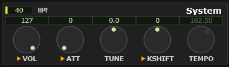
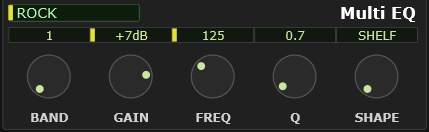

# 4 The System and Multi EQ modules

The two small modules down the left-hand edge hold the settings that apply to the
whole instrument rather than to one part.

## System

<!-- CAPTURE: Editor view, dark theme, crop of the System module showing all five
     knobs AND the HPF box in the title row (set it to a value, not Off, so the box
     reads as live). VST build so TEMPO shows dimmed. Re-shot 2026-09-07 for the HPF
     box added 2026-09-05. -->

| Knob | What it does | Range | Default |
|---|---|---|---|
| **VOL** | Master volume — everything the module produces | 0 – 127 | 127 |
| **ATT** | Master attenuator — a cut applied to everything. 0 is no cut; turning it **up** turns the sound **down** | 0 – 127 | 0 |
| **TUNE** | Master tune, in cents. Use it to match another instrument that is not at concert pitch | −102.4 – +102.3 cents | 0 |
| **KSHIFT** | Master transpose, in semitones | −24 – +24 | 0 |
| **TEMPO** | The tempo the effect tempo-sync feature works from | 10.00 – 250.00 BPM | 120 |

**VOL**, **ATT** and **KSHIFT** are DAW-automatable parameters, and are marked as
such — see [automation](#a3-daw-automation-parameters). **TUNE** and **TEMPO** are
not.

**VOL versus ATT.** Both set the level of everything the module produces, and both
exist because they are meant for different jobs. These are the hardware's own two
controls, `M.Volum` and `M.Attn` in its Multi mode's All Part settings.

**VOL** is Master Volume, and it reads the way you expect: 0 is silence, 127 is
full. It is also the parameter a Universal MIDI **Master Volume** message writes,
so a song file can move it out from under you.

**ATT** is the Master Attenuator, and it runs the other way: 0 is full level and
127 is the quietest, the value being how much is taken *off*. Nothing in an
ordinary MIDI file touches it — only an XG system-exclusive message aimed at it
specifically — so it stays where you put it. The MU100's own documentation
suggests it for keeping several songs at a consistent level, which is still the
best way to think about it: leave VOL where a song expects it, and use ATT for a
trim of your own.

**TEMPO** is only used by the effect tempo-sync feature, which turns delay times
and LFO rates into note values. It changes nothing on its own.

### HPF — the system high-pass floor

The box in the module's top-left corner is a **high-pass floor for the whole
instrument**: a rumble filter you set once. It is the plugin's own filter, not the
MU100's, and it is the same filter the Part module's **HPF2** is — one level up.

**No part is high-passed below this frequency.** That is the whole rule. A part
whose own HPF2 is *higher* is left exactly as it is; a part whose HPF2 is lower, or
off altogether, is filtered here instead. It is not a second filter stacked under
the first — each part is filtered once, at whichever of the two frequencies is
higher — so switching it on costs nothing and cannot make a part sound
double-filtered.

Set it to **40** and everything below 40 Hz goes, at 12 dB per octave, on every
part at once. Type a number, drag, or use the wheel; **Off** (below 20 Hz) is the
default. The same value appears as the **S** column on the
[HPF2 display](#the-hpf2-screens-s-column-the-system-floor), drawn there as a dashed
line across every part's bar — anything below the line is being lifted to it.

Because it runs per voice, inside the emulated chip, it reaches **everything**: the
main output, each [per-part output](#per-part-stereo-outputs), and what the parts
send to the reverb and chorus. Low end you filter here never gets into the effects.

> **Plugin-only.** Like HPF2 and the peaking EQ bands, this has no XG address: it
> is saved in your DAW project but **not** in a `.syx`, and it grays out when you
> untick **Options ▸ Enable plugin-only parameters**.

> **VST only** — TEMPO shows your project's tempo, live, and is read-only and
> dimmed. Your DAW is the authority; there would be no sense in a second answer.

> **Standalone only** — TEMPO is yours to set, since there is no transport to
> follow. It steps in whole BPM, or tenths with Shift held.

## Multi EQ

<!-- CAPTURE: Editor view, dark theme, crop of the Multi EQ module with a
     non-FLAT program selected so the knobs show non-default values. -->

The MU100's own five-band master equaliser, applied to everything on its way out.
This is the hardware's EQ, exactly as the front panel offers it — not one of the
plugin's additions.

**Program** picks one of five presets:

| | |
|---|---|
| **FLAT** | No equalisation. The default. |
| **JAZZ** · **POPS** · **ROCK** · **CLASSIC** | Yamaha's own voicings |

Picking a program loads all five bands at once. From there you can adjust any band
by hand — the program box simply keeps naming the preset you started from.

**BAND** selects which of the five bands the four knobs below it are editing.
Bands run low to high: 1 is the bass shelf, 5 the treble shelf, 2 to 4 are peaking
bands in between.

| Knob | What it does |
|---|---|
| **GAIN** | Boost or cut this band |
| **FREQ** | Where the band sits |
| **Q** | How wide the band is. Low Q is broad and gentle; high Q is narrow. |
| **SHAPE** | Bands 1 and 5 only: shelf or peaking |

**SHAPE** grays out on bands 2 to 4, which are always peaking.

> **Watch out** — this is a *master* EQ, after everything else. If you want to
> shape one part, use the part's own EQ in the [Part module](#10-the-part-module)
> or the [EQ display](#6-the-eq-display) instead.

Multi EQ settings are saved in a `.mss`, in an `.mes` effect setup, and in a
`.syx` export — it is standard XG data.
