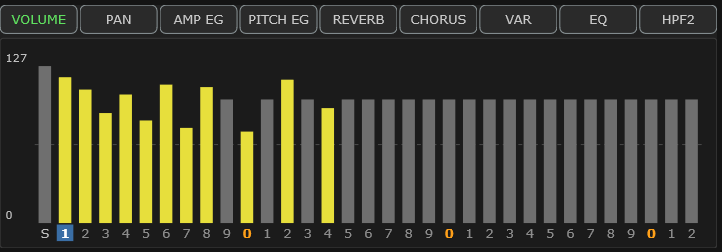
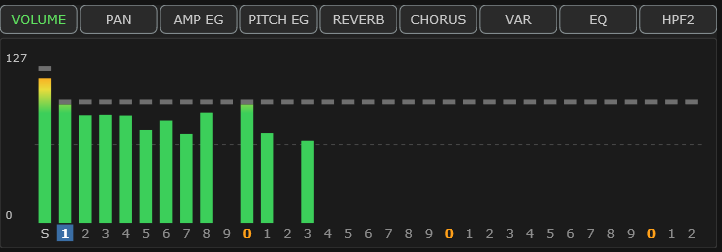

# 5 The Graphic Display

The large screen at the top of the editor shows one thing at a time, across all
32 parts or for the selected part, and lets you edit it by dragging.

<!-- CAPTURE: Editor view, dark theme, crop of the Graphic Display in VOLUME
     mode with a varied set of part levels so the bars are not all equal, and the
     animated level meters turned OFF so the solid setting bars are visible —
     the meter form of the same screen is the next capture down. -->

VOLUME arrives with its [level meters](#animated-level-meters-on-volume) turned on,
which draws each part's setting as a thin dash rather than as the solid bar above.
The two are the same value shown two ways; the solid form is what the other bar
screens use, and what VOLUME shows if you turn the meters off.

Nine buttons along the top choose what it shows:

| Button | Shows | Scope |
|---|---|---|
| **VOLUME** | Each part's level | all parts |
| **PAN** | Each part's stereo position | all parts |
| **AMP EG** | The amplitude envelope — how a note swells and fades | one part |
| **PITCH EG** | The pitch envelope | one part |
| **REVERB** | Each part's reverb send | all parts |
| **CHORUS** | Each part's chorus send | all parts |
| **VAR** | Each part's variation send | all parts |
| **EQ** | The part's equaliser, as a curve | one part |
| **HPF2** | Each part's plugin high-pass cutoff | all parts |

The screens fall into three families, each with its own way of working.

### Which screens are marked for DAW automation

> **VST only**, like every [automation marker](#automation-markers).

When **Options ▸ Mark DAW-automatable parameters** is on, the marker sits on a
screen's **button**, not on its bars or points: a marked button means what you drag on
that screen has its own lane in your DAW, so dragging it while a lane is in Write or
Touch records it.

| Button | Marked |
|---|---|
| **VOLUME**, **PAN**, **REVERB**, **CHORUS**, **VAR** | always — every part's bar has a lane |
| **HPF2** | always, unless [plugin-only parameters](#enable-plugin-only-parameters) are switched off (the button is then greyed) |
| **EQ** | for a part; **not in drum-edit mode** |
| **AMP EG** | **only in drum-edit mode, with a key picked** — a drum key's ATTACK, DECAY1 and DECAY2 have lanes, a part's envelope does not |
| **PITCH EG** | never |

The bar screens keep their marks in drum-edit mode, because their bars still edit the
**parts**, not the drum key.

**Why EQ goes unmarked in drum-edit mode.** Of its six handles, only **F** — the drum
key's HPF2 — has a lane there; the key's shelves and peaking bands do not. A marked
button would suggest all six can be automated. The key's HPF2 is still marked where it
has a control of its own, the Part module's **HPF2** box, and dragging the **F** handle
on this screen writes the very same lane — see
[Drum parts](#drum-parts) in the EQ chapter. (The **HPF2** *screen* is not a way in:
its bars are the parts' cutoffs, not the drum key's.)

### Which screens are marked for MIDI CC

While [MIDI Out sends edits as](#midi-out-sends-edits-as) is on **MIDI CC**, an
**underline** under a screen's button means what you drag on that screen records as a
MIDI controller:

| Button | Underlined |
|---|---|
| **VOLUME**, **PAN**, **REVERB**, **CHORUS** | always (CC7, CC10, CC91, CC93) |
| **VAR** | while the Variation effect is a SYSTEM effect (CC94); not while it is an insertion, when the screen is inert |
| **AMP EG** | for a part — its attack and release record as CC73 and CC72 (its decay has no controller); **not in drum-edit mode** |
| **PITCH EG**, **EQ**, **HPF2** | never |

AMP EG's two marks never meet: the triangle is for a drum key, the underline for a
part.

## The bar screens

VOLUME, PAN, REVERB, CHORUS, VAR and HPF2 draw **33 bars** — one marked `S` at the
left, then parts 1 to 32. Everything in this section works the same whether VOLUME
is drawing solid bars or meter dashes.

The axis under the bars numbers them by their last digit, with the tens (10, 20,
30) marked by an orange `0`, so you can count along in blocks of ten. The
**selected part's number is highlighted**, and **clicking a number selects that
part** — see [Which part am I looking at?](#which-part-am-i-looking-at) at the end
of this chapter.

This is the fastest way to balance a whole arrangement. Instead of selecting each
part and finding its knob, you drag across the bars and watch the whole mix at
once.

| Action | Result |
|---|---|
| **Drag** a bar | Set that part's value |
| **Wheel** over a bar | Nudge it |
| **Right-click** a bar | Reset it |
| **Hover** | Show the exact value after a moment |
| **Click** a part number *below* the bars | Select that part |
| **Right-click** a part number | Select it and open the [part menu](#copying-a-part-and-resetting-one) |
| **Arrow keys** | Walk the columns and change values — see [Using the controls from the computer keyboard](#using-the-controls-from-the-computer-keyboard) |

The numbers along the bottom are a **selector, not part of the graph**. Dragging
and wheeling stop at the bottom of the graph — which is where a bar of zero sits —
so a value near the bottom is still set the same way as any other: press anywhere
in the graph above the numbers and drag up, or point there and use the wheel. You
do not have to grab the bar itself; nothing below that line adjusts anything.

A bar is **yellow when its value differs from the default** and grey when it does
not, so a glance across the screen says which parts you have touched. That is the
same signal as the [changed marker](#the-changed-marker) on a value box, and
**Options ▸ Show changed markers** switches it off along with the rest — the bars
then all draw grey and nothing else changes.

PAN has a center line, and the center position has a slight detent so you can
find it by feel.

These are the same values as the Part module's VOL, PAN, REV, CHORUS, VAR and
HPF2 controls. Change either and the other follows immediately — they are two
views of one thing, not two settings.

### The HPF2 screen's `S` column — the system floor

On the HPF2 screen the `S` bar is the **system high-pass floor**, the same value as
the **HPF** box in the [System module](#4-the-system-and-multi-eq-modules). It is
drawn as a **dashed line across the whole graph** as well as a bar, because that is
what it does: every part below the line is filtered at the line instead, and every
part above it is left alone.

The part bars keep showing **their own** cutoffs, not the raised ones — a value you
set never moves on screen because something else is overriding it. The line is what
tells you the difference. Set the floor to 40 Hz and a part sitting at 20 Hz still
reads 20; it is simply being filtered at 40, which the line says.

Drag the `S` bar, or type a number into the System module's box — they are two views
of one value, like every other pairing here.

## Animated level meters on VOLUME

Options ▸ **Display Animation...** ▸ **Animated volume level meters** turns the
VOLUME screen into a meter bridge for all 32 parts at once. It is **on by
default**; untick it and the screen goes back to plain solid bars, with nothing
else on it changed.

<!-- CAPTURE: Editor view, dark theme, crop of the Graphic Display in VOLUME mode
     with the meters option on and several parts sounding, so both the setting
     dashes and the colored meters are visible. -->

With it on, each part's **volume setting** shrinks to a thin dash — the same
height the top of the solid bar had — and the space below it shows how much sound
that part is actually making:

| The bar | What it means |
|---|---|
| The **dash** | The volume setting. Still yellow when it differs from the default, still what you drag |
| The **colored fill** | That part's live output level |
| **Green** | Quiet, up to about −18 dB |
| **Yellow / orange** | Getting loud |
| **Red** | At the top of the scale |

A color always means the same level, whatever the part's setting is — the ramp is
fixed to the bar, not to how far the meter has climbed.

The colors in that table are the ones you get out of the box: the **Classic** ramp
at the **Standard** color spread, which are the defaults. Both are settings, and
changing either changes which color you see at a given level — see **Meter colors**
and **Color spread** below.

**Editing does not change.** Drag, wheel, right-click and hover all work exactly
as before and all act on the setting, not on the meter.

Two things are worth knowing about what the meters measure:

- **The level is measured after the part's own volume and pan**, so pulling a
  part's bar down pulls its meter down with it. That is why the meter lives under
  that bar rather than anywhere else.
- **Muting a part does not stop its meter.** A part muted with the Voice module's
  **M** cell goes silent but its bar carries on moving, which is what lets you keep
  tracking a sound while it is out of the mix. It is the **S** bar at the far left
  — the plugin's own output — that falls when you mute or solo. See
  [mute and solo](#m-and-s-mute-and-solo).
- **A meter never climbs past its own dash.** If a part is loud enough to run past
  its setting the meter simply sits under the indicator, so the setting stays
  readable at a glance.

> **Tip** — this is the quickest way to find the part making a sound you want to
> change: watch which meter moves when you hear it, then click the number under
> that bar to select the part and start editing. The Voice module's MIDI
> indicators tell you the same thing, but they only flash as notes start and stop,
> where a meter stays up for as long as the sound lasts.

The `S` bar at the left meters something different: the plugin's whole stereo
output, after the effects and the master volume. It is the one to watch for
clipping.

> **Watch out** — a part meter shows that part's *dry* signal. Reverb, chorus and
> variation tails are produced after the parts are mixed together, so they show on
> the `S` bar but not on any part's meter. A part can fall silent while its reverb
> is still ringing.

### Meter colors

Five color ramps, in the same Display Animation window. Each is tuned separately
for the dark and light themes, so whichever you pick stays readable in both.

| Ramp | |
|---|---|
| **Classic** | Green through yellow and orange to red — the mixing-desk meter everyone already reads without thinking. The default |
| **Teal** | Classic with a teal primary. Cooler, and further from the greens the editor uses for values |
| **Ocean** | Blue through teal and amber to red |
| **Amber** | No green at all — a heat ramp, like the orange part markers along the bottom of the display |
| **Mono** | Gray, with red reserved for the very top. The quietest of the five, and the closest to the light theme's own look |

### Color spread

Where up the bar the colors start. The ramp is anchored to real levels, and music
mostly sits around −20 dB — which is just below the point where Classic leaves
green — so at the default setting the primary color is nearly all you ever see.

| Setting | The primary color ends at | What you see |
|---|---|---|
| **Standard** | −18 dB | Green, essentially always. A real meter's proportions |
| **Wide** | −30 dB | A colored tip on the loudest few parts |
| **Full** | −42 dB | Most sounding parts carry color; a loud one runs green to gold |

This moves the **colors** only. Bar heights are identical at all three settings —
they have to be, because a bar is read against its own setting dash. Nothing here
makes the meters respond to quieter sounds; it changes when the color arrives.

> **Watch out** — no setting makes a whole bar colorful. The bottom of a tall bar
> is showing the quiet levels underneath the peak, and those are quiet whatever the
> spread is. Color spread changes where color *starts*, not whether the whole bar
> is colored.

### Meter fill

Whether a meter is drawn as one continuous column or as a stack of lit blocks.

| Setting | What you see |
|---|---|
| **Solid** | One unbroken bar of color from the floor up to the level. The default |
| **LED** | The same bar cut into segments the size of the setting dash, with the display background showing between them — a hardware meter bridge's lamps |

The colors, the levels and the clamp to the setting dash are identical either way;
this changes only how the fill is painted. The one real difference is that **LED
lights a segment only once the level has actually reached it**, so it can read up
to one segment low — which is what a real segmented meter does too.

## MIDI override marks on the bars

A thin cyan rule across a bar means **incoming MIDI has moved that part's setting on
the module**. The rule sits at the value the module now holds; your bar does not move,
because nothing arriving over MIDI changes your setup. The general rule and how to
clear one are in [MIDI override marks](#midi-override-marks).

The bar screens are the one place these appear for all 32 parts at once, which is what
makes them worth watching: a song that rides volume, pan or a send across the mix
writes its whole shape here in one picture. Everywhere else in the editor the marks
speak for the selected part alone.

The rule is drawn a little wider than the bar so it stays readable when the module
lands one step from your own value, and it reads the same whether the bar is solid or
the VOLUME screen's setting dash over a running meter. **HPF2 never carries one.** That
control is the plugin's own, so no MIDI message can reach it.

## The envelope screens

**AMP EG** and **PITCH EG** show an envelope as a shape with draggable points.

**AMP EG** is how the level of a note behaves over time — the attack, the decay,
the release. Drag a point to change it. These are *offsets* from whatever the
voice itself does, so the center position means "as the voice was designed".

**PITCH EG** is the same idea for pitch: a note that swoops in, or a drum that
drops in pitch as it decays.

> **Watch out** — **PITCH EG does nothing on a drum kit part.** The device ignores
> it, so the screen grays out and tells you so. Values already there are left
> alone rather than zeroed, because they are real part settings that come back the
> moment you assign a melodic voice again — exactly as on hardware.

In drum-edit mode, AMP EG retargets to the selected drum key, and the corner of
the screen names the drum sound rather than the part. Its three points are then the
key's **ATTACK**, **DECAY1** and **DECAY2**, which have DAW automation lanes, so the
AMP EG button picks up the [automation marker](#which-screens-are-marked-for-daw-automation)
in this mode only.

Both envelope screens can be edited from the computer keyboard as well as with the
mouse: the mark lands on each point in turn, up/down for its level and `.` / `,` for its
time. See [Using the controls from the computer keyboard](#using-the-controls-from-the-computer-keyboard).

## The EQ screen

The one screen complex enough to need its own chapter — see
[The EQ display](#6-the-eq-display). Its six handles take the keyboard too, with a third
axis for the Q.

## Which part am I looking at?

The one-part screens name their target in the bottom-right corner: `PART 5`, or
the drum sound's name when you are editing a kit key.

The bar screens say it on the axis instead. The selected part's number sits in a
highlighted block — the same blue, with the same bold number on it, that the
[Voice module](#11-the-voice-module) puts behind its selected row. The two match
deliberately: one mark with one meaning, wherever on screen you happen to be
looking. Among thirty-three bars it is much quicker than counting along the row.

You can also **set** it there: click a number under the bars and that part becomes
the selected one, exactly as clicking its row in the
[Voice module](#11-the-voice-module) does. Hovering a number tells you which it is
(`Part 12 Select`) before you commit to the click. The `S` column selects nothing —
it is a system value, not a part.

Part selection is one thing wherever you change it. Click a Voice module row or an
axis number and everything follows together: the axis highlight, the Voice row, and
the Part, Controllers and Keyboard modules, which all show the selected part.
