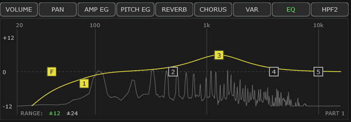

# 6 The EQ display

The **EQ** screen in the Graphic Display is a visual equaliser for **one part at
a time**. Whichever part is selected in the Voice module is the one you are
editing — the bottom-right corner of the screen always tells you which (`PART 1`,
`PART 12`, …).

Everything here edits the same values as the `EQ` row of value boxes in the
[Part module](#10-the-part-module). The screen and the boxes are two views of one
thing; change either and the other follows immediately.


<!-- CAPTURE: Editor view, dark theme, crop of the Graphic Display in EQ mode
     with a shaped curve (a low-cut plus one boost), a note sounding so the
     spectrum trace is visible, and one handle hovered to show its readout. -->

## The screen at a glance

```
   20        100              1k              10k     ← frequency, left to right
 +12 ┌──────────────────────────────────────────┐
     │                                          │
   0 │  [F]    [1]      [2]   [3]     [4]  [5]  │  ← the six handles you drag
     │                                          │
 -12 └──────────────────────────────────────────┘
      RANGE: ±12 ±24                      PART 1
```

Two lines are drawn in that box, and they mean different things:

**The thick colored curve** is what the EQ is *doing* — the boost and cut it
applies at every frequency. Flat across the middle means "no change".

**The thin gray line** is the **live sound of that part**, as it comes out of the
EQ. It only moves while notes are playing. This is the animated spectrum, and it
is optional — see [Display Animation](#display-animation).

Because the thin line is measured *after* the EQ, the two move together: pull a
band down and you will watch that region of the spectrum sink with it.

**The line moves less than the curve does, and less than you hear.** The two are
drawn in the same box on very different vertical scales. The curve is drawn on the
gain scale down the left edge, 24 dB from top to bottom at the default range. The line
is drawn on a level scale that has to span about 90 dB, from full scale down to
silence, because that is the range real sound covers. So the same 12 dB change moves
the curve nearly four times as far as it moves the line — enough that a change which
is plainly audible can take a second look to see.

Two things help when you want to *watch* a change rather than hear it. Use a sound
that sustains, since a decaying note is falling while you are trying to compare it;
and set **Smoothing decay** to Slow or Very slow under
[Display Animation](#display-animation), which holds each peak up longer without
delaying the moment it first appears.

Note that the **RANGE** selector rescales the curve only. At ±24 the curve is drawn
half as tall while the line stays exactly where it was, so the difference between them
grows.

**The line follows the module, not your handles.** Normally those are the same thing.
While a shelf is [overridden by incoming MIDI](#midi-override-marks) they are not, and
the two readings then say different things on purpose: the curve is the shape you set
and will save, the line is the sound you are actually getting. One case looks like the
line ignoring an override but is not: a shelf sitting at **0.0 dB** is flat whatever
its frequency, so an override that moved only the frequency changes nothing to hear —
the ghost handle slides sideways and the line correctly stays put.

## The six handles

Left to right: **F**, then bands **1** to **5**. A handle is hollow when that band
is doing nothing and filled when it is active, so you can see at a glance what is
in use.

| | Name | What it does | Frequency range | Gain | Q |
|---|---|---|---|---|---|
| **F** | HPF2 | Clean high-pass — rolls away everything *below* the set frequency | Off, or 20 Hz – 1 kHz | — | — |
| **1** | LO SHELF | Lifts or cuts everything below its frequency (bass control) | 32 Hz – 2 kHz | ±12 dB | — |
| **2** | PEAK | Boost or cut a band around its frequency | 32 Hz – 16 kHz | ±12 dB | 0.1 – 12.0 |
| **3** | PEAK | " | 32 Hz – 16 kHz | ±12 dB | 0.1 – 12.0 |
| **4** | PEAK | " | 32 Hz – 16 kHz | ±12 dB | 0.1 – 12.0 |
| **5** | HI SHELF | Lifts or cuts everything above its frequency (treble control) | 500 Hz – 16 kHz | ±12 dB | — |

Defaults: HPF2 **Off**; band 1 at **80 Hz**; bands 2/3/4 at **500 Hz / 1 kHz /
4 kHz** with Q **0.7**; band 5 at **10 kHz**. All gains start at **0.0 dB**
(flat).

**Q** is the width of a peaking band — low Q is a broad, gentle hill; high Q is a
narrow spike. Shelves and the high-pass have no Q.

A cyan hollow handle carrying a band number is a **MIDI override mark**: incoming
MIDI has moved that shelf on the module, and it shows where the module now has it.
Your own handle does not move. Only bands **1** and **5** can ever show one, because
they are the module's own bass and treble shelves; **F** and bands **2** to **4** are
the plugin's own filters, which no MIDI message can reach. Gain and frequency are
separate settings, so a mark that moved only one of them sits at your value on the
other axis.

**HPF2 is a clean filter.** Unlike the MU100's own HPF (the `HPF` knob in the Part
module's filter group, which is resonant and emphasizes the frequency it cuts at),
HPF2 is a plain, uncolored low-cut — the sort of thing you would reach for to
clear mud out of a pad, or to stop a bass part fighting the kick.

It is a **two-pole** filter: 12 dB per octave, Butterworth, with no resonant peak
at the corner. That is the ordinary workhorse low-cut slope — steep enough to take
out rumble a decent way below where you set it, gentle enough that it does not
audibly thin what you meant to keep.

## Important: what saves where

Three of these six are **not** Yamaha MU100 features. They are extras this plugin
adds:

| Real MU100 hardware | Plugin-only extras |
|---|---|
| Band **1** (LO SHELF) | **F** (HPF2) |
| Band **5** (HI SHELF) | Bands **2**, **3**, **4** (the peaking bands) |

This matters when you save:

- **Save Setup (`.mss`)** — the plugin's own format. Saves **everything**,
  including all six. Use this for your own work.
- **Export Multi 32-Part Syx (`.syx`)** — the standard Yamaha format. Saves only
  bands 1 and 5, because those are the only ones a real MU100 (or XGEdit, or any
  other XG tool) understands. **The high-pass and the three peaking bands are left
  out.**

That is not a bug — it is what keeps `.syx` files genuinely compatible with real
hardware. Just remember that a `.syx` round trip loses the extras, so use `.mss`
if you want your whole sound back.

If a patch has to end up on hardware, unticking **Options ▸ Enable plugin-only
parameters** grays these three out so the question cannot arise.

## Mouse controls

| Action | Result |
|---|---|
| **Drag** a handle | Up/down = gain, left/right = frequency |
| **Alt + drag** up/down | Q (bands 2, 3, 4 only) |
| **Alt + drag** left/right | Frequency, with the gain held still |
| **Mouse wheel** over a handle | Q |
| **Right-click** a handle | Reset that band |
| **Hold Shift** while dragging | Fine adjustment |
| **Hover** over a handle | Shows its exact values |

The readout while you hover or drag gives gain, frequency and Q in that order — or
`HPF2 <freq>` for the F handle.

## Keyboard controls

Every handle is also a keyboard stop. Press `Tab` until the white mark reaches the
graphic display, then `Left` and `Right` to walk along its screen buttons and on to the
handles — or simply click a handle, which puts the mark on it.

| Key | Result |
|---|---|
| **Up** / **Down** | Gain |
| **.** / **,** | Frequency — the caps print `>` and `<` |
| **]** / **[** | Q (bands 2, 3, 4 only) |
| **Shift +** any of those | Fine: the smallest step that value has |
| **Backspace** | Reset that band, exactly as right-clicking it does |

The handle's values appear beside it while you work, so you can read what you are
setting without going to the Part module for it.

**`Enter` types the value on the axis you last moved** — press `]` then `Enter` and you
are typing a Q, `.` then `Enter` and you are typing a frequency; before you have moved
anything it takes the gain. A box opens on the handle showing that value with its units,
and the handle's readout stays up beside it so you can see the rest. Dragging counts as
"last moved" too, when the drag was decisively one direction. See
[Using the controls from the computer keyboard](#using-the-controls-from-the-computer-keyboard).

The **F** handle has neither a gain nor a Q, so both arrow pairs move its frequency and
`]` and `[` do nothing there. On a **shelf** (1 and 5) there is no Q either, and those
two keys are left for your DAW. So is every other key this screen does not use — see
[Using the controls from the computer keyboard](#using-the-controls-from-the-computer-keyboard).

## Drum parts

On a part with a DRUMS buffer the two shelf handles (**1** and **5**) are grayed and the
corner reads **SHELVES PER DRUM KEY**. The MU100 has no part-level shelving EQ for a drum
part — the kit carries its own BASS and TREBLE for every key instead (owner's manual,
p.82). Turn on [drum-edit mode](#13-drum-editing) and pick a key, and this screen becomes
that key's EQ: all six handles live, the same drag and keyboard controls, the corner
naming the drum sound you are shaping.

**F, 2, 3 and 4 stay live on a drum part**, because those are the plugin's own filters
rather than the MU100's. They shape the **whole kit**, and they stack with anything you
set on an individual key. The curve on screen shows them alone, which is the truth about
what the part-level EQ is doing — the per-key layer belongs to whichever key you are
editing, and the screen draws that when you go into drum-edit mode.

**Automating a drum key's HPF2 from here** (VST only). The only handle on this screen
with a DAW automation lane in drum-edit mode is **F**, the key's HPF2 — `DR1 C1 36 HPF2`
and so on. Put that lane in Write or Touch and drag **F**, and the lane records. The
other five handles change the key's sound but have no lane, which is why the **EQ**
button carries no [automation marker](#which-screens-are-marked-for-daw-automation) in
this mode. The Part module's **HPF2** box writes the same lane and is marked.

## Bypassing the EQ

**A grey dashed curve, and `EQ BYPASSED` in the corner, mean you are hearing this
part without its EQ.** Everything on screen still shows what you have set — the
handles do not move, and you can go on adjusting them while listening dry — but none
of it is in circuit.

Toggle it with `Alt + E`, or with the amber **EQ BYP** lamp in the
[Part module](#10-the-part-module), which is the same switch. `Alt + Shift + E`
bypasses every part at once. Full details — including what happens on a drum part, and
why reading from the device switches it off — are in
[EQ BYP](#eq-byp-hearing-the-part-without-its-eq).

## Reading the curve

**The curve does not pass through the handles**, and that is correct. Each handle
marks where *its own* band is centered, but the curve shows the **combined** result
of all of them. Put two boosts near each other and the curve between them rises
higher than either handle — that is real, and it is what you will actually hear.

The **F** handle always sits on the 0 dB line even though the high-pass pulls the
curve down to its left. The handle marks the cutoff frequency; it is not a gain
control.

**The curve includes the [system HPF floor](#hpf-the-system-high-pass-floor), even
when this part's own HPF2 is Off.** If the floor is set to 40 Hz you will see the
curve roll off below 40 Hz on every part, because that is what you are hearing — the
part is filtered at whichever is higher, its own cutoff or the floor. The **F handle
stays where the part's own value is**, since that is the number you can drag and the
one the Part module shows; only the curve moves. If the curve rolls off somewhere the
F handle isn't, the floor is what put it there.

In [drum-edit mode](#13-drum-editing) the curve describes the **drum key's** filters
alone, so the floor is not drawn into it — nor is the rest of the part-level layer.

**`RANGE: ±12 ±24`** (bottom left) zooms the vertical scale. At **±12** the graph
is detailed but a big combined boost can run off the top; at **±24** you can see
the whole excursion. It only changes how the graph is *drawn* — your settings do
not change, and neither does the sound.

When the curve leaves the visible range it is **cut off**, not flattened against
the edge. A line that stops is telling you "there is more happening than fits" —
switch to ±24 to see it. (The thin spectrum line behaves differently: it is
clamped at the bottom, because a signal sitting at the floor genuinely means
"nothing here".)

## Drum kits

When a part holds a drum kit and you are in drum-edit mode, the EQ **retargets to
the selected drum key**, exactly as the MU100's own drum EQ does. The corner label
changes from `PART n` to the drum sound's name so you always know what you are
editing.

Two layers stack for a drum voice: the **part-level** EQ (applied to the whole
kit) and then the **per-key** EQ. That means you can, say, roll the low end off
the whole kit and still put a narrow cut on just the snare. The part-level layer
here is **HPF2 and the three peaking bands** — the two shelves exist only per key,
which is the MU100's own rule.

Per-key settings are shared by every part using the same DRUMS buffer, and they
reset to flat when you load a different kit into that buffer.

## Display Animation

**Options ▸ Display Animation...**

**EQ animated spectrum** — turns the thin live line on and off. On by default.

**Resolution** — how finely the spectrum is measured, shown as the spacing between
measurement points:

| Setting | Detail | Best for |
|---|---|---|
| 1024 (43 Hz bins) | Coarsest, lightest | Watching broad shape; older machines |
| 2048 (22 Hz bins) | | General use |
| **4096 (11 Hz bins)** | **Default** | Seeing what the high-pass is doing |
| 8192 (5 Hz bins) | Finest, heaviest | Picking out individual low notes |

The bin spacing is what matters down low. At 1024 the measurement points are 43 Hz
apart — wider than the gap between the lowest notes on a keyboard — so the bottom
of the display turns into a staircase. If you are working with the high-pass or
the bass region, stay at 4096 or higher.

**Smoothing decay** — how quickly peaks fall back after a note. *Fast* is twitchy
and responsive; *Very slow* leaves peaks hanging so you can read them. **Slow** is
the default and suits most playing.

Neither setting affects the sound in any way. Both only change the picture.

## What the spectrum does and does not show

The line is measured at the EQ's own point in the signal chain — the same place
Bitwig, FabFilter and similar plugins measure. Worth knowing what that includes:

**Included:** the part's own notes, and all six EQ controls above.

**Not included:**

- The part's **volume** and **expression** (CC7/CC11) and its **pan** — ride the
  volume fader and the line will not budge. It shows the sound *going into* the
  mix, not its level *in* the mix.
- **Reverb, chorus, variation and the insertion effects** — those happen after
  this point.
- **Other parts.** This is the selected part alone. Switch parts and the line
  follows.

Two practical consequences: a part that is turned right down still shows a
full-height trace, and a part drenched in reverb shows only its dry sound. Both
are normal.

## A note on CPU

The measuring itself is done inside the emulated sound chip and costs almost
nothing. The drawing is done on the interface, which means that even if you set
the heaviest options on a slow machine, the worst that happens is a slightly
sluggish display — **it cannot cause audio glitches or dropouts**. Turn the
resolution up freely; if the interface gets sluggish, turn it back down.

If you would rather have nothing moving at all, switch **EQ animated spectrum**
off — the measuring stops completely and costs nothing.

That said, the drawing shares a processor with everything else, so on a machine
that is already struggling this is one of the things worth reclaiming. See
[it is using too much CPU](#it-is-using-too-much-cpu).
