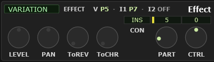

# 7 The Effect module

## Understanding the effect units

This is the part of an XG module people most often get wrong, so it is worth
getting straight before touching anything.

The MU100 has **five effect units**, and they are not five of the same thing.

### The three system effects

**REVERB**, **CHORUS** and **VARIATION** are *system* effects. There is one of
each, shared by all 32 parts, wired as a **send and return**:

```
   part 1  ──┐
   part 2  ──┤ send amount ──► [ REVERB ]  ──┐
   part 3  ──┤                                ├──► output
     …     ──┘                                │
   the parts' own dry signal ─────────────────┘
```

Each part has its own **send** knob — `REV`, `CHORUS` and `VAR` in the Part module
— saying how much of that part goes into that unit. So every part can have a
different amount of the *same* reverb, but they cannot have different reverbs. If
you want a long hall on the strings and a short room on the drums, you have to
choose.

That is not a limitation of this plugin; it is how every XG module works, and it
is why the reverb you pick matters so much.

**Variation** is the odd one of the three. It can work as a system effect like the
other two, or it can be switched to work on **one part only** — see
[Variation's two modes](#variations-two-modes) below.

### The two insertion effects

**INSERTION1** and **INSERTION2** are different in kind. Each is patched **into**
a single part's signal path, in line, rather than fed from a send:

```
   part 7  ──► [ INSERTION1 ] ──► output
```

That is what you want for things that have to replace the sound rather than sit
behind it: a distortion, an amp simulator, a rotary speaker, an auto-wah. A send
would give you the clean part *and* a distorted copy; an insertion gives you the
distorted part.

Each insertion works on one part at a time. You choose which in the Effect module.

### Which to use

| You want | Use |
|---|---|
| Space and depth behind everything | REVERB |
| Thickening, width, movement across the mix | CHORUS |
| A second system effect — a delay, another reverb, a phaser across the mix | VARIATION, in system mode |
| To transform one part completely | INSERTION1 or 2, or VARIATION in insertion mode |

## The module


<!-- CAPTURE: Editor view, dark theme, crop of the Effect module with VARIATION
     selected so CON, PART and CTRL are all live, and the routing strip along the
     top showing at least one assigned part rather than three OFFs. -->

The Effect module selects **which unit you are working on**, and holds that unit's
levels and routing. The unit's actual parameters — the sixteen knobs — are in the
[Effect Parameters module](#8-the-effect-parameters-module) below it.

Pick a unit: **REVERB**, **CHORUS**, **VARIATION**, **INSERTION1** or
**INSERTION2**. Both the controls here and the whole Effect Parameters module
follow.

| Control | What it does | Which units |
|---|---|---|
| **LEVEL** | The unit's return level into the mix | all |
| **PAN** | Where its return sits in the stereo image | system units |
| **ToREV** | Feed this unit's output into the reverb | chorus, variation |
| **ToCHR** | Feed this unit's output into the chorus | variation |
| **CON** | Connection: **SYS** (send/return) or **INS** (in line on one part) | variation |
| **PART** | Which part the unit is inserted into | variation in INS mode, insertions |
| **CTRL** | A MIDI controller assigned to a parameter of this effect | variation, insertions |

Controls a unit does not have are inactive. Reverb has no ToREV, for instance,
because feeding a reverb into itself is not a thing the hardware does.

### The routing strip

Along the top of the module, between the **EFFECT** caption and the module title,
is a small readout of the three effect slots that can be assigned to individual
parts, and where each one currently points:

```
   V OFF  ·  I1 P5  ·  I2 OFF
```

`V` is the variation, `I1` and `I2` are the two insertions — the same order as the
unit picker below, read left to right — and the strip is always showing, whichever
unit you happen to be editing. `P5` means that slot is assigned to part 5; **OFF**
means it is not assigned to a part and is free to use; **SYS** means the variation
is a system effect and so is not using a slot at all.

This is the answer to "is there an insertion free, and what is already using them"
without pointing the picker at each unit in turn and reading its PART knob — which
loses the unit you were working on.

**Hover it** and the bottom bar names what is loaded in those same three units:

```
   Effects: Var: DELAY LCR; Ins1: DISTORTION; Ins2: DISTORTION
```

The two halves are meant to be read together: the strip says *where* each unit is
routed, the tooltip says *what* is in it. Between them you can see the whole
insertion picture without opening anything.

**ToREV and ToCHR** are how you build chains without an insertion: chorus into
reverb is the classic one, so the chorused signal gets the same room as everything
else rather than sitting dry in front of it.

## Variation's two modes

The **CON** control is the switch:

- **SYS** — variation is a third system effect. Every part's `VAR` send feeds it,
  and its return is mixed back in. Use it for a delay, a second reverb, or any
  effect you want spread across the arrangement.
- **INS** — variation is patched in line on the part named by **PART**. Every
  part's `VAR` send is ignored.

> **Watch out** — switching to INS is what makes the Part module's **VAR** and
> **DRY** knobs go inert. They gray out because they genuinely do nothing in that
> mode: there is no send to set, and the part's dry signal is going through the
> effect rather than around it. That is a very common "why is this knob dead?"
> moment.

## Where effect settings are saved

All five units and their parameters are stored in a `.mss`, in a `.syx` export,
and in an `.mes` effect setup — this is all standard XG data.

The only exception is the **tempo-sync** links, which are the plugin's own and are
carried by `.mss` and `.mes` but not by `.syx`. The delay time itself exports
perfectly well; it is only the "follow the tempo" link you lose.
