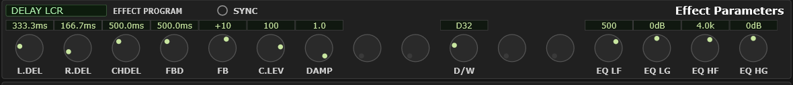
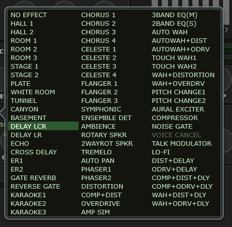

# 8 The Effect Parameters module

The wide strip across the middle of the editor: a **program picker** on the left
and **sixteen knobs** to its right, editing whichever effect unit is selected in
the [Effect module](#7-the-effect-module) above.

<!-- CAPTURE: Editor view, dark theme, crop of the Effect Parameters module with
     a rich effect loaded (e.g. Variation = DELAY LCR) so most knobs are in use
     and the SYNC toggle is visible. -->

## Choosing an effect

Click the **EFFECT PROGRAM** box and a popup lists every program that unit can
load, in three columns with nothing hidden. Or put the pointer over the box and
**wheel** through them without opening anything — which is the good way to
audition, since a whole wheel-flick counts as one undo step.

<!-- CAPTURE: Editor view, dark theme, the EFFECT PROGRAM popup open on the
     Variation unit, showing all three columns with the current program
     highlighted. -->

The current program is highlighted, so you can always see where you are in the
list.

The list differs by unit: 13 reverbs, 15 choruses, 72 variations and 44 insertion
programs. All of them are cataloged in
[the effect reference appendix](#a1-effect-reference).

> **Watch out** — picking a program **loads its factory parameters over the
> sixteen knobs**. If you have tuned an effect and want to keep it, save before
> you go browsing. It is one undo step, so a mistake is one click to fix.

The device does that loading itself, which matters if your effect programs are
chosen by SysEx on a MIDI track rather than here. A message that sets the effect
**type alone** leaves these sixteen knobs showing the *previous* program's values
while you hear the new one's. Send the type together with its parameters and the
two stay in step. See
[changing sounds from a MIDI track](#changing-sounds-from-a-midi-track).

## The sixteen knobs

The knobs are a fixed row of sixteen positions spanning the width of the module,
and each effect uses as many of them as it needs. The positions are fixed, not
packed: a parameter always sits in the same place for a given effect, and any
position the current effect has no parameter for shows as a bare disc — not broken,
just empty.

Labels are abbreviated, because they have to fit: `I.DEL`, `FBD`, `EQ LG`. Hover
any knob for the full name. Where an abbreviation means different things in
different effects — `DELAY` is one thing in an echo and another in a chorus — the
hover text is the one for the effect you actually have loaded.

Values read in real units wherever the plugin can be confident of them: a delay
in milliseconds, a frequency in hertz, a gain in decibels. Where it cannot, it
shows the raw number rather than guessing at a unit, because a plausible-looking
wrong unit is worse than an honest number.

**D/W** (dry/wet) appears on most effects and sets the balance between the
untreated and treated signal. It only does something when the effect is routed as
an **insertion** — a send-and-return effect's balance is set by the send and the
return level instead, so on a system effect the knob is inactive.

**DAMP** (high damp) is worth a note of its own, because it reads backwards at
first. It is a coefficient rather than an amount: **1.0 is no damping at all**, and
lower values damp more, down to 0.1. It also sits in the effect's feedback path
rather than across its output, so it darkens each successive repeat or reflection
instead of the whole sound — the first repeat of a delay is barely touched, the
sixth is obviously duller. With the feedback low there is nothing for it to act on,
which is why it can seem to do nothing at all until you turn the feedback up, and
why it shows on a cymbal long before it shows on a piano. To darken the whole
delay instead, reach for its `EQ HF` / `EQ HG` pair.

Every effect's knobs, ranges and factory defaults are listed in
[the effect reference](#a1-effect-reference).

## Tempo-synced effects

Certain effects have a delay time or an LFO rate that can be locked to the tempo,
so a delay lands on eighth notes and a tremolo pulses in time rather than at some
number of milliseconds you had to work out.

This is a **plugin-only convenience**. The MU100 has no such feature; the plugin
works out the milliseconds and sends those, which is why the sound exports to
`.syx` perfectly and only the tempo-following link is lost.

**Turning it on.** Syncable effects show a small **SYNC** toggle in the top strip
above the knobs. Click it, and the relevant knobs switch from showing a time to
showing a **note value** — `1/4`, `1/8T`, `1/16D` and so on, seventeen in all,
from 1/64 up to a whole note, with triplet and dotted variants.

**The tempo comes from your project** in a DAW, live — change the tempo and the
delay follows. In the standalone it comes from the System module's TEMPO knob.

Which effects offer it, and on which knobs, is marked with **⟳** in
[the effect reference](#a1-effect-reference). Broadly:

- **Delays and echoes** — the delay-time knobs
- **Modulation effects** — rotary speaker, tremolo, auto-pan, auto-wah, and the
  flangers and phasers — the LFO rate
- **Pitch change** — the initial delay

> **Watch out** — a note value that would need a longer time than the effect can
> produce is shown grayed, and turning the knob skips over it. That is not a
> fault. Some effects have short maximum times — the pitch-change initial delay
> tops out at 400 ms, so at ordinary tempi only the shorter notes are reachable.

If you change the tempo so that the note you chose is no longer reachable, the
plugin **keeps the note** and clamps the actual time. Move the tempo back and it
snaps straight to where it was.

**Following the tempo is not an edit, so it never appears in Undo or the HISTORY
list.** When the tempo changes, or a project opens at its own tempo, the plugin
recalculates the synced times without adding anything to the list. What Undo does
record is the **note**. Undoing a turn of a synced knob puts the previous note back,
and switching SYNC on or off undoes as one step, so the delay always lands on that
note at the current tempo, even if you changed the tempo in between.

**An overridden effect program does not switch the grid.** If incoming MIDI selects a
different effect, the program box takes a cyan tab and hovering it names what the
device loaded. The sixteen knobs go on showing **your** program, with your labels and
your values, because that is what they edit and what a save will store. The editor
does not follow the device onto the other effect. So while that tab is up, read the
grid as your effect and not as the one you are hearing.

**Whether the knobs also mark depends on the two effects sharing a knob layout.** Any
parameter the song moves is an override in its own right, so both marks can be up at
once, and what they mean differs.

- **Same layout**, one hall reverb swapped for another that lists the same
  parameters: the slots mean the same things in both, so parameter overrides are
  marked on the knobs as usual.
- **Different layout**, a reverb swapped for a chorus: the knob marks are
  **suppressed**, and the program tab is the whole of the cue. The first knob is TIME
  in one layout and FREQ in another, so a mark would be positioned on your scale and
  read out in your units, which would be a confident wrong answer rather than a
  useful one. The same reasoning leaves a tempo-synced knob unmarked.

One thing no mark can tell you. Selecting an effect on the device loads that
program's own defaults there, and that happens inside the synth rather than arriving
as a message, so the editor never sees it. The marks report **what the song sent**,
not everything the device ended up with. Treat an overridden program as meaning the
whole effect is somewhere else, not just the parameters that happen to be marked.

Clearing the override under **Options** puts the device back on yours.

**A synced knob carries no MIDI override mark**, and that is on purpose rather than
an oversight. While SYNC is on the knob is reading in note values, whereas the device
— and so any incoming XG parameter message — is working in milliseconds or hertz. A
cyan mark drawn on that dial would be a position on the wrong scale, and a note value
is not something a parameter message can ask for in the first place. Turn SYNC off
and the knob goes back to showing a time, mark and all. Every other knob in the two
effect modules is marked normally; see
[MIDI override marks](#midi-override-marks).
