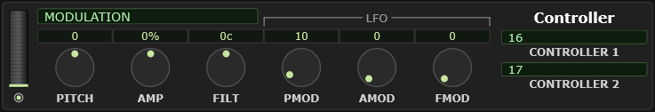

# 9 The Controller module

What the mod wheel, the pitch bend lever and aftertouch actually *do* — set
separately for each part.

<!-- CAPTURE: Editor view, dark theme, crop of the Controller module with
     MODULATION selected and PMOD at a non-default value, plus the wheel. -->

On a hardware synth these assignments are fixed by the patch. On an XG module they
are yours: you decide that on this part the mod wheel opens the filter, while on
that one it adds vibrato.

## Choosing a source

The selection box picks which controller you are setting up:

| | |
|---|---|
| **MODULATION** | CC1, the mod wheel |
| **PITCH BEND** | The bend lever |
| **CH AFTER TOUCH** | Channel pressure — leaning on the keys |
| **POLY AFTER TOUCH** | Per-key pressure, if your keyboard sends it |
| **CONTROLLER 1** | Any CC you nominate |
| **CONTROLLER 2** | A second one |

**CONTROLLER 1** and **CONTROLLER 2** each have a **number** box next to them: put
the CC number you want to use there (0–95), and that CC now drives the six depths
below. This is how you assign a pedal, a breath controller or a knob on your
keyboard to something musical.

## The six depths

Each source has six depth knobs — how strongly it affects six different things.
All six are centered at zero by default, meaning "does nothing"; positive and
negative both work, and negative is often the interesting one.

| Knob | Effect on the sound |
|---|---|
| **PITCH** | Bends the pitch. This is the one you set for pitch bend range. |
| **FILT** | Opens or closes the filter — brightness under your fingers |
| **AMP** | Loudness |
| **PMOD** | *Pitch* modulation depth — vibrato |
| **FMOD** | *Filter* modulation depth — a wobble in brightness |
| **AMOD** | *Amplitude* modulation depth — tremolo |

The distinction between the first three and the last three is worth getting: the
first three move the value **directly**, the last three set how much the part's
**LFO** moves it. Push MODULATION's `PITCH` and the note simply goes sharp as you
push the wheel; push its `PMOD` and the note starts to vibrato — which is what a
mod wheel normally does.

> **Watch out** — **FMOD and AMOD do nothing on a drum kit part**, so they gray
> out when one is selected. That is the device's own behavior, not the plugin's.

## The wheel

The wheel on the right of the module **sends the selected controller live**, as if
you had moved a physical one. Drag it while notes are playing and you hear exactly
what your depth settings do.

The mouse wheel moves it as well — 4 controller values a click, 1 with **Shift** —
except in **Pitch Bend**, which springs back to center on release and so has nothing a
wheel click could leave behind.

It is a performance control, not a parameter — there is no value stored anywhere.
The small light beside it re-sends the current position, which is useful after
something has reset the device's idea of where the controller is.

## Per part, and where it saves

These settings belong to the **selected part**, like everything else in this half
of the editor. Select a different part in the Voice module and you are editing
that part's assignments.

They are standard XG data, so they save in a `.mss`, in a `.mps` part setup, and
in a `.syx` export.
