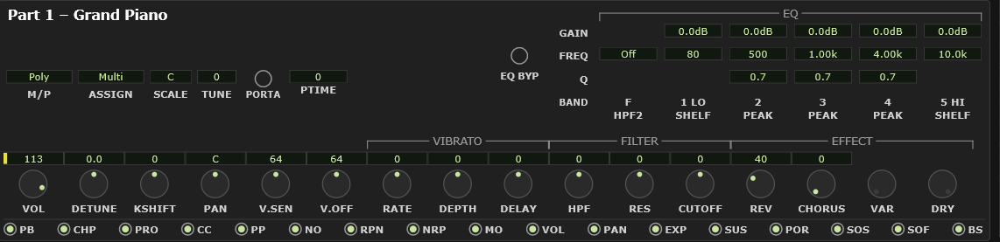

# 10 The Part module

The channel strip for **one part** — the part selected in the
[Voice module](#11-the-voice-module). It is the module you will use most.

<!-- CAPTURE: Editor view, dark theme, crop of the Part module in part mode
     (not drum-edit), a melodic part selected, the receive-switch LED row
     visible, and a couple of knobs off default so changed tabs show. -->

The title in the top left tells you what you are editing: **Part** normally, or
**Drum Key** when you are editing an individual drum sound. By default it also names
the thing itself — `Part 12 – Grand Piano`, `Drum Key – C#1 SIDE STICK`. Each half of
that can be turned off under Options ▸
[Part module title shows](#part-module-title-shows), and the drum key follows
[Label notes as](#label-notes-as), so it reads `Drum Key – 37 SIDE STICK` if you work
in note numbers.

## The main row

Sixteen knobs across the top, in four groups.

### Level and tuning

| Knob | What it does | Range | Default |
|---|---|---|---|
| **VOL** | The part's volume | 0 – 127 | 100 |
| **DETUNE** | Fine tuning, in hertz. Detune two parts slightly against each other for thickness. | −12.8 – +12.7 Hz | 0 |
| **KSHIFT** | Transpose, in semitones | −24 – +24 | 0 |
| **PAN** | Stereo position | L63 – C – R63 | C |

### Velocity response

| Knob | What it does |
|---|---|
| **V.SEN** | Velocity sensitivity — how much harder playing changes the sound. Center is normal; low makes the part respond flatly, which suits pads and organs. |
| **V.OFF** | Velocity offset — shifts the whole response up or down. Raise it to make a part speak on light playing. |

### Vibrato

| Knob | What it does |
|---|---|
| **RATE** | How fast the vibrato is |
| **DEPTH** | How wide |
| **DELAY** | How long a note waits before the vibrato starts |

All three are **offsets from what the voice already does**, so center means "as
the voice was designed", not "no vibrato". DELAY is the expressive one — a little
of it makes a sustained line sound played rather than held.

### Filter

| Knob | What it does |
|---|---|
| **HPF** | High-pass cutoff — cuts the bass. This is the MU100's own resonant filter. |
| **RES** | Resonance — emphasis at the low-pass cutoff. Push it for the classic squelch. |
| **CUTOFF** | Low-pass cutoff — the brightness control. Turn it down to soften a sound. |

All centered at 0, offsets from the voice's own setting.

> The **HPF2** box in the EQ grid is a *different* filter — a clean, uncolored
> low-cut the plugin adds. See [The EQ display](#the-six-handles).

### Sends

| Knob | What it does | Default |
|---|---|---|
| **REV** | How much of this part goes to the reverb | 40 |
| **CHORUS** | …to the chorus | 0 |
| **VAR** | …to the variation | 0 |
| **DRY** | How much of the untreated part reaches the output | 127 |

> **Watch out** — **VAR** and **DRY** go inert when variation is switched to
> insertion mode. See [Variation's two modes](#variations-two-modes).

Ten of these sixteen knobs also have their own DAW automation lane, and are
marked as such. See [automation parameters](#a3-daw-automation-parameters).

## The left cluster

| Control | What it does |
|---|---|
| **M/P** | Mono or Poly. Mono is right for lead lines and most basses — one note at a time, and legato playing glides rather than retriggering. |
| **ASSIGN** | How overlapping notes on the same key are handled — see below |
| **PORTA** | Portamento on/off — the glide between notes |
| **PTIME** | How long the glide takes |
| **SCALE** | Per-note micro-tuning: detune each of the twelve pitch classes independently, for historical temperaments or deliberately sour tunings |
| **TUNE** | The amount for the selected scale note |

Portamento only really does what you expect in Mono mode.

### What ASSIGN does

It only ever matters when a note-on arrives for a note **that is already
sounding on this part** — the same key struck again before the first one has
finished. Chords and ordinary playing are unaffected.

| | |
|---|---|
| **Single** | The new note takes over the voice already playing that note. One instance of a given note number at a time. |
| **Multi** | The new note gets its own voice and the old one keeps ringing out through its release, so repeats stack up. *(default)* |
| **Inst** | The drum-oriented setting — the XG spec labels it `INST (for DRUM)` — allocating per instrument rather than per note number. |

The audible difference is on long-decay sounds played fast: piano with the pedal
down, harp, tubular bells. On **Multi** each repeat rings on over the last; on
**Single** each new hit chokes the one before it. On a short sound — most basses,
most plucks — you will struggle to hear any difference at all.

**Single** is the thriftier of the two, since it never spends a second voice on a
note the part is already playing. That is worth knowing if you are running
sixteen busy parts.

> **Watch out** — **M/P, SCALE, TUNE, PORTA and PTIME all gray out on a drum kit
> part.** The device ignores them there, so the plugin does too. Their values are
> left alone rather than reset, and come back if you assign a melodic voice.

## The EQ grid

Three rows (**GAIN**, **FREQ**, **Q**) across six columns:

| Column | | |
|---|---|---|
| **F / HPF2** | Clean high-pass | *plugin only* |
| **1 LO SHELF** | Bass | hardware XG |
| **2 PEAK** | | *plugin only* |
| **3 PEAK** | | *plugin only* |
| **4 PEAK** | | *plugin only* |
| **5 HI SHELF** | Treble | hardware XG |

These are the same six controls the [EQ display](#6-the-eq-display) draws as a
curve — the boxes and the screen are two views of one thing. The screen is easier
to work with; the boxes are how you type an exact number.

**On a part with a DRUMS buffer the two shelf columns are grayed and inert**, and the
bracket above the row reads **EQ — SHELVES PER KEY**. That is the instrument's own rule,
not a plugin choice: the MU100 ignores part-level EQ on a drum part — *"When a Drum Part
is selected, the EQ menu is not available. However, the same EQ parameters can be
adjusted for each individual drum sound in the DRUM menu"* (owner's manual, p.82). The
kit's BASS and TREBLE belong to each key, so that is where you set them: turn on
[drum-edit mode](#13-drum-editing), pick a key, and this same row edits **that key's**
EQ, live.

**HPF2 and the three peaking bands stay live on a drum part.** They are the plugin's own
filters rather than the MU100's, so nothing stops them running on a kit, and they apply
to the **whole kit at once** — on top of whatever you have set on individual keys. Roll
the low end off the entire kit here, then go into drum-edit mode and put a narrow cut on
just the snare.

The high-pass column has a FREQ cell only, so the GAIN and Q rows are empty there.
The two shelves have no Q.

**Four of the six are the plugin's own additions** and do not export to `.syx`.
That is covered properly in [the EQ chapter](#important-what-saves-where).

**HPF2 and all five band GAINs have DAW automation lanes**, one set per part. The
markers say so: one by the **HPF2** label, and — because all five gains qualify — a
single one by the **GAIN** row label rather than one per box. FREQ and Q have no
lanes; gain is what you automate, and it is enough to fade a band in or out or
switch it off mid-song. For the plugin-only controls among them (HPF2 and the three
PEAK gains) a DAW lane is the *only* way to automate them, since they have no XG
address to record as SysEx. See
[automation parameters](#a3-daw-automation-parameters).

### EQ BYP — hearing the part without its EQ

The amber lamp to the left of the row labels takes **the EQ you are working on out of
circuit** so you can hear what your adjustments are actually doing. On an ordinary part
that is its high-pass and all five bands. On a **drum** part it is everything the part
hears: its part-level high-pass and peaking bands *and* the kit's per-key EQ — every
key's high-pass, peaking bands and BASS/TREBLE.
`Alt + E` does the same from the keyboard, and `Alt + Shift + E` bypasses every part
at once (press it again to put them all back).

**Lit means bypassed.** It is amber rather than the editor's usual green for exactly
that reason: green here means "working", and a green lamp meaning "switched off"
would be a thing to unlearn. While it is engaged the bracket above the grid reads
**EQ — BYPASSED**, the EQ display draws its curve grey and dashed, and an **EQ BYP**
badge appears in the **bottom-right corner of the window** — the same status badge that
reports mutes and solos, at the right-hand end of the bottom bar. It names the part
(`EQ BYP 10`) or counts them (`EQ BYP x2`), and clicking it clears every bypass, mute
and solo at once.

**Nothing is lost while it is engaged.** The values stay exactly where you left them,
the boxes stay live and editable, and saving a setup or exporting a `.syx` writes your
real EQ, not the bypassed one. It is not part of the patch and not saved anywhere: a
reopened project always comes back with the EQ in circuit.

Two things worth knowing:

- **Reading from the device releases it.** While a part is bypassed its two hardware
  shelf gains are sitting at 0 dB on the MU100 itself, so a read-back would fetch
  those zeroes; the bypass therefore switches itself off first, and the lamp goes out
  to tell you it happened.
- **An ordinary part is bypassed alone** — no other part's EQ ever moves with it.
- **A drum part bypasses the whole KIT, for every part using it.** A kit's EQ is stored
  in the DRUMS buffer rather than in the part, so if two parts are assigned the same
  buffer they are playing the same kit, with one shared set of per-key EQ settings.
  Bypassing from either one therefore switches off **every band on every key — the
  high-pass, all the peaking bands and the BASS and TREBLE alike — for both parts**,
  along with each part's own part-level high-pass and peaking bands. It is not a partial
  effect on the other part: that part hears its kit completely dry too, its own **EQ
  BYP** lamp lights, and the corner badge counts them both (`EQ BYP x2`).

  This is the honest scope rather than a shortcut. The kit's BASS and TREBLE are applied
  by the MU100 itself and there is only one copy of them, so they cannot be switched off
  for one part and left on for the other; given that, switching off *only* those two on
  the second part would leave it in a state nothing on screen could explain. Releasing
  the bypass from either part restores the kit for both.

  **Moving parts around while a kit is bypassed keeps up.** Assign another part to a
  bypassed kit's DRUMS buffer and it joins the bypass — its own lamp lights and the badge
  counts it. Move a part off that buffer and it keeps the bypass only if you switched it
  on *from that part*; if it was only bypassed because it shared the kit, its EQ comes
  back as it leaves. The kit you left behind is restored as soon as no part on it is
  bypassed any more.

  **Hover the lamp to see which kind of bypass you are looking at.** Two lit lamps on one
  kit are identical to look at but not to move, so the tooltip says why this part is
  bypassed: *bypassed from this part*, or *bypassed with DRUMS1*.

  If each drum part has its own DRUMS buffer — the usual arrangement, and what the
  MU100's own defaults give you — none of this arises: it is simply the part in front of
  you.

## The receive switches

The row of seventeen LEDs along the bottom decides **which kinds of MIDI message
this part will act on**. All are on by default.

| | | | | | |
|---|---|---|---|---|---|
| **PB** pitch bend | **CHP** channel pressure | **PRO** program change | **CC** control change | **PP** poly pressure | **NO** note |
| **RPN** | **NRP** | **MO** modulation | **VOL** volume | **PAN** | **EXP** expression |
| **SUS** sustain | **POR** portamento | **SOS** sostenuto | **SOF** soft pedal | **BS** bank select | |

Use them to protect a part from a general MIDI file: turn **PRO** off and nothing
in the song can change that part's voice out from under you; turn **VOL** off and
your level survives a CC7 sweep.

**NO** is the one to remember, because it is effectively a mute — with it off, the
part receives no notes at all.

> **Watch out** — you can hide this row with **Options ▸ Show part MIDI receive
> switches**, and a part left with **NO** off then goes silent with nothing on
> screen to explain it. If a part mysteriously stops sounding, turn the row back
> on and look here first.

These switches are **per part**, not per kit — two parts playing the same drum kit
still have their own.

In drum-edit mode the whole row grays out, because everything else on the module
is then editing one drum key and a live part-level switch would read as part of
that key's data. The exception is **K.ON**/**K.OFF**, which appear among the
knobs and are the per-key equivalent of **NO**.

## Drum-edit mode

When you select a drum key, this module retargets to that key. See
[Drum editing](#13-drum-editing).
