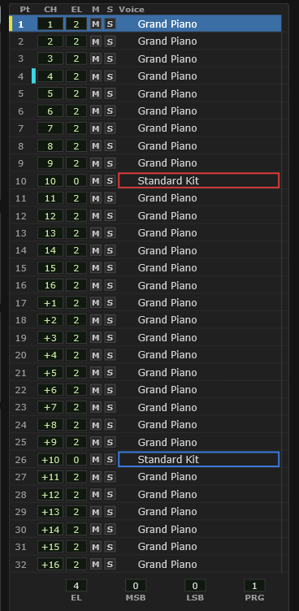
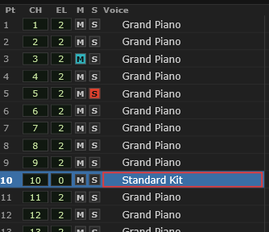
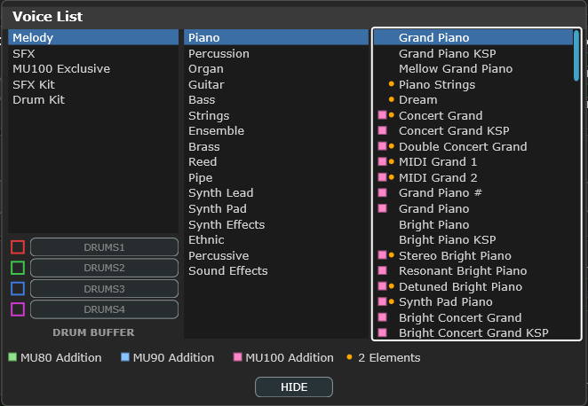
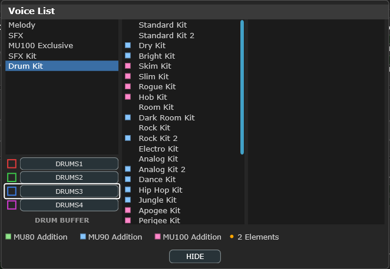

# 11 The Voice module

The tall column down the right-hand side: **all 32 parts at once**, and the place
you pick which one everything else in the editor is showing.

<!-- CAPTURE: Editor view, dark theme, crop of the full Voice column, a part
     selected (highlighted row), at least one drum part showing its buffer color
     outline, the M and S columns visible (unlit), and the footer readout visible.
     At least one row should carry the yellow changed tab and one the cyan override
     tab beside the part number, since both are part of the row's anatomy. -->

## The columns

| Column | | |
|---|---|---|
| **Pt** | Part number, 1 to 32, with a marker either side of it | click to select |
| **CH** | The MIDI channel this part listens on | editable |
| **EL** | Element reserve | editable |
| **M** | Mute — silences this part | click to toggle |
| **S** | Solo — silences every part except this one | click to toggle |
| **Voice** | The instrument assigned | click to change |

Either side of the part number sit the two row markers — a yellow tab for "changed"
and a cyan one for "changed by MIDI". Both are described under
[the two row markers](#the-two-row-markers) below.

Then, at the far right of each row, a thin **activity tab** that lights orange
whenever MIDI reaches that part. It is the fastest way to answer "is anything
getting through, and to where?" — turn it off under **Options ▸ Display
Animation...** if you find it distracting. Do not confuse it with the cyan voice
marker that appears just left of it when a program change has moved this part's
voice: the orange one flashes and fades, the cyan one stays until you deal with it.

The footer below the list gives the selected part's element count and its exact
bank and program numbers, for when you need to write them into a MIDI file
yourself.

### Selecting a part

**Click a row.** The Part module, the Graphic Display, the Controller module and
the Keyboard all follow.

The one other place you can do it is the **part numbers under the Graphic
Display's bars**, which select in exactly the same way — handy when you have just
spotted the part you want on a level meter. There is deliberately no dropdown
anywhere: both selectors set the same one selection, so they cannot get out of
step with each other.

### M and S — mute and solo

Two small cells per row, shaped like the mute and solo buttons on a mixer strip:
dark with pale lettering when off, **cyan** (mute) or **red** (solo) with dark
lettering when on.

<!-- CAPTURE: Editor view, dark theme, crop of the top twelve rows of the Voice
     column with part 3's M cell lit cyan and part 5's S cell lit red. -->

They are a **monitoring aid, not part of your patch.** Nothing is transmitted to
the tone generator, nothing is written into the file you save, and nothing is
recorded onto an automation lane — see [what they are not](#what-mute-and-solo-are-not)
below.

| | |
|---|---|
| **Click M** | mute this part, or unmute it |
| **Click S** | solo this part — click again to unsolo |
| **Ctrl+click** either | *only* this part is muted / soloed; every other one is cleared |
| **Ctrl+click** a cell that is already the only one lit | clears it, since there is nothing left to collapse onto |

Clicking M or S does **not** change which part is selected, so you can silence
part 7 while you carry on editing part 3.

Any number of parts can be muted or soloed at once, but **no single part can be
both.** Soloing a part that is muted unmutes it; muting a part that is soloed
unsolos it. Only the part you clicked is affected — mutes and solos on *other*
rows are left exactly as they were.

That is the same as your DAW's mixer, and it also removes the one state that
could lie to you: a part whose **M** cell was lit while you could still hear it.

#### Clearing them again

Whenever anything is muted or soloed, an indicator appears at the right-hand end
of the bottom bar — `SOLO 05`, `MUTE x3`, or both — naming the part when there is
only one and counting them when there are several. **Click it to clear
everything.**

That indicator is the one cue that survives everything else: it is there whether
the columns are hidden, whether the Voice module is scrolled out of sight, and
whether you are looking at the Editor or the Hardware view. If the plugin has gone
quiet, look there first.

The other quick way to clear a screenful of mutes or solos is **Ctrl+click one
part**, which clears the rest of that column, then **click it again** to turn that
one off. It works the same on both: Ctrl+click an **M** to clear every other mute,
Ctrl+click an **S** to clear every other solo.

Two things about that second click. It is an **ordinary click** — Ctrl does nothing
there, because once a part is the only one lit both kinds of click simply clear it.
And it clears **only the column you are working in**: the two are independent, so
clearing the solos leaves any mutes exactly where they were. The badge is the one
action that clears both at once.

#### What mute and solo are *not*

- **They are not saved.** They are cleared when you close the plugin window, and
  they are not stored in `settings.xml` or in your DAW project. Reopen a project
  and everything is audible. This is deliberate: a plugin that comes back silent
  with no visible reason is a much worse problem than losing an audition.
- **They send nothing.** No MIDI leaves the plugin, so an external MU100 on the
  MIDI output is unaffected, a recorded MIDI track is unaffected, and using them
  cannot dirty your patch or fill up Undo.
- **They cannot be automated.** They are not among the DAW-automatable parameters
  in [appendix A3](#a3-daw-automation-parameters). To silence a part *as part of
  the arrangement*, automate that part's **VOL** instead, or mute the MIDI track
  feeding it.
- **They are not the receive switches.** Turning a part's **NO** (Rcv Note) switch
  off in the Part module also silences it, but that *is* patch data — it is saved,
  transmitted, and survives a reload. Use mute for auditioning and `NO` only when
  you mean the part to stay off.

#### Two things that will look wrong until you know why

**A muted part's level meter keeps moving.** On the Graphic Display's VOLUME
screen the bar for a muted part carries on responding to the notes reaching it.
That is on purpose — it is how you find the part that is making a sound you want
to get rid of, which is usually why you reached for mute in the first place. The
`S` bar, which meters the plugin's actual output, is the one that falls silent.

**Reverb and chorus tails ring on for a moment.** Mute and solo cut the part at
the mixer, but the MU100's effects return a single stereo pair for all 32 parts
and their tails cannot be separated. Whatever was already in the reverb keeps
decaying for a second or so after you mute. Nothing new enters it.

For completeness: the cut is ramped over about five milliseconds, so clicking M
repeatedly does not click. And if you are using the [per-part outputs](#mixing-the-parts-in-your-daw),
a muted part is silent on its own output bus too, not just in the main mix.

#### Hiding the columns

**Options ▸ Show Mute and Solo columns** turns the two columns off, and the voice
names get the width back. It is a display setting only — **anything already muted
or soloed stays that way**, which is what the bottom-bar indicator is for.

### CH — the MIDI channel

Which channel the part responds to. By default part 1 is channel 1 and so on,
with parts 17–32 on the second MIDI port.

Two parts on the **same** channel both play — which is how you layer two voices,
a string pad under a brass section, from one MIDI track. Set a part's channel to
**OFF** and it responds to nothing.

> **Watch out** — layering costs polyphony, and the MU100 has 64 notes to spend.
> See [differences from the hardware](#21-differences-from-the-mu100-hardware).

### EL — element reserve

How many of the 64 available notes are **guaranteed** to this part. When the
module runs out of notes it steals from parts that are over their reserve first.

Give the bass and the drums a reserve and they will not drop out when a big
piano chord arrives. Total reserves across all parts cannot exceed what the
module has.

## Choosing a voice

Click any voice name and the **Voice List** opens.

<!-- CAPTURE: Editor view, dark theme, Voice List open, Melody selected in
     column 1, a category in column 2, and a voice list in column 3. Include the
     DRUMS1-4 buttons and the legend. -->

Three columns, working left to right. The first picks a family:

| | |
|---|---|
| **Melody** | The 1 000-odd ordinary instruments, split into sixteen categories |
| **SFX** | Sound effects |
| **MU100 Exclusive** | Voices this module has and earlier MU models do not |
| **SFX Kit** | Effects arranged across a keyboard |
| **Drum Kit** | Drum kits |

Pick a family, then a category, then a voice. Clicking a voice sends it to the
device straight away, so you can audition from the on-screen keyboard with the
list still open.

### Auditioning from the keyboard

The arrow keys walk a column, and **landing on a voice assigns it exactly as
clicking it would** — so you can hold the on-screen keyboard sounding and step
down a category one voice at a time. The list takes the keyboard focus when it
opens, on the column your current voice is in, so the arrows work straight away
without clicking anything first. Page Up/Down, Home and End move the same way.

- In the first column the arrows change **family**, which assigns nothing — it
  only rebuilds the columns to its right.
- In the second column they change **category** under Melody (again assigning
  nothing), and assign the voice or kit under any other family.
- In the third column they assign the voice.

### Moving between the four areas

**Tab** and **Shift + Tab** move between the list's four areas — the three
columns and the **DRUM BUFFER** box — and **Left** and **Right** do the same
thing without wrapping round at the ends. They are the same keys that move
between modules and controls in the editor behind, so there is nothing extra to
learn; if you have rebound either pair under
[Edit keyboard shortcuts...](#edit-keyboard-shortcuts), the list follows your
binding.

**These four keys keep working when [Use keyboard shortcuts](#use-keyboard-shortcuts)
is switched off** — which is how a fresh plugin instance starts in a DAW. With the
option off they use their standard assignments (**Tab**, **Shift + Tab**, **Left**,
**Right**) rather than anything you have rebound them to, because with the option off
your key map is not in force. Without this the list would be a dead end: the arrows
would still move within whichever column the list opened on, but you could not reach
the category, the family or the **DRUM BUFFER** box, and so could not choose a voice
outside the category the part was already using. See
[Screen readers, and what works with shortcuts switched off](#screen-readers-and-what-works-with-shortcuts-switched-off).

The area holding the keyboard is drawn with a white frame (black on the light
theme). It matters because each column keeps its own highlighted row whether or
not it is the one the arrows will move — the frame is what tells you which.

**Areas with nothing in them are skipped.** The third column is empty for every
family except Melody, and the DRUM BUFFER box only accepts a kit while **SFX
Kit** or **Drum Kit** is the family, so under Melody the walk is simply the three
columns and back round.

### Filling a drum buffer without the mouse

Everything the DRUMS buttons do with a click they do from the keyboard:

<!-- CAPTURE: Editor view, dark theme, Voice List open with Drum Kit selected in
     column 1 and the kit list in column 2, the keyboard on the DRUM BUFFER box
     with DRUMS3 framed and not yet armed. Same crop as voice-browser.png. -->

1. Pick **Drum Kit** or **SFX Kit** in the first column.
2. **Tab** to the **DRUM BUFFER** box — one press from the second column, since
   the empty third column is skipped.
3. **Up** and **Down** move between DRUMS1–4.
4. **Enter** arms the one you are on. It fills in to show it is armed, and **the
   keyboard moves straight to the kit list**, because that is what you are about
   to do next.
5. **Up** and **Down** now assign each kit to that buffer as you reach it.

To disarm, **Tab** back to the box and press **Enter** on the armed buffer again.
Leaving the two kit families, or closing the list, disarms it for you.

**Enter** closes the list, and whatever you last landed on simply stays — there
is nothing to confirm. **Escape** closes it too, from any of the four areas, and
so does **HIDE**. (Click something behind the list first and Enter goes to
whatever you clicked; use **HIDE** or **Escape** then.)

The one place Enter means something else is on a **DRUMS** button, where it arms
the buffer rather than closing — pressing a control is what Enter does everywhere
in this editor, and in the lists there is nothing left to press, because the row
you arrowed onto was applied the moment you reached it. **Escape** is the exit
that never changes meaning.

A whole run of arrow presses is **one undo step**, reverting to the voice you
started from rather than making you press Undo once per row. A click is its own
step, as before.

> **Watch out** — arrowing through the **Drum Kit** or **SFX Kit** list with a
> DRUMS buffer armed assigns each kit as you reach it, and assigning a kit
> [resets that buffer's per-key settings](#drum-kits-and-the-four-buffers). That
> is what clicking each one in turn would do too, and Undo reverses it, but it
> goes by much faster from the keyboard.

The list is not modal — you can drag it out of the way and keep working.

### Full names or the hardware's eight-character names

Every voice has two names: the full one, *Grand Piano*, and the eight-character
one the MU100's own LCD prints, *GrandPno*. Options ▸ **Voice names** switches
between them, and it switches them everywhere at once — this list, the part rows
behind it, and the drum and SFX kits along with everything else.

Full names are the default. Pick the short ones when you want the editor to read
like the hardware — they are exactly what the **Hardware view**'s LCD shows, and
what your own MU100 shows — when you have scaled the voice-list text up far enough
that the full names stop fitting the name column, or when you are naming per-part
output tracks in a DAW, whose name fields are much narrower than this list. The
reasons are set out in full under
[Voice names](#voice-names) in Options and settings.

It is only a label. Nothing is stored or sent differently either way, so you can
switch back and forth as often as you like. (One place it is more than a label:
in the VST, File ▸ **Name All Output Tracks from Voices** uses whichever form is
showing — see [Naming the output tracks](#naming-the-output-tracks).)

### The markers beside a voice name

Small colored dots and squares mark where a voice came from and what it costs,
with a legend along the bottom of the window:

| | |
|---|---|
| **MU80 Addition** | Added on the MU80 — not in the original XG set |
| **MU90 Addition** | Added on the MU90 |
| **MU100 Addition** | Added on this model |
| **2 Elements** | Uses two elements, so it costs **two** notes of polyphony rather than one |

The first three tell you how portable a choice is: a voice marked *MU100
Addition* will not exist on an MU80, and a file that calls for it plays something
else there.

**A voice with none of those three markers is an XG standard voice** — part of
the original XG set, present on every XG module ever made. There is no marker for
it because it is the norm; the markers exist to flag the exceptions. So if a patch
has to travel, prefer the unmarked ones.

The **2 Elements** marker is the one that affects how a song plays. Those voices
sound richer and halve your effective polyphony on that part — worth knowing when
a busy arrangement starts dropping notes.

> **MU100 Exclusive** in the first column is worth exploring if you are coming
> from an MU80 or MU90. These are the voices this model added, and files written
> for the earlier modules will never call for them.

## Drum kits and the four buffers

When you assign a **drum kit**, it does not simply belong to that part. It goes
into one of **four shared drum buffers**, DRUMS1 to DRUMS4, and *every part
assigned to that buffer plays that kit*.

The four buttons at the bottom of the browser arm a buffer for the next kit you
pick. An armed button fills in with color and its swatch turns solid, so you can
see which one you are about to write. In the part list, a part using a buffer has
its voice name outlined in that buffer's color.

**Arming a buffer also shows you what is already in it**: the kit list jumps to that
buffer's current kit and highlights it, switching between **Drum Kit** and **SFX Kit**
if the kit is in the other family. A buffer that no part is using highlights nothing —
a blank list means the buffer is empty, and the next kit you pick is what fills it.

This is how the hardware works, and it is why the plugin has a separate
[Drum Setup file format](#drum-setup-mds) and why loading one
[asks which buffer first](#the-drum-buffer-chooser).

> **Watch out** — assigning a kit to a buffer **resets that buffer's per-key
> settings**, and it affects every part on that buffer, not just the one you had
> selected. If you have spent time tuning individual drums, save a `.mds` before
> you change the kit.

## Copying a part, and resetting one

**Right-click a row** — anywhere on it — and a small menu opens with three things on
it:

| Item | What it does |
|---|---|
| **Copy Part *n* settings** | Puts that part on the clipboard |
| **Paste Part *m* settings** | Replaces this part with whatever was copied |
| **Reset Part *n* to defaults** | Puts this part back to how it came out of the box |

Right-clicking **selects the part first**, so the menu always acts on the part the
rest of the editor is showing. The same menu is on the **part numbers under the bar
screens** in the [Graphic Display](#the-bar-screens), and **Shift + F10** opens it on
the selected part without a mouse.

There is nothing to remember about what the clipboard is holding, because the menu
says so: the paste line reads **Paste Part 5 settings** when part 5 is on it, and is
grayed out until you have copied something.

**What travels is exactly what a [Part Setup file](#part-setup-mps) carries** — the
voice, the whole channel strip, the filters and EQ, and, if the part is playing a
drum kit, **the whole drum buffer with it**. It is the same operation as saving a
`.mps` and loading it again, without the file; use the file when you want to keep it,
and this when you are moving a sound around inside one song.

> **A pasted drum kit asks which buffer**, exactly as loading a `.mps` does, and for
> the same reason: a drum buffer is shared by every part assigned to it, so writing
> one reaches parts you did not select. The chooser names which parts are on each
> buffer before you decide.

**Each of the three is a single undo step**, however much it changed — one `Ctrl + Z`
puts back the part, its drum buffer and its per-key edits together.

The clipboard belongs to **this instance of the plugin** and to this session: it is
not saved with the song, and a second copy of the plugin has its own.

### Resetting a drum part warns first

Resetting a part whose factory voice is a **drum kit** — parts 10 and 26 — puts that
kit back, and that re-initializes the whole drum buffer: every key in it returns to
the kit's own defaults. Because the buffer is shared, that changes what *other* parts
play too, so the plugin says so first and names them, and you can cancel.

Resetting any other part needs no warning even if it is currently playing a kit: it
becomes a normal part first, so no other part is touched.

## The two row markers

Every row can carry two small tabs, and both answer the same question: **has
anything happened to this part that I would have to click through to find?**

- **A yellow tab at the far left of the row** means something on that part differs
  from its factory default.
- **A cyan tab just right of the part number** means something on that part has
  been changed on the device by incoming MIDI. See
  [changing sounds from a MIDI track](#changing-sounds-from-a-midi-track).

Scanning the two columns is the quickest way to see which parts you have worked on
and which ones a song has been moving behind your back, without selecting each part
in turn.

**Neither tab counts what the row already shows.** The receive channel, the element
reserve and the voice are all readable on the row itself, one cell to the right, so
a tab that lit for them would be restating something you can see while drowning out
something you cannot. Change a part's channel and no tab appears; change its filter
cutoff, which lives in the Part module, and the yellow tab does.

The voice is the one exception, and only for MIDI overrides: **a program change
arriving over MIDI marks the voice name itself**, at the far right of the row. A
program change is a big enough event to be worth its own place, and it is the one
override this list can name rather than merely count — hover the row and the
tooltip tells you which voice the device is actually playing.

Neither tab covers per-drum-key settings. Those belong to a **buffer**, which is
shared between every part assigned to it, so counting them here would light the tab
on parts nobody has touched. See [drum editing](#13-drum-editing).

The yellow tab is refreshed a few times a second rather than the instant you move a
control, so it can lag a knob drag very slightly. That is deliberate: it looks at
the whole part, and a marker of this kind does not need to be instant.

**Options ▸ Show changed markers** hides the yellow tab, here and everywhere else
it appears. The cyan one is not affected — that is a different question with its
own settings.
