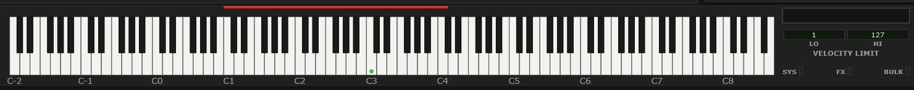
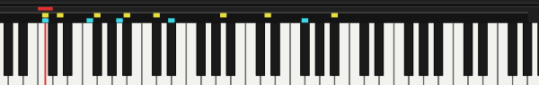

# 12 The Keyboard module

The keyboard along the bottom does six jobs: it plays notes, it shows what the
selected part is playing, it sets that part's playable range, it holds the
velocity limits, it is how you choose a drum key to edit, and on a drum part it
shows at a glance which keys of the kit you have touched.

<!-- CAPTURE: Editor view, dark theme, crop of the Keyboard module with a note
     range set (red bar over roughly C1-B3), the velocity boxes visible, and the
     SYS/FX/BULK lamps at the right. -->

**The labels under the keys mark the Cs.** They read `C-2` … `C8` by default, or
`0` … `120` if you set Options ▸ [Label notes as](#label-notes-as) to MIDI note
numbers. Only the Cs are labelled either way — they are the landmark you count from,
and a number under all 128 keys would be noise. The octave digit here is the MU100's
own convention, **middle C = C3 = 60**, which is worth knowing if your DAW calls that
note something else.

## Playing notes

**Right-click and drag** across the keys. Notes sound at the velocity in the
**VELOCITY LIMIT HIGH** box.

Right-drag, not left — left-drag does something else entirely, which is the one
thing about this module worth learning first. Auditioning while you edit is the
whole point of having a keyboard on screen, and it is also the quickest test that
the plugin is making sound at all.

**The note goes out on the selected part's Rcv channel**, not to the part
directly — the plugin has no private route to a part, and neither does anything
else. Two consequences follow, and both are what a MIDI keyboard on that channel
would do:

- If another part is set to the **same** channel, it sounds too.
- A part set to **Rcv OFF** cannot be auditioned at all. Nothing sent on any
  channel reaches it, so the keyboard stays silent rather than sounding whichever
  part happens to sit on the channel it would otherwise have used.

## Watching what is played

Keys held by incoming MIDI light in the same green. Several light at once, so a
chord shows as a chord, and a kick, snare and hi-hat struck together read as one
picture rather than as three events you have to catch separately.

It follows **the part you have selected**, not the whole instrument — it lights
keys arriving on that part's Rcv channel and nothing else. Select another part
and the keyboard shows what that one is playing. A part whose Rcv channel is
`OFF` never lights, which makes this a quick answer to "is this part receiving
anything at all?".

Turn it off under **Options ▸ Display Animation...**, where it is
**Played notes on the keyboard**; on by default.

## Setting the note range

**Left-drag** across the keys and a red bar appears above them: the range of notes
the selected part will respond to.

Start your drag nearer the low end of the current range to move the **lower**
limit, nearer the high end to move the **upper** one.

This is what you use to **split a keyboard**. Put a bass on part 1 limited to C1–B2
and a piano on part 2 limited to C3 upwards, set both to the same MIDI channel,
and one controller plays both with a split at middle C. Overlap them instead and
you have a layer that thins out at the top.

**From the computer keyboard**, each end of the bar can be reached like any other
control — see [Using the controls from the computer keyboard](#using-the-controls-from-the-computer-keyboard) — and a white
mark appears on the end you are on. **Up** / **Down** or **.** / **,** then move that end
by an **octave**, **Shift** with any of them by a **semitone**, and **Backspace** puts it
back to the full span. The octave is the coarse
step here rather than a single note because it is the unit a keyboard is laid out in,
and because 128 semitones is a long way to travel one press at a time.

## Velocity limits

**LOW** and **HIGH** set the range of velocities the part responds to — notes
outside it are ignored.

Set alongside a second part with the complementary range, this gives you a
**velocity switch**: a soft-played string pad below 80, a brass stab above it,
both on one channel.

**HIGH** doubles as the velocity used when you right-drag the keyboard, so set it
to something musical before auditioning.

## Drum key selection

When the selected part holds a drum kit, a **DRUM KEY** box appears at the right
of this module. **Click the box to arm it** — it fills in yellow — and then
clicking a key selects **that drum sound for editing**. The box names it (`SNARE`,
`COWBELL`) and a red marker appears over the key. The Part module and the AMP EG
and EQ screens all retarget to that one key.

**You can arm the box from the computer keyboard, but you cannot pick the key that
way** — the box is one of the controls the mark can land on (see [Using the controls from the computer keyboard](#using-the-controls-from-the-computer-keyboard)), and the piano keys are not.

Without a mouse, pick the key by **playing the note** instead — see [Selecting a key by
playing it](#selecting-a-key-by-playing-it). That works whenever the transport is
stopped, and it is arguably the better way round in any case, since you hear the drum you
are selecting. With neither a mouse nor a MIDI keyboard, drum-key editing is out of
reach.

The played-note display stays on in this mode, deliberately. The two marks say
different things and are drawn so they can be read together: the **red** marker
is the tone you are editing, the **green** keys are what is sounding. So you can
watch the kick, snare and hi-hat go past while the marker stays put on the one
you are working on.

Until the box is armed, a left-click on the keys still sets the note range as
usual. That is the arrangement's whole point: the keyboard keeps its normal jobs
until you explicitly say you are picking a drum.

This is covered fully in [Drum editing](#13-drum-editing).

> **VST only** — playing a drum note also selects it, which is convenient while
> programming and a nuisance while your drum track is running. **Options ▸ Enable
> MIDI drum key selection during DAW playback** decides whether it happens while
> the transport rolls; off by default.

## Which drum keys have been touched

On a part playing a kit, a narrow **two-row strip** appears between the red bar and
the keys, one slot per note, running across the kit's own key range.

<!-- CAPTURE: Keyboard module, dark theme, close crop of the marker strip and the
     keys immediately below it, with several yellow tabs in the upper row, at least
     two cyan tabs in the lower row, one key showing both, and the red drum-key
     marker and its stem on a key that carries a mark. -->

| Row | Colour | Means |
|---|---|---|
| **Upper** | yellow (violet on the light theme) | this key holds a value that differs from what the kit loads it with |
| **Lower** | cyan | incoming MIDI is currently overriding one of this key's settings |

**Click a slot** to select that key — it arms drum-key editing if it is not already
armed, so it is the fastest way in when you already know where you are going.
**Hover** one and the status line names the drum and counts both kinds of mark.

**Options ▸ Show changed markers** hides the upper row; the strip and its lower row
stay. Hovering still counts the edited keys, so the information is a hover away even
with the row switched off.

This is the only overview of a drum kit's per-key settings anywhere in the editor,
and it exists because there is nowhere else to see them: a kit holds a full set of
parameters for 79 keys and the Part module shows one key at a time. Without it, the
only way to find the three keys you tuned last week is to click through all 79.

The upper row measures against **that kit's own defaults**, not against some general
default — a rock kit and a jazz kit load the same key with different values, and the
mark means "different from how this kit loaded", which is the useful question.

> **A kit change clears the upper row**, because assigning a kit re-initializes the
> buffer to that kit's defaults — see [The four drum buffers](#the-four-drum-buffers-the-thing-to-understand).
> The marks describe your settings, and a reset rewrote them.

> The strip belongs to the **drum buffer**, not to the part. Two parts sharing a
> buffer show the same strip, because they are playing the same kit.

## The SYS / FX / BULK lamps

Three small lamps at the right of the module, showing incoming system-exclusive
traffic that is not addressed to any one part:

| Lamp | Lights for |
|---|---|
| **SYS** | System-wide messages — XG System On, master volume, tuning, display text |
| **FX** | The effect units and the Multi EQ |
| **BULK** | Bulk dumps and dump requests — a whole setup arriving at once |

They are diagnostic. When a song's opening bar sets the module up, you will see
SYS flash, then FX as the effects are configured, and the part tabs in the Voice
module flicker as each part is set. If nothing lights at all, nothing is arriving.

Transport and timecode messages are deliberately ignored here, so a rolling DAW
does not hold SYS permanently lit for reasons that have nothing to do with your
music.

Turn the lamps off, together with the part activity tabs, under **Options ▸
Display Animation...**.
