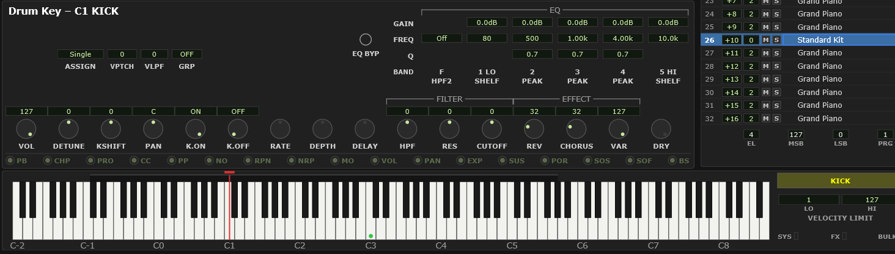

# 13 Drum editing

Editing a drum kit means editing **one drum sound at a time** — its level, its
pitch, where it sits in the stereo image, how much reverb it gets, its own filter
and EQ. The MU100 keeps a full set of these for every key of every kit, and the
editor lets you at all of them.

It works by **retargeting** modules you already know rather than opening a
separate editor. That is efficient once you have the idea, and confusing for the
first five minutes, so this chapter is that five minutes.

## Getting into drum-edit mode

1. In the **Voice module**, select a part that is playing a **drum kit**. If none
   is, click a voice name, choose **Drum Kit** in the Voice List, arm a **DRUMS**
   buffer, and pick a kit. (All of that works from the computer keyboard too — see
   [Filling a drum buffer without the mouse](#filling-a-drum-buffer-without-the-mouse).)
2. A **DRUM KEY** box appears at the right of the Keyboard module, reading
   `NO DRUM KEY`.
3. **Click that box to arm key selection.** It fills in yellow to show it is
   armed.

   
   <!-- CAPTURE: Keyboard module, dark theme, crop of the DRUM KEY box in the
        armed state showing a selected drum name. -->

4. **Now click a key on the keyboard** — the piano keys on screen, that is, or play
   the note on a MIDI keyboard, which is the way to do it without a mouse. The box names the drum — `SNARE`,
   `COWBELL` — and a red marker appears over that key.

   Clicking the **marker strip** just above the keys does steps 3 and 4 together, and
   it is the quickest way back to a key you have already worked on — see
   [Which drum keys have been touched](#which-drum-keys-have-been-touched).
5. The Part module's title changes from **Part** to **Drum Key**, and everything
   on it now edits that drum sound.

> **Watch out** — step 3 is the one people miss. Until the DRUM KEY box is armed,
> clicking the keyboard sets the part's **note range** instead, exactly as it does
> for a melodic part. If your click moved the red range bar rather than selecting
> a drum, the box was not armed.

**Which MIDI can select a key** is answered differently in the two versions, and in
both cases the answer is "your keyboard, not your recorded tracks". In the **VST**
it is automatic: any input may select while the transport is stopped, none while it
rolls, unless you turn on Options ▸ [Enable MIDI drum key selection during DAW
playback](#enable-midi-drum-key-selection-during-daw-playback). In the **standalone**
there is no transport to watch, so you tick the devices yourself in the MIDI Input
window's [Drum key column](#which-devices-pick-drum-keys). Clicking a key with the
mouse always works in both.

<!-- CAPTURE: Editor view, dark theme. Part module in drum-edit mode showing the
     "Drum Key" title and the retargeted knob row (K.ON/K.OFF present, RATE/
     DEPTH/DELAY inert, receive LED row grayed), plus the Keyboard module with a
     key selected and the drum name box filled. -->

To leave, select a part with a melodic voice, or click a key with no drum on it.

> **Watch out** — until you have picked a key, **nothing on the Part module is
> editable**, and its value boxes go blank rather than showing numbers. That is
> deliberate: there is no key for a value to belong to, so showing one would be a
> lie. The title says so — `Drum Key – none selected`.

## What changes

### The Part module

The main knob row rebinds to the drum key's own parameters:

| Knob | In drum-edit mode |
|---|---|
| **VOL** | The drum's level in the kit |
| **DETUNE** | Fine pitch |
| **KSHIFT** | Coarse pitch, in semitones — tune a tom, drop a kick |
| **PAN** | Where this drum sits |
| **K.ON** | Receive note-on for this key |
| **K.OFF** | Receive note-off for this key |
| **HPF / RES / CUTOFF** | This drum's own filter |
| **REV / CHORUS / VAR** | This drum's own sends |

The vibrato knobs (**RATE**, **DEPTH**, **DELAY**) and **DRY** have no drum
equivalent and go inert.

> **These have DAW automation lanes of their own**, one set per key per buffer,
> along with the key's **HPF2** and its three **AMP EG** rates — `DR1 D1 38 CUTOFF`
> and so on. **K.ON** and **K.OFF** do not; they are switches rather than something
> you ride. The automation markers move with the mode, so the marked knobs here are
> exactly the ones with lanes. See
> [appendix A3](#a3-daw-automation-parameters), and note that a lane belongs to the
> **buffer** — every part sharing DRUMS1 hears it.

**ASSIGN** retargets as well, from the part's setting to this key's own. It means
the same thing — **Single** lets one voice sound the key at a time, so a fast roll
chokes itself; **Multi** gives each hit its own voice and lets them ring together.
Multi is what you normally want on a ride or an open hi-hat. The part-level
**Inst** choice is not offered here: the box drops to two options in drum-edit
mode, because a single key has no instruments to allocate between.

> Because it is per key, one kit can hold both — a choked snare and a ringing
> cymbal side by side. Do not confuse it with **GRP** below: **GRP** decides how
> *different* keys cut each other off, **ASSIGN** how *one* key behaves against
> itself. See [What ASSIGN does](#what-assign-does) for the part-level control
> this stands in for.

Beside the knob row, three controls that only exist for drums:

| | |
|---|---|
| **GRP** | Alternate group. Two drums in the same group cut each other off — which is how a closed hi-hat chokes an open one. |
| **VPTCH** | How much velocity affects this drum's pitch |
| **VLPF** | How much velocity affects its filter |

The **EQ grid** and **HPF2** retarget too, so each drum can have its own
equalization. This is the *only* place a drum kit gets equalized — the part-level
row is grayed and inert on a part with a DRUMS buffer, because the MU100 ignores
part-level EQ on a drum part. There are no stacked layers here: one EQ, per key.
So to roll the low end off a whole kit you set the same cut on each key that needs
it, and a narrow cut on just the snare is a single key's edit.

The **receive-switch row grays out**, because those are part-level settings and
a live one among all these per-key controls would be read as belonging to the key.
Their per-key equivalent, **K.ON**/**K.OFF**, is in the knob row.

### The Graphic Display

**AMP EG** and **EQ** follow the selected key, and the corner of the screen names
the drum instead of the part. **PITCH EG** grays out — the device ignores it on a
drum part entirely.

### Which sends work

Reverb, chorus and variation sends exist per drum *and* per part. Both apply.

### The marks on the controls

Both of the editor's value marks work here, and both are per key rather than per
part. The **yellow** tab on a value box says this key's value differs from what the
kit loaded it with. The **cyan** ring or bar says incoming MIDI has moved that
setting on the device while your value stayed put — see
[MIDI override marks](#midi-override-marks).

The strip above the keyboard is the same two answers for the whole kit at once.

> **Most of a drum key's settings have DAW automation lanes** (VST only) — the
> knobs listed above, the key's **HPF2**, and
> its three **AMP EG** rates. The automation markers follow the mode: the marked knobs
> are exactly those, and on the Graphic Display the **AMP EG** button is marked while
> **EQ** is not — see
> [which screens are marked](#which-screens-are-marked-for-daw-automation).

## The four drum buffers — the thing to understand

A drum kit does not belong to a part. It belongs to one of **four shared drum
buffers**, DRUMS1 to DRUMS4, and **every part assigned to that buffer plays that
kit and shares its per-key settings**.

Two consequences that catch people out:

> **Watch out** — if two parts are on the same buffer, tuning a snare on one tunes
> it on the other. They are not two copies; they are one kit.

> **Watch out** — **assigning a kit to a buffer resets that buffer's per-key
> settings**, and it does so even if you assign the same kit it already had. There
> is no "just refresh the voice" — the device re-initializes the drum setup on any
> program write to that part. The hardware values go back to *that kit's own*
> defaults, which differ from kit to kit and from key to key; the plugin's own
> per-key EQ and high-pass go flat and off.
>
> So: **save a `.mds` before you change a kit** if you have work you want to keep.
> The marker strip goes blank at the same moment, which is the visible sign that it
> happened.

**The other half of that rule, and it is good news.** Per-key settings belong to
the **buffer**, not to the part. Moving a part to a *different* buffer, or off to
a plain melodic voice, leaves the buffer it came from exactly as it was — its kit
and all your per-key work are still there, still audible on any other part using
that buffer, and still saved with the project even if no part is on it at all.
Only *assigning a kit to a buffer* resets that buffer.

So parking a part somewhere else for a while is safe. Coming back and picking the
kit again is not: that is a program write like any other, and it resets the buffer.

> **Undo covers an accidental kit change.** **Edit ▸ Undo** puts back the kit *and*
> the per-key settings you had, on the device as well as in the editor. It is a
> safety net, not a substitute for `.mds`: the undo history lives in memory for the
> session only and is not saved with the project, so it cannot help you after
> reopening.

> **A kit change sent from a MIDI track resets the buffer too** — and the editor
> does not follow it, so the panels keep showing the previous kit's per-key
> settings while you hear the new kit's. Undo cannot help there either, because
> the editor never saw it happen. See
> [changing sounds from a MIDI track](#changing-sounds-from-a-midi-track).

That second rule is why the plugin has a `.mds` format at all, and why loading a
part setup onto a drum part carries the whole buffer with it. See
[Files and formats](#drum-setup-mds).

## Moving a drum treatment to another kit

The useful trick that falls out of all this:

1. Get a kit sounding the way you want — levels, tuning, pans, sends, EQ.
2. **File ▸ Save Setup As... ▸ Drum Setup (.mds)**.
3. Load a different kit onto a buffer.
4. **File ▸ Open File...**, pick your `.mds`, and choose that buffer.

Because a `.mds` carries no program change, nothing re-initializes, and your
settings land on the new kit's sounds. Values land by **note number**, so this
works between kits with comparable layouts — a rock kit onto a jazz kit, yes; a
drum kit onto an SFX kit, not usefully.

## Selecting a key by playing it

Playing a drum note selects that key for editing, which is the fastest way to work
when you are programming a part on a controller.

> **VST only** — during DAW playback this would follow every note in your drum
> track, so it is off while the transport rolls unless you switch on **Options ▸
> Enable MIDI drum key selection during DAW playback**.

## Speed

Sending a whole drum buffer is a lot of data — 79 keys with their full parameter
sets, about 2.7 seconds of it. Loading a `.mds`, or a `.mps` for a drum part,
shows a brief busy indicator. That is not the plugin being slow; it is the
emulated MIDI connection running at the same speed a real cable would.
