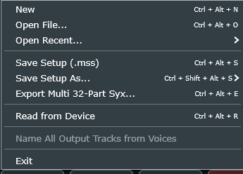
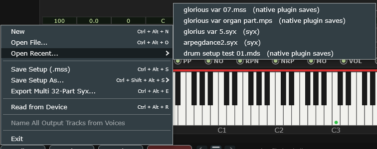
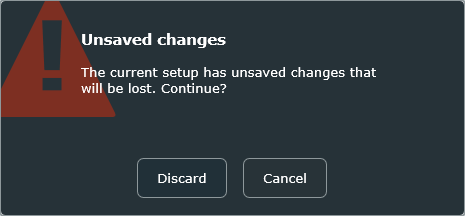
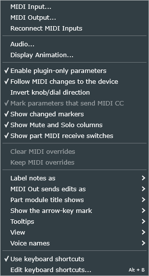

# 14 Menus and the bottom bar

Everything the plugin does that is not a parameter lives on the strip along the
bottom of the window.

<!-- CAPTURE: Editor view, dark theme, full-width crop of the bottom strip
     showing File, Options, About, PANIC, the undo trio, and a loaded file path
     with a trailing asterisk. -->

From the left: **File**, **Options**, **Help**, **PANIC**, then the undo trio
(undo, HISTORY, redo), then the file-path display.

The bar is identical in both views except that **the undo trio is hidden on the
Hardware view** — nothing you do on the front panel is undoable, so leaving the
arrows there would have been a lie. Nothing else moves; the buttons' space is
simply left empty.

## The file-path display

The right-hand end of the bar names the file your setup came from, or is empty if
you have not opened or saved one. A trailing **`*`** means you have unsaved
changes.

The `*` is worked out by comparing your current setup against the one that was
saved, not by remembering that you touched something — so if you undo back to
where you were, it disappears again by itself.

This strip doubles as the tooltip readout if you set **Options ▸ Tooltips ▸
Bottom bar**. Both the path and the tooltip start at the same left edge, so your
eye always begins reading in the same place.

## The File menu

<!-- CAPTURE (done, standalone): the File menu open. "Name All Output Tracks
     from Voices" is grayed here because the standalone has no host; "Exit" is
     standalone-only. -->

| Item | What it does |
|---|---|
| **New** | Resets the editor and the sound engine to factory defaults, with no file name. Asks first if you have unsaved changes. |
| **Open File...** | One dialog for every format the plugin reads: `.mss`, `.mps`, `.mds`, `.mes` and `.syx`. Asks first if you have unsaved changes. |
| **Open Recent...** | The last five files opened or saved. |
| **Save Setup (.mss)** | Saves over the file you are working on. |
| **Save Setup As...** | A submenu: System, Part, Drum or Effect setup. |
| **Export Multi 32-Part Syx...** | Writes a standard XG bulk dump for real hardware and other XG software. |
| **Read from Device** | Pulls the sound engine's current state back into the editor. |
| **Name All Output Tracks from Voices** | Renames your DAW's 32 part output tracks after the voices on them. |
| **Exit** | Standalone only. Quits, asking first if you have unsaved changes. |

What each format holds is the subject of
[Files and formats](#16-files-and-formats); what follows is what the *menu items*
do that is not obvious.

**Open File** works out the format from the file's contents, not its extension. A
`.mss` you renamed to `.txt` still loads as a system setup.

**Open Recent** shows each entry as `name  (folder)` rather than a full path,
because a working copy and a backup usually share a filename and differ only in
where they live. An entry whose file has been moved or deleted tells you so and
**removes itself from the list**.

<!-- CAPTURE (done, standalone): File > Open Recent submenu open, showing the
     "name  (folder)" format across two or three different formats. -->

**New** and **Open** ask before discarding work:

<!-- CAPTURE (done): the "Unsaved changes" dialog with Discard / Cancel. -->

**Discard** goes ahead and loses your edits; **Cancel** backs out. The prompt only
appears when the setup really has changed since it was last saved — undo your way
back to the saved state and it stops asking.

**Save Setup** overwrites the file named in the bottom bar. If you have not saved
yet, or if the file you loaded was a `.syx`, it behaves as Save As instead —
the plugin will not overwrite a `.syx` with its own format.

**Save Setup As ▸ Drum Setup (.mds)** is grayed out unless the part you have
selected is actually using a drum buffer. There would be no drum data in the file
otherwise.

> **Watch out** — **Read from Device** clears the undo history, and it reads back
> only the parameters the editor covers. It is the right thing to use after you
> have been editing on the Hardware view's front panel; it is not a general
> "refresh".

**Name All Output Tracks from Voices** renames your DAW's part output tracks to
`Pt 01 Concert Grand` and so on. It is grayed out unless per-part outputs are
switched on, and it is unavailable in the standalone.

The names follow **Options ▸ Voice names**, so setting that to *8 characters*
first gets you `Pt 01 ConGrnd` instead — see [Voice names](#voice-names).

> **Watch out** — the rename is all-or-nothing: your DAW re-reads all 32 names at
> once, so if you have renamed some of those tracks by hand, this will overwrite
> them, including ones you have not touched in the plugin. That is exactly why it
> is a menu command rather than something that happens automatically when you pick
> a voice.

## The Options menu

<!-- CAPTURE (done, standalone): the Options menu open. The VST adds three items
     the standalone has no use for - see the table. Re-shot 2026-09-10 for the
     renamed follow item ("Follow MIDI changes to the device", ticked, in its
     alphabetical place); that shot also picked up the two MIDI override commands,
     which the 2026-09-07 one predated. Re-shot 2026-10-04 for "MIDI Out sends edits
     as" and the two mark toggles (the CC one grayed, as it is in XG SysEx mode). -->

The menu above is the standalone's. In a DAW it gains three more items, marked
*VST* below.

| Item | | |
|---|---|---|
| **MIDI Input...** | *standalone* | Choose input devices and which port each feeds |
| **MIDI Output...** | *standalone* | Choose where the editor's edits are echoed |
| **Reconnect MIDI Inputs** | *standalone* | Reopen the MIDI inputs after Windows has lost them |
| **Audio...** | | Buffer, latency compensation, and per-part outputs |
| **Display Animation...** | | Activity indicators and the EQ spectrum |
| **Enable DAW automation** | *VST* | Let the DAW's own automation lanes drive the plugin |
| **Enable MIDI drum key selection during DAW playback** | *VST* | Let incoming notes pick the drum key while the transport rolls |
| **Enable plugin-only parameters** | | Allow the controls a `.syx` cannot carry |
| **Follow MIDI changes to the device** | | Watch what incoming MIDI does, and mark it |
| **Invert knob/dial direction** | | Flip drag and wheel direction |
| **Mark DAW-automatable parameters** | *VST* | An orange triangle by every control with a DAW lane |
| **Mark parameters that send MIDI CC** | | An underline by every control that records as a MIDI controller (MIDI CC mode only) |
| **Show changed markers** | | Show or hide every "this value is not its default" mark |
| **Show Mute and Solo columns** | | Show or hide the Voice module's M and S cells |
| **Show part MIDI receive switches** | | Show or hide the Part module's LED row |
| **Clear MIDI overrides** | | Put the module back on the values the panels show |
| **Keep MIDI overrides** | | Fold what MIDI changed into your setup |
| **Label notes as** ▸ | | Note letters (C3) / MIDI note numbers (60) |
| **MIDI Out sends edits as** ▸ | | XG SysEx (every XG parameter) / MIDI CC (only parameters that have a CC) |
| **Part module title shows** ▸ | | The part's number and voice / The drum key and instrument |
| **Show the arrow-key mark** ▸ | | Always / Only while using the computer keyboard |
| **Tooltips** ▸ | | Pop-ups near cursor / Bottom bar / None |
| **View** ▸ | | Dark Editor / Light Editor / Hardware |
| **Voice names** ▸ | | Full / 8 characters (as the hardware shows them) |
| **Use keyboard shortcuts** | | Master switch for every keyboard shortcut |
| **Edit keyboard shortcuts...** | | Open the Keyboard Shortcut Editor |

Each of these is described in [Options and settings](#15-options-and-settings).
Three notes belong here, though:

**View** both switches the view now *and* is what the plugin reopens in next time.
They were never two separate settings. Dark Editor and Light Editor are the same
view in two color schemes, so picking either also switches you to the editor if
you were on the Hardware view; Hardware is the other view. One of the three is
always ticked.

**Menu items show their keyboard shortcut on the right** — here, in the File menu
and in the Help menu — as long as **Use keyboard shortcuts** is on. Switch it off
and the shortcuts disappear from the menus, since none of them does anything. See
[Use keyboard shortcuts](#use-keyboard-shortcuts).

**Everything in this menu is a preference of your installation**, shared by every
project and every instance. None of it is stored in your song. See
[settings.xml](#a2-settingsxml-reference) for the full list, including a few
things that have no menu item.

## The Help menu

Two items: **MEGAN XG Manual...** opens this manual, and **About MEGAN XG** shows
the version, the credits and the license. Both show their keyboard shortcut when
**Use keyboard shortcuts** is on.

This button was labelled **About** in earlier builds. The manual needed a home you
could find without knowing the shortcut, and the Options menu is for settings
rather than documents.

**If the online manual opens instead**, MEGAN XG could not find a copy on your
machine, so it opened the published one at
[bboxdave.github.io/megan-xg](https://bboxdave.github.io/megan-xg/). The copy it looks for is
`Documents\MEGAN XG\manual\MEGAN-XG-Manual.html`. The copy attached to each
release on GitHub is a single file with its pictures built in, so it works on its
own; a copy you build yourself needs its `images` folder beside it.

## The mute / solo badge

> It reports **EQ bypasses** as well — an `EQ BYP 10` / `EQ BYP x2` in the same place,
> in amber. Clicking it clears bypasses, mutes and solos together. See
> [EQ BYP](#eq-byp-hearing-the-part-without-its-eq).

<!-- CAPTURE: Editor view, dark theme, crop of the right-hand end of the bottom
     bar with one part soloed and one muted, so the badge reads SOLO 05 MUTE 03. -->

At the far right of the bar, and **only while something is muted or soloed**: a red
or cyan badge reading `SOLO 05`, `MUTE x3`, or both together. It names the part
when there is exactly one and counts them when there are several, and it takes the
solo color whenever anything is soloed, because solo is the stronger statement.

**Clicking it clears every mute and every solo at once.**

It is on the bottom bar rather than in the Voice module deliberately: mute and solo
can be engaged from a module you have since switched away from, or with the M and S
columns hidden, or while you are looking at the Hardware view. This badge is
visible in all of those cases, and it is the first thing to check if the plugin has
gone unexpectedly quiet. The file path gives up the width while it is showing and
takes it back when it goes.

See [the Voice module](#m-and-s-mute-and-solo) for the controls themselves.

## The MIDI OUT: CC badge

An orange `MIDI OUT: CC` badge stands in the bottom bar for as long as
[MIDI Out sends edits as](#midi-out-sends-edits-as) is set to **MIDI CC**. It is
there because that mode's cost is invisible: most edits record nothing in it, and
nothing else on screen says the mode is on.

**Clicking it switches MIDI Out back to XG SysEx.**

## PANIC

The red button. Press it when a note is stuck.

It sends, on every channel of both ports: **All Sound Off**, **All Notes Off**,
and releases the **sustain** and **sostenuto** pedals. That is everything that can
actually hold a note on.

It deliberately does **not** send Reset All Controllers, which panic buttons
conventionally include. Reset All Controllers stops no sound; what it does do is
flatten pitch bend, modulation, expression and **portamento** — and portamento is
a setting the editor owns and displays. A panic that included it would silence
your stuck note *and* leave the Part module showing a portamento switch that no
longer matched the device.

> **Watch out** — PANIC is not the fix for a part that plays no notes at all. See
> [Troubleshooting](#22-known-issues-and-troubleshooting); the usual cause is a
> receive switch.

## Undo, HISTORY and Redo

Covered in [Controls](#undo-and-redo), where the rest of the editing behavior is.
