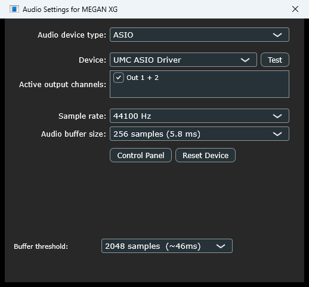
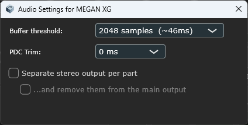
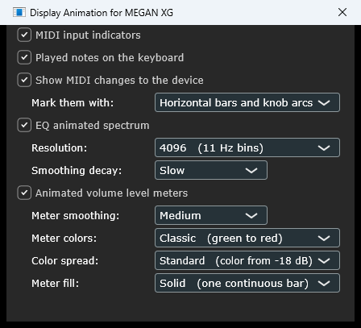
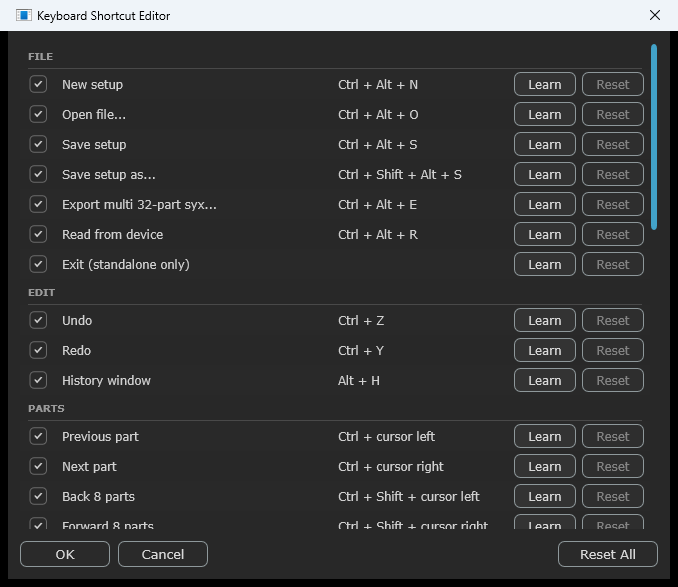

# 15 Options and settings

Almost everything in the **Options** menu is a preference of your *installation*,
not of your song. Change it once and it applies to every project and every
instance, now and after a restart. It is all kept in one file —
[settings.xml](#a2-settingsxml-reference) — which also holds a handful of things
that have no menu item.

The exception is the pair of per-part output checkboxes, which belong to the DAW
project instead. The section below says which is which; then the chapter goes
through the menu top to bottom.

## What is remembered where

Three groups, and it is worth knowing which one a setting is in before you go
looking for why it did or did not come back.

**Global — remembered for the installation.** Written to `settings.xml` the moment
you change them, and picked up by every instance created from then on, in either
build. Opening an old project does not change them.

> **Everything in the Options menu except the two per-part output checkboxes and
> Enable DAW automation.**
> That is: the view and theme, the editor window size and the six text sizes,
> tooltips, automation markers, the Part module title naming, invert knob direction,
> enable plugin-only parameters, MIDI drum key selection during playback, show
> changed markers, show Mute/Solo columns, show part receive switches, following
> MIDI changes to the device, voice-name length, every Display Animation option, the
> **Buffer threshold**, **PDC Trim**, the ROM folder, the MIDI **input** and
> **output** device selections, and the remembered folders and Open Recent list.

**Per project — the per-part output settings and Enable DAW automation.**
**Separate stereo output per part**, **...and remove them from the main output**
and **Enable DAW automation** are saved in the DAW project and nowhere else. They
are the only three that work this way, because each is really a property of the
arrangement rather than of your installation: how many tracks a song wants out of
the synth, and whether this song drives the plugin through native automation lanes
at all. Your DAW already stores its own half of both — which of the 32 aux buses
are switched on, and the automation lanes themselves — and keeping both halves in
the song is what lets a mix you built on them come back intact.

The other side of that is worth stating plainly:

> **A new instance always starts with the two output settings off** — a plain
> stereo instrument — however you left them in your last project. **Enable DAW
> automation starts on**, which is also how every project saved before the setting
> existed reads.

If you always work with the per-part outputs — or always work without native
automation — set that up in a **DAW template** rather than looking for a global
setting. A template is a saved project, so it carries all three like any other
project does.

**Session-only — starts fresh every time.** Never written anywhere, in either
build:

> The graphic display's current screen, the selected part, the selected drum key,
> the drum-buffer assignments, and the **Mute and Solo** states.

Mute and Solo are the deliberate one. They answer "what am I listening to right
now", and a plugin that reopens silent with no visible cause is a worse problem
than re-muting a part.

There is one more thing worth knowing about the global group: nothing propagates
to an instance that is **already open**. Change a setting with two instances
running and the second one keeps its old value until it is created again. What it
will *not* do is undo your change: each instance writes only the settings it
changed itself, so the one holding the old value leaves it alone, and the next
instance you open reads the value you set. See
[Multiple instances](#multiple-instances).

### Settings that describe your machine, not your music

`romPath`, **Buffer threshold**, **PDC Trim** and the standalone's **MIDI input**
routing stay global even though a song might plausibly want its own, on purpose —
each describes the computer you are sitting at:

- The buffer and the trim are stored as a **length of time**, not a number of
  samples at one rate, so a 48 kHz project and a 96 kHz project need the same
  value. What actually decides it is your DAW's buffer size and how loaded the
  machine is.
- The ROM folder and the MIDI input devices are facts about *this* installation.
  A project that carried them would break the moment you opened it on another
  computer, plugged in a different keyboard, or moved your Documents folder —
  and MIDI input failing over silently, with no error, is the worst way for it to
  break.

## MIDI Input... · MIDI Output... · Reconnect MIDI Inputs

> **Standalone only** — in a DAW, the host routes MIDI and these do not appear.

Covered in [Running standalone](#19-running-standalone).

## Audio...

<!-- CAPTURE (done, standalone): Options > Audio... showing the device selector
     and Buffer threshold. No PDC Trim row - that is VST-only. -->

Everything about how audio leaves the plugin. Shown here in the standalone, which
adds the sound-card selector at the top; in a DAW the window starts at **Buffer
threshold** and gains the two part-output checkboxes below.

<!-- CAPTURE (done, VST): VST only - needs a DAW. Options > Audio... showing Buffer
     threshold, PDC Trim, and both part-output checkboxes, with no device
     selector. -->

> **Standalone only** — the top of this window is JUCE's standard audio device
> panel: driver type, output device, sample rate and hardware buffer size.

### Buffer threshold

How much audio the emulated sound engine works ahead, in samples, from 128 to
32768. This is a trade between **stability** and **latency**:

| | |
|---|---|
| Lower | Less delay between a note and its sound, but a busy machine is more likely to produce clicks or dropouts. |
| Higher | Rock solid, at the cost of up to about 740 ms of delay. |

The default of 2048 (about 46 ms) is a safe starting point. If you are playing
the plugin live from a keyboard and it feels sluggish, come down; if you hear
crackling under load, go up.

This is separate from your DAW's own buffer size, and adds to it.

#### When the top two settings are the ones you need

The two largest options — **16384** (about 370 ms) and **32768** (about 740 ms) — are
there for one specific symptom: **an occasional stutter of a second or two in an
otherwise clean session**, which comes back every couple of minutes.

A deep buffer does not make the emulated sound engine faster. It gives it a larger
reserve to draw on, so a brief interruption is covered instead of being heard. If you
are **playing live** these settings will feel sluggish and you do not want them. If you
are **mixing or bouncing**, the extra delay costs you nothing — your DAW compensates for
it — and the stutter is reduced or gone.

One thing worth knowing if you go looking for the cause: **your DAW's performance meter
will look fine.** It measures the work done in the audio callback, and this plugin does
almost none there — the emulation runs on its own thread, which no host meter can see. A
calm meter is not evidence that the plugin is comfortable.

> **Watch out** — if the stutter is *regular*, suspect something else on your machine
> before you settle for a deep buffer. During development this plugin produced audio
> glitches on the test machine at intervals just over two minutes apart, every time. A
> very large buffer greatly reduced the symptom, which made it look convincingly like
> the plugin. It was not: a background program running on a timer was taking the
> machine away periodically, and taking it out of automatic startup removed the problem
> completely — at low buffer settings as well.
>
> The tell is the **regularity**. A plugin short of headroom stutters when the music
> gets busy; a timer stutters on the timer, whatever you are playing. Two ways to tell
> them apart:
>
> - **Play something much lighter and keep listening.** A single held note, or two bars
>   of one part looped — not your full project. If the stutter keeps arriving on the
>   same rhythm with almost nothing to play, the load is not what is causing it.
> - **Watch Windows' own CPU graph while it happens.** Ctrl+Shift+Esc opens Task
>   Manager; its **Performance** tab has a scrolling CPU chart. This plugin's own load
>   is steady, so a *spike* that arrives every couple of minutes, in step with what you
>   are hearing, is something else on the machine waking up.
>
> If it is something else, a buffer setting only hides it. Anything that runs on a
> schedule can be the cause — an updater, a backup, a virus scan, or a PC
> manufacturer's own update or support service, which is what it turned out to be here.
> Task Manager's **Startup apps** tab is where to look first; a manufacturer's service
> may not appear there, in which case it is under Services, and the tidiest fix is
> usually to uninstall or disable the vendor updater you did not know you had.

### PDC Trim

> **VST only** — there is no host to compensate in the standalone, so the setting
> is not offered there.

**PDC** is *plugin delay compensation* — your DAW shifting the plugin's events
slightly earlier so that what comes out lands where you wrote it. The trim tells
the DAW how much to shift, from 0 to 50 ms.

If notes from this plugin sound consistently *late* against the rest of your
project, raise it until they line up. Leave it at 0 unless you have a reason.

Note this shifts *already-recorded* material only. It adds no delay of its own —
it changes what the plugin reports to the host — so it cannot make live playing
from a keyboard feel any different. For that, see **Buffer threshold** above.

### Separate stereo output per part

> **VST only** — the standalone can only open its main stereo output.

Gives every one of the 32 parts its own stereo output in your DAW, so you can
process them separately — an EQ on the bass, a compressor on the drums, all of it
in your DAW rather than in the MU100.

The second checkbox, **...and remove them from the main output**, drops those parts
from the main stereo mix so you are not hearing each part twice. It stays grayed
out until the first one is on, since it has nothing to act on by itself.

**Both are off by default**, and a new instance opens a plain stereo instrument
that behaves exactly as it did before these existed.

These two belong to the **project** rather than to your installation — they and
**Enable DAW automation** are the only three settings that do; see
[What is remembered where](#what-is-remembered-where). A project you saved with them
on comes back with them on, which is what keeps a mix built on the per-part outputs
intact; a **new** instance always starts with both off, so put them in a DAW template
if that is how you always work. If a project sounds faint and
washy and falls silent when you turn the reverb down, that is these two settings on
in a host where the extra outputs go nowhere you can hear — see
[everything is faint](#everything-is-faint-and-vanishes-when-i-turn-the-reverb-down).

What the per-part outputs carry is described in
[DAW integration](#per-part-stereo-outputs) — it is the *dry* part signal, and
there are some real limits worth knowing before you build a mix around it.

## Display Animation...

<!-- CAPTURE: Options > Display Animation... window, all twelve rows visible. -->

Twelve settings, none of which affects the sound in any way. All of them are
picture only.

**MIDI input indicators** — the small orange tabs in the Voice module that light
when a part receives MIDI, and the SYS / FX / BULK lamps by the keyboard. On by
default. They are the quickest way to see whether MIDI is arriving and on which
part.

**Played notes on the keyboard** — lights every key the selected part is
currently holding, in the Keyboard module. On by default. Several keys light at
once, so a chord reads as a chord. It follows the selected part's Rcv channel, so
switching parts switches what you are watching. See
[The Keyboard module](#12-the-keyboard-module).

**Show MIDI changes to the device** — mark any control whose value on the device
has been changed by incoming MIDI. On by default. Your setup is never changed by anything
arriving over MIDI, so what you save is always what the panels show; these marks
are how you can tell when the module has been taken somewhere else. See
[changing sounds from a MIDI track](#changing-sounds-from-a-midi-track) for how to
read them. DAW automation is not marked: those lanes are part of your project and
do move your values, exactly as in any other plugin. This setting decides only
whether the marks are *drawn*; whether the editor watches at all is
[Follow MIDI changes to the device](#follow-midi-changes-to-the-device).

Switching it off also stops the editor speaking about overrides to a screen
reader, which is the same judgement: the marks are what a sighted user has turned
off, and the spoken form is the same news.

**Mark them with** — what those marks look like on the Part module's value boxes
and knobs: **Horizontal bars**, **Horizontal bars and knob arcs** (the default), or
**Vertical bars and knob dots**. The three are described, with what each is good
for, under [MIDI override marks](#midi-override-marks). The row is greyed while the
marks are switched off above it, and while the editor is not following MIDI changes
at all; neither greying changes what it is set to.

**EQ animated spectrum** — the live spectrum line on the EQ screen. On by
default. The next two settings gray out when this is off.

**Resolution** — how finely the spectrum is measured. The choices are labeled by
the spacing between measurement points, because that is what decides whether the
bottom of the display is readable:

| Setting | Best for |
|---|---|
| 1024 (43 Hz bins) | Broad shapes; older machines |
| 2048 (22 Hz bins) | General use |
| **4096 (11 Hz bins)** | The default. Seeing what a high-pass is doing |
| 8192 (5 Hz bins) | Picking out individual low notes |

**Smoothing decay** — how fast peaks fall back after a note: Fast, Medium, Slow
(the default) or Very slow.

**Animated volume level meters** — turns the Graphic Display's VOLUME screen into
a 33-channel meter bridge. **On by default.** Each part's volume *setting*
becomes a thin dash where the top of its solid bar used to be, and the space below
it fills with that part's live output level: green when quiet, rising through
yellow and orange to red near full scale. The leftmost `S` bar meters the plugin's
own stereo output. See [The Graphic Display](#5-the-graphic-display) for how to
read them.

**Meter smoothing** — how fast a meter falls back after a note: Fast, **Medium**
(the default), Slow or Very slow. Meters rise instantly whatever this is set to;
it only governs the fall.

**Meter colors** — which color ramp the meters use: **Classic** (the default),
Teal, Ocean, Amber or Mono. Each carries its own values for the dark and light
themes, so a choice cannot leave either one hard to read.

**Color spread** — how far down the bar those colors reach: **Standard** (color
from −18 dB, the default), Wide (−30 dB) or Full (−42 dB). Bar heights do not
change; only the color does.

**Meter fill** — how the fill itself is drawn: **Solid** (one continuous bar,
the default) or **LED** (lit segments the size of the setting dash, separated by
gaps in the display background). Cosmetic, with one wrinkle: LED lights a segment
only once the level reaches it, so it can read up to one segment low. All three
settings are described with pictures in
[The Graphic Display](#5-the-graphic-display).

Turning these up cannot cause audio glitches. The measurement happens inside the
sound engine and costs almost nothing; the drawing happens on the interface, so
the worst an over-ambitious setting can do is make the display sluggish.

The one setting here that is not purely drawing is **Animated volume level
meters**: it switches on a per-part measurement inside the emulated mixer rather
than only on the interface. It is on by default because that measurement is one
peak reading per part per audio block and is far too small to hear; if you want
the last of it back on a heavily loaded machine, untick it.

If you are here because the machine is short of headroom, these settings are part
of a larger list — see
[it is using too much CPU](#it-is-using-too-much-cpu) for the order worth trying
things in.

## Enable DAW automation

> **VST only.** On by default, and **saved with the project** rather than with your
> installation — see [What is remembered where](#what-is-remembered-where).

The plugin publishes 4 939 parameters your DAW can automate natively — part volumes,
pans, sends, filter cutoffs and EQ gains, and fourteen controls on every drum key.
Appendix
[A3](#a3-daw-automation-parameters) lists them. Behind them sits a bridge that keeps
each one and the editor in step, thirty times a second, whether or not you use it.

Untick this and that bridge stops. Two reasons you might want it:

- **You want to automate using only XG SysEx.** Recording your edits as
  system-exclusive on a MIDI track is the older way of doing this and it still
  works perfectly, so if you have decided to drive the plugin that way and no
  other, the native lanes are machinery you are not using.

  > Note the word *only*. The two kinds of automation are not alternatives and
  > they run side by side quite happily in the same project — see
  > [Two kinds of automation](#two-kinds-of-automation). Using XG SysEx is not by
  > itself a reason to turn this off; deciding against the native lanes
  > altogether is.
- **You want the headroom back.** Do not expect much: the bridge costs a fraction
  of one processor core, and it is nowhere near the emulation itself. What it does
  more noticeably is quiet the traffic between the plugin and your DAW, which shows
  up while a project is loading or while a lane is sweeping rather than as a steady
  saving.

> **Watch out** — the parameters do not disappear from your DAW's automation list.
> They cannot: a plugin has to declare them when it is created, long before it is
> told which project it belongs to. So with this off you can still *record* a lane
> and it will do nothing. The cue that tells you which state you are in is the
> automation markers: with this off, the little
> [triangles](#mark-daw-automatable-parameters) beside the automatable controls go
> away too.

Existing automation is not lost, only ignored — tick this again and every lane
picks up where it was. Switch it back on while the transport is rolling and the
plugin adopts the lane values within a fraction of a second; switch it on while
stopped and nothing happens at all until you next press play.

### What you will see when you switch it back on

**Your DAW's own parameter values jump to match the plugin.** Whatever you have
been editing in the editor is treated as the truth, and the DAW is brought up to
date with it. That is the right way round — your edits are not thrown away — but it
is worth expecting, because a row of values moving at once in your DAW's generic
plugin panel, or on a control surface, looks like something has gone wrong. Nothing
is sent to the sound engine, and nothing you can hear changes.

> **Watch out** — the automation you had already *recorded* is untouched by any of
> this. So the next time the transport reaches it, it drives the plugin again, and a
> value you set by hand on an automated parameter is replaced by whatever the lane
> says at that point in the song.
>
> **That happens on playback, not at the moment you re-enable**, and only to
> parameters you have actually written automation for — a parameter with no lane is
> never affected.

If you have been editing freely with automation switched off and want to keep
those settings, put them somewhere that survives before you play the song again:
**File ▸ Save Setup (`.mss`)** captures the whole patch, or write the values into
the lanes themselves so that the automation and the sound agree.

## Enable MIDI drum key selection during DAW playback

> **VST only.** Off by default.

In drum-edit mode, playing a drum note selects that key for editing — which is a
fast way to work, and a nuisance while the transport is rolling and your drum
track is playing every key in turn. Off, the selection stays where you put it
during playback.

The standalone has no transport to watch, so it asks per device instead: see the
MIDI Input window's [Drum key column](#which-devices-pick-drum-keys).

## Enable plugin-only parameters

On by default.

The plugin adds filter controls the real MU100 does not have — **HPF2** and **EQ
bands 2, 3 and 4** on every part and drum key, and the System module's **HPF**
floor. They sound, they save in the plugin's own file formats, and they are
genuinely useful. What they cannot do is survive an export to `.syx`, because no XG
device understands them.

Untick this and those controls gray out, so a session cannot produce anything the
export would silently drop. Do that whenever the patch you are building has to end
up on real hardware.

> **Watch out** — this blocks *editing*; it does not bypass anything. Values you
> already dialed in stay in effect and stay audible. That is deliberate — the
> alternative would silently change your sound the moment you changed a setting.

Effect tempo-sync is deliberately **not** locked by this. Sync only works out a
delay time in milliseconds, and that number is perfectly ordinary XG data that
exports fine; you lose the tempo-following link, not the sound.

## Follow MIDI changes to the device

On by default. Watches what incoming MIDI does to the module, marks every control
the device has been moved off in cyan, and keeps the count in the bottom bar. See
[changing sounds from a MIDI track](#changing-sounds-from-a-midi-track) for how to
read the marks.

Untick it and the editor stops watching: no marks appear and the count stays at
zero. Unticking it also drops any marks already standing, because a mark that
stopped being maintained would freeze at whatever the last message said and go on
claiming to describe the device.

It changes nothing about the sound and nothing about what gets saved — the module
still obeys the MIDI it is sent either way, and your setup is still the thing that
is stored. Switch it off for the session where a sequencer is sending program
changes at the top of every take and you would rather the panels sat still.

> **Two settings, not one.** This one decides whether the editor *watches*.
> **Display Animation ▸ Show MIDI changes to the device** decides whether what it
> watched is *drawn*, and the **Mark them with** row under it decides what the
> drawing looks like. Turn the drawing off and the count still runs, so **Keep MIDI
> overrides** still has something to fold in. Turn *this* off and there is nothing
> to draw, which is why both of those go grey with it.

## Invert knob/dial direction

Off by default. Reverses drag and wheel direction on knobs and value boxes, so
that dragging *up* decreases — the way a physical rotary control turns. See
[Controls](#the-universal-rules) for exactly which controls it affects.

## Show changed markers

On by default. Shows or hides every mark that says **this value is not its
default** — the whole family at once, wherever it appears:

- the colored tab at the edge of a **value box** or a selection box;
- the yellow tab at the far left of a **Voice module** row;
- the yellow **bars and envelope handles** on the Graphic Display;
- the upper row of the **Keyboard's drum marker strip**.

They are described where each one lives; [the changed marker](#the-changed-marker)
in Controls is the short version. Turn them off for a quieter screen, or when you
want to look at a patch without being told what has been edited, and turn them back
on when you want to find your way around one.

**Nothing moves when you switch it.** The space each tab occupies is reserved
whether or not the tab is drawn, so no value shifts, no column reflows and no
module changes size. Nothing is edited either: the values are untouched, nothing is
sent to the module, and what gets saved is exactly the same.

Two marks that look similar are deliberately *not* covered:

- the **cyan** MIDI-override marks, which say the module has been moved off your
  value by incoming MIDI. That is a different question and has its own settings —
  [Follow MIDI changes to the device](#follow-midi-changes-to-the-device) and
  **Display Animation ▸ Show MIDI changes to the device**.
- the **`*`** at the end of the bottom bar, which means your setup differs from the
  file you last saved. That is about the file, not about defaults.

## Show Mute and Solo columns

On by default. Shows or hides the **M** and **S** cells in the Voice module — the
per-part mute and solo described in [the Voice module](#m-and-s-mute-and-solo).
With them hidden, the voice-name column gets the width back; the window does not
change size either way.

**Hiding the columns does not clear anything.** A part that was muted stays muted
and stays silent. That is what the mute/solo indicator at the right-hand end of
the bottom bar is for — it appears whenever anything is engaged, whatever this
setting says, and clicking it clears everything.

## Show part MIDI receive switches

On by default. Shows or hides the row of seventeen LEDs along the bottom of the
Part module — the per-part switches that decide which kinds of MIDI message that
part will act on.

Hiding them only hides them: the switches keep their values and nothing is sent
to the device.

> **Watch out** — this is the single most confusing setting in the plugin. If you
> turn a part's **NO** (receive note) switch off and *then* hide the row, that
> part goes silent with nothing on screen to say why. If a part ever stops
> sounding for no apparent reason, turn this back on and look at its LED row
> first.

## Clear MIDI overrides / Keep MIDI overrides

Two commands rather than settings, grayed out when nothing has been changed by
MIDI, and each carrying the count.

**Clear** puts the module back on the values the panels are showing. Nothing in
your setup changes; the device catches up to it. This is also what clicking the
count in the bottom bar does.

**Keep** does the opposite: it folds what arrived into your setup, so the change
the song made becomes the thing you save. One undo step, however many settings it
moved.

## Mark DAW-automatable parameters

> **VST only.** On by default.

Puts a small orange triangle before the name of every control that also has a
native automation lane in your DAW. Where an entire group qualifies,
the marker goes once on the name that covers it: the Part module's EQ **GAIN** row
label rather than each box, and the
[Graphic Display](#which-screens-are-marked-for-daw-automation)'s screen buttons
rather than each bar or point. See
[automation parameters](#a3-daw-automation-parameters).

The markers also go away entirely when
[Enable DAW automation](#enable-daw-automation) is unticked, whatever this is set
to — with the bridge stopped, a marker would be pointing at a lane that records
and does nothing.

## Mark parameters that send MIDI CC

On by default, in both versions.

Underlines the name of every control whose edits record as a MIDI controller — the
eleven listed under
[recording edits as controllers](#recording-edits-as-controllers-cc) — and the
Graphic Display buttons for their screens.

The underlines appear **only while [MIDI Out sends edits as](#midi-out-sends-edits-as)
is on MIDI CC**. In XG SysEx mode every XG edit records, so there is nothing to tell
apart; the item is grayed there, and keeps whatever you last chose for when you
switch back.

A control can carry this underline and the
[DAW triangle](#mark-daw-automatable-parameters) at once.

## Label notes as

Whether the editor writes a MIDI note as a **note letter** or as a bare **MIDI note
number**. Two choices, letters by default.

| | Reads |
|---|---|
| **Note letters (C3)** | `C3`, `A#2`, `C#1` |
| **MIDI note numbers (60)** | `60`, `58`, `37` |

Both rows name the same note, which is the quickest way to say the thing that makes
this setting worth having: **this plugin calls middle C `C3`**, following the MU100
itself. Your DAW may call that same note `C4` or `C5`. The letter never disagrees
between them — only the octave digit does — so if you work in a DAW that numbers
octaves differently, switching the editor to note numbers removes the mismatch
entirely rather than asking you to keep translating.

It applies everywhere the editor prints a note as text:

- the labels under the [Keyboard module's](#the-keyboard) keys;
- the drum key in the [Part module's title](#part-module-title-shows), ahead of the
  instrument name;
- the drum marker strip's hover text;
- the key-range ends, as a screen reader reads them out;
- the MIDI-override badge's hover text, where it lists the keys of a drum buffer.

> **The keyboard still labels only the Cs**, whichever form you pick — `C3` becomes
> `60`, and the keys between stay unlabelled. The C is the landmark you count from
> either way, and numbering all 128 keys would be noise rather than information.

**It does not change the DAW automation parameter names.** Those carry both forms
already — `DR1 A#2 58 VOL` — precisely because a host may not share this plugin's
octave convention. See [appendix A3](#a3-daw-automation-parameters).

**This is a display setting only**, saved with the installation rather than with a
song. Nothing is stored or transmitted differently, and switching takes effect at
once.

## MIDI Out sends edits as

What the plugin's MIDI output carries when you change something in the editor, so
your DAW can record it. Two choices, **XG SysEx** by default.

| | Sends | Records as |
|---|---|---|
| **XG SysEx (every XG parameter)** | every edit to an XG parameter | system-exclusive events, which many DAWs show only as lists of numbers |
| **MIDI CC (only parameters that have a CC)** | the eleven edits that have a MIDI controller, and nothing else | ordinary controller events, which a DAW can draw and edit as lines |

There is **no mixture of the two**. In MIDI CC mode an edit that has no controller —
an effect setting, an EQ band, anything in drum-edit mode — sends nothing at all,
rather than falling back to SysEx. A recording in one format is far easier to read
and edit than one that is mostly controllers with the odd SysEx event mixed in.

Neither mode sends the plugin-only settings (HPF2, EQ bands 2–4, the System HPF,
tempo sync). They have no XG address, so there is nothing to send.

In MIDI CC mode the controls that do record are
[underlined](#mark-parameters-that-send-midi-cc), and an orange `MIDI OUT: CC`
[badge](#the-midi-out-cc-badge) stands in the bottom bar as a reminder that
everything else is not being recorded.

Which controls have a controller, what MIDI CC mode cannot do, and the things that
catch people out on playback are all in
[Recording your edits as MIDI](#recording-your-edits-as-midi).

This setting is saved with the installation rather than with a song, and takes
effect immediately.

## Part module title shows

Two tick boxes, **both on** by default. They make the Part module's title name what
the module is currently editing, rather than only saying which mode it is in.

| | Title reads |
|---|---|
| *neither ticked* | `Part` — or `Drum Key` in drum-edit mode |
| **The part's number and voice** | `Part 12 – Grand Piano` |
| **The drum key and instrument** | `Drum Key – C#1 SIDE STICK` |
| *both ticked* | each mode names its own |

They are separate settings because they apply to different modes, and you may well
want one without the other — the drum name while you pick your way around an unfamiliar
kit, say, without the voice name in ordinary part editing.

Ticking a box takes effect at once and names whatever is selected right now; you do not
have to change part or key first.

**Untick them if you would rather have the plain title.** The names are on by default
because they save a glance across at the Voice module and, in drum-edit mode, tell you
which of the kit's keys you have got hold of. Some people find a string that changes
every time they select a part distracting instead; nothing else in the module depends on
it, and the title is perfectly legible without it.

A few details worth knowing:

- The voice name follows [Voice names](#voice-names), so with **8 characters** picked the
  title reads `Part 12 – GrandPno`. The two settings agree by construction: the title
  shows the same string the Voice module's own row does.
- The drum key and its instrument are named only when a key with a sound on it is
  selected. With no key picked, or with a key the kit leaves empty, the title keeps
  saying **why** there is nothing to edit (`Drum Key – none selected`,
  `Drum Key – empty key`) rather than naming a tone that is not there. Both halves come
  together or not at all — this box does not offer the key without the instrument.
- The key follows [Label notes as](#label-notes-as), so with **MIDI note numbers** picked
  the same title reads `Drum Key – 37 SIDE STICK`.
- **This is a display setting only.** Nothing is saved or transmitted differently, and
  the setting belongs to the installation, not to a song — see
  [What is remembered where](#what-is-remembered-where).

## Show the arrow-key mark

When a control has the computer keyboard's attention, a white mark is drawn around it —
brackets, or a ring on the smallest controls. It is the standing promise that the arrow
keys act on **that** control and no other, which is what makes it safe for them to be
unmodified keys.

| | |
|---|---|
| **Always** *(default)* | The mark appears as soon as the cursor is on something — including after a **mouse click**, which also moves it |
| **Only while using the computer keyboard** | A mouse click hides the mark again. The next arrow, Tab or Enter both acts and brings it back |

The second setting is for working with the mouse alone, where the mark can only ever be
something a click put there. Nothing else changes: the cursor still moves with your
clicks, so the first key you press acts on the control you last clicked — and reveals the
mark on it as it does.

**There is no way to switch the mark off entirely, and that is deliberate.** It is the
only thing on screen that says which control an arrow key is about to change. That
matters most in a DAW, where keyboard shortcuts start switched off: the arrows, Enter and
Backspace still work on whatever control has been clicked (see
[Screen readers, and what works with shortcuts switched off](#screen-readers-and-what-works-with-shortcuts-switched-off)),
so a hidden mark would leave you editing a control with nothing having said which one.

Hiding the mark never changes what the keyboard does, and never affects a screen reader.

## Tooltips

Where hover text appears: **Bottom bar** (the default), **Pop-ups near cursor**,
or **None**. See [Controls](#tooltips).

## View

**Dark Editor**, **Light Editor** or **Hardware**. This switches the view now and
is also what the plugin opens in next time — the two were never separate
settings.

Dark and Light are the same editor in two color schemes, so picking either also
brings you to the editor if you were looking at the Hardware view. The theme is
remembered on its own, so a trip to the Hardware view and back returns you to the
scheme you were using.

## Voice names

**Full** by default. Every voice in the MU100 has two names: the full one
(*Grand Piano*, *Standard Kit*) and the eight-character one the hardware's own
LCD has room for (*GrandPno*, *StandKit*). This setting picks which one the
plugin shows you, everywhere a voice name appears — the Voice module's part
list, the Voice List browser, and the drum and SFX kits along with the rest.

It changes nothing but the label. Both names travel with the voice, nothing is
saved or transmitted differently, and switching back is lossless.

Three reasons you might want the short ones:

- **They match the hardware.** They are exactly what the **Hardware view**'s LCD
  shows, and what you are used to reading on your own MU100 — so the panel, the
  editor and the module in the rack all say the same thing.
- **They fit a scaled-up voice list.** At the default text size the name column
  holds the full names, but if you have raised `editorTextVoiceListPct` in
  [settings.xml](#text-size-settings-only) the longer ones stop fitting.
- **They fit a DAW's track name fields**, which are usually much narrower than the
  voice list. See below.

> **VST only:** File ▸ **Name All Output Tracks from Voices** uses whichever form
> is showing, so the short names are the ones to pick if you are naming per-part
> audio output tracks — `Pt 01 ConGrnd` survives a mixer strip that would truncate
> `Pt 01 Concert Grand`. If you want full names in the editor and short ones on the
> tracks, switch to **8 characters**, name the tracks, then switch back: the names
> have already gone to the host and stay as they are. See
> [Naming the output tracks](#naming-the-output-tracks).

## Use keyboard shortcuts

**Off in a DAW, on in the standalone.** This switch turns all of MEGAN XG's
keyboard shortcuts on or off together. With it off, the plugin ignores your
keyboard completely and every key goes to your DAW as usual. The shortcuts also
stop being listed in the menus, since none of them does anything.

It starts off in a DAW on purpose. Shortcuts like Ctrl+Z belong to your DAW until
you say otherwise, so you switch them on when you want them. The standalone has no
DAW to share with, so they are on from the start.

Turning the switch off does not forget your shortcuts. Anything you have changed is
still there when you turn it back on.

## Edit keyboard shortcuts...

<!-- CAPTURE (done, standalone): the Keyboard Shortcut Editor window, scrolled to
     the top so the File and Edit groups show. -->

This window lists everything MEGAN XG can do from the keyboard, in the same groups
the menus use. Each row has:

- a **checkbox**, to switch that one shortcut off while keeping its key. Tick it
  again and the key comes back.
- what the shortcut **does**;
- the **key** it uses, or nothing if it has none;
- **Learn** — click it and then press the keys you want. The row turns blue and
  says *Press a key...* while it waits. **Esc** changes your mind.
- **Reset** — put that row back to the key it came with. It is grayed out when the
  row is already there, which is a handy way to see what you have changed.

Along the bottom, **OK** keeps your changes, **Cancel** discards them all, and
**Reset All** puts every row back to the key it came with — you still press OK
afterwards.

**If the key you press is already taken**, the window tells you which shortcut has
it and asks first. If you go ahead, the other one is left with no key rather than
quietly stopping working.

The **Controls** group is the one that uses bare keys, and that is deliberate: it
is a mode you work *in*, so each keystroke has to be a single key. It is also the
group most likely to collide with your DAW, which is another reason the whole
feature starts switched off when the plugin is hosted. See
[Using the controls from the computer keyboard](#using-the-controls-from-the-computer-keyboard).

`+` and `-` are deliberately **not** bound, though they are free. Windows reports
that key without its Shift, so a shortcut on it would work when you press it as `=`
and do nothing when you press it as `+` — which is how most people press it. Assign
them yourself if you would rather have them.

**You can use a key on its own**, without Ctrl, Alt or Shift, and the window will
warn you when you do. While you are working in the plugin window that key belongs
to MEGAN XG and will not reach your DAW — so a plain `M` costs you whatever `M`
does in your DAW. Everything MEGAN XG comes with uses Ctrl, Alt or Shift, apart
from `F1`.

### The shortcuts MEGAN XG comes with

| | |
|---|---|
| **File** | |
| New setup | `Ctrl + Alt + N` |
| Open file... | `Ctrl + Alt + O` |
| Save setup | `Ctrl + Alt + S` |
| Save setup as... | `Ctrl + Shift + Alt + S` |
| Export multi 32-part syx... | `Ctrl + Alt + E` |
| Read from device | `Ctrl + Alt + R` |
| Exit *(standalone)* | *(none)* |
| **Edit** | |
| Undo | `Ctrl + Z` |
| Redo | `Ctrl + Y` |
| History window | `Alt + H` |
| **Parts** | |
| Previous / next part | `Ctrl + cursor left` / `right` |
| Back / forward 8 parts | `Ctrl + Shift + cursor left` / `right` |
| Open voice list for part | `Alt + Enter` |
| Copy part settings | `Ctrl + Alt + C` |
| Paste part settings | `Ctrl + Alt + V` |
| Reset part to defaults | `Ctrl + Alt + Backspace` |
| Part menu | `Shift + F10` |
| **Controls** | |
| Next / previous module | `Tab` / `Shift + Tab` |
| Previous / next control | `cursor left` / `cursor right` |
| Increase / decrease value | `cursor up` / `cursor down` |
| ...finely, one step | `Shift + cursor up` / `down` |
| Increase / decrease horizontally | `.` / `,` |
| ...finely, one step | `Shift + .` / `Shift + ,` |
| Increase / decrease on a third axis (EQ Q) | `]` / `[` |
| ...finely, one step | `Shift + ]` / `Shift + [` |
| Type value / press control | `Enter` |
| Secondary action (select a bar's part) | `Ctrl + Enter` |
| Reset control to default | `Backspace` |

The four **Controls** movement keys also move between the Voice List's three
columns and its DRUM BUFFER box while that list is open, so rebinding them
rebinds it there too - see [Choosing a voice](#choosing-a-voice).

**The last eight rows of the Controls group keep working when this whole option is
switched off**, on whichever control has the keyboard - see
[Screen readers, and what works with shortcuts switched off](#screen-readers-and-what-works-with-shortcuts-switched-off).
They use their standard keys there, not your rebound ones.

| | |
|---|---|
| **Mixer** | |
| Mute / solo part | `Alt + M` / `Alt + S` |
| Mute / solo part exclusively | `Alt + Shift + M` / `Alt + Shift + S` |
| Bypass part EQ | `Alt + E` |
| Bypass EQ on all parts | `Alt + Shift + E` |
| Clear all mutes, solos and EQ bypasses | `Alt + Shift + C` |
| **Display** | |
| Volume · Pan · Amp EG · Pitch EG · Reverb | `Alt + 1` … `Alt + 5` |
| Chorus · Variation · EQ · HPF | `Alt + 6` … `Alt + 9` |
| **View** | |
| Switch Hardware / Editor view | `Alt + V` |
| Zoom in / out | `Ctrl + =` / `Ctrl + -` |
| Reset window size | `Ctrl + 0` |
| **Device** | |
| PANIC | `Ctrl + Alt + P` |
| **Options** | |
| Edit keyboard shortcuts... | `Alt + B` |
| **Help** | |
| Open the manual | `F1` |
| About MEGAN XG | `Alt + A` |

The groups match the menus, which is why the shortcut editor's own row is under
**Options** and not next to the manual.

Two of these are worth explaining, in case you go changing them.

**The File shortcuts use `Ctrl + Alt`, not plain `Ctrl`.** `Ctrl + S` saves your
song in nearly every DAW, and it would be a nasty surprise if MEGAN XG took that
key while you were working in its window — you would think your song was saved
when it was not. `Ctrl + Z` and `Ctrl + Y` *are* plain, because there taking the
key is the whole idea: with the Editor showing, undo should undo the last change
you made to the sound.

**The part shortcuts use left and right, not up and down.** Up and down already
move through the [Voice List](#11-the-voice-module) while it is open, so parts
move with `Ctrl` and the left and right arrows instead.

### Zooming

There is one canvas behind the whole Editor and it scales to fit the window, so
zooming *is* resizing the window — `Ctrl + =` makes the window 5% bigger and
`Ctrl + -` makes it 5% smaller, and everything inside grows or shrinks with it.
`Ctrl + 0` puts the window back to the size MEGAN XG opens at.

`Ctrl + =` is the same key as `Ctrl + +` — it is just the key without holding
Shift, the way a web browser works.

Zooming this way can never cut anything off, which is why it is the first thing to
reach for if the text is too small. The text-size settings in
[settings.xml](#text-size-settings-only) grow the *text* without growing the boxes
it sits in, so they are best kept for a small top-up once the window is the size
you want.

In the Hardware view the window keeps the shape of the picture, so zooming there
changes the size but never the proportions.

### Where the shortcuts work

Most of the shortcuts act on the Editor, so they need the **Editor view** to be
showing. In the Hardware view you can still use the File shortcuts, PANIC,
About, the manual, the shortcut editor, the view toggle and the zoom keys; the
part, mixer, display, undo and voice-list keys do nothing there. When a shortcut
does nothing, MEGAN XG passes the key on to your DAW rather than keeping it.

`Alt + Shift + C` (clear all mutes and solos) is the one exception — the mute and
solo badge shows over the picture too, so the key that clears it works there as well.

`Ctrl + Z` behaves the same way when there is nothing left to undo: MEGAN XG lets
it through and your DAW gets it.

**Shortcuts stay out of the way while you type.** A value box you are typing into,
and any dialog or file window, keeps the keyboard to itself.

**The Voice List and the [History window](#undo-history-and-redo) use the arrow
keys for their own lists** while they are open. Those keys are not in the table
above and cannot be changed.

### Shortcuts and your DAW

Whether a key reaches the plugin at all is up to your DAW. It depends on which
window you last clicked in, and some DAWs have their own setting for whether
plugin windows receive keystrokes.

Once you are working in the MEGAN XG window, it holds on to the keyboard for you.
Clicking its title bar is enough, and anything that borrows the keyboard gives it
back when it closes — the Voice List, the History window, and MEGAN XG's own
windows such as About and the Keyboard Shortcut Editor. If a shortcut still does
nothing, click somewhere harmless inside the window (the bottom bar is a good
spot) and try again.

The other side of this is worth knowing: while you are working in the MEGAN XG
window, every key you have set here belongs to MEGAN XG and not to your DAW. That
is what the switch above is for, and it is why the shortcuts MEGAN XG comes with
leave the plain `Ctrl` keys alone apart from undo and redo.

## Settings with no menu item

Five text-size percentages, and the remembered window sizes and folders, exist
only in `settings.xml`. The text sizes are the ones worth knowing about — see
[Text size](#text-size-settings-only) in the settings reference.

The short version: **make the window bigger first.** The whole editor is drawn on
one canvas that scales to fit the window, so resizing grows the text and the boxes
it lives in together, and can never clip anything. The percentages grow the text
*without* growing the boxes, so they are for a modest top-up — 110 or 120 —
after the window is as large as you want it. The editor canvas is usually limited
by window height, so a taller window buys more than a wider one.
