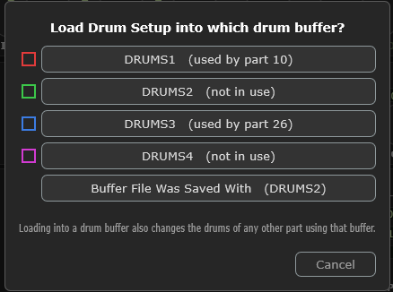

# 16 Files and formats

The plugin reads and writes six things. Four are its own formats for saving your
work, one is the standard XG format for talking to the rest of the world, and one
is your DAW project.

## At a glance

| | Extension | Holds | Use it for |
|---|---|---|---|
| **System Setup** | `.mss` | Everything — all 32 parts, all effects, all the plugin's extras | Your own work. This is the default Save. |
| **Part Setup** | `.mps` | One part, and its drum kit if it has one | Reusing a sound in another song |
| **Drum Setup** | `.mds` | One drum kit's per-key settings, and nothing else | Moving a drum treatment onto a different kit |
| **Effect Setup** | `.mes` | All five effect units and the Multi EQ | Reusing an effects rack |
| **XG bulk dump** | `.syx` | Standard XG data for all 32 parts | Real hardware, XGEdit, other XG software |
| **DAW project** | — | Everything, plus the session | Automatic; your DAW handles it |

The four `m*s` formats are the plugin's own. They are plain text, so they survive
being emailed, put in version control, or opened in a text editor out of
curiosity.

> **Watch out** — the format is worked out from the file's **contents**, not its
> extension. Rename a `.mds` to `.mps` and it still loads as a drum setup. That is
> usually what you want; just do not expect renaming to convert anything.

## System Setup (`.mss`) — the one you want

**File ▸ Save Setup (.mss)**, or **File ▸ Save Setup As... ▸ System Setup**.

This is the plugin's complete state: every part's voice and channel strip, all
five effect units, the Multi EQ, the drum setups, and — importantly — **the
plugin-only extras that no XG format can carry**: the HPF2 filters, the three
peaking EQ bands per part and per drum key, and the effect tempo-sync settings.

It does *not* hold session things: your ROM path, your audio buffer, your MIDI
routing, which view you were on. Loading a setup changes your sound and nothing
else about how the plugin is set up.

**Save Setup** overwrites the file named in the bottom bar; if there isn't one, it
behaves like Save As. It will never overwrite a `.syx` you loaded — that would
turn a hardware-compatible file into one only this plugin can read.

## XG bulk dump (`.syx`) — for everything else

**File ▸ Export Multi 32-Part Syx...**

A standard XG bulk dump, byte-compatible with a real MU100, MU80/90/128, an
SW1000XG, XGEdit, and anything else that speaks XG. This is how a patch you built
here gets onto hardware or into someone else's setup.

The plugin also **reads** `.syx` files, through the ordinary Open File. That is
how you bring in work you did in XGEdit or dumped off a hardware module.

> **It has to be a bulk dump.** MEGAN XG reads the `.syx` files XGEdit *saves*,
> not XGEdit's own native setup files — and the same goes for any other editor's
> own format. If that is the form your old work is in, open it in the program that
> wrote it and save it out, or transmit it, as an XG bulk dump first.

> **Watch out** — a `.syx` export **drops the plugin's extra controls**: HPF2, the
> three peaking EQ bands (bands 1 and 5, the bass and treble shelves, *are*
> standard XG and do export), and the tempo-sync links. This is not a bug — it is
> what keeps the file genuinely compatible. If you want everything back, save a
> `.mss` as well.
>
> If a patch has to end up on hardware, untick **Options ▸ Enable plugin-only
> parameters** before you start, and the question never comes up.

## Part Setup (`.mps`)

**File ▸ Save Setup As... ▸ Part Setup**

One part: its voice, its whole channel strip, its EQ and filters, and — if that
part is playing a drum kit — **the whole drum buffer that goes with it**.

The file is stored without a part number, so a part saved from part 12 can be
loaded onto part 3.

The drum buffer is included because it has to be. Assigning a program to a part
re-initializes the drum setup attached to it — that is how the device behaves, and
it happens whether or not the kit actually changes. "Load the part but leave its
drums alone" is not a state that exists, so the file says what the drums should
become.

> **To move a part inside the song you are already working on**, right-click its row
> in the Voice module and use **Copy** and **Paste** instead — see [copying a part](#copying-a-part-and-resetting-one).
> They carry exactly what this file carries. Save a `.mps` when you want to keep the
> sound for another day.

## Drum Setup (`.mds`)

**File ▸ Save Setup As... ▸ Drum Setup** — grayed out unless the selected part is
actually on a drum buffer.

The per-key layer alone: every key's level, pitch, pan, sends, filters and EQ. No
part settings, **no voice, no program change**.

Leaving the program out is the entire point. Because loading one fires no program
change, it is the only way to rewrite the per-key data *without* the kit being
re-initialized first — which is what lets you take the drum treatment you spent an
afternoon on and drop it onto a **different kit** or another part, leaving that
kit and its channel strip alone.

Values land by note number, so it transfers meaningfully between kits with
comparable layouts. Loading a standard-kit treatment onto an SFX kit will do
something, but it will not be musical.

> **Watch out** — the `.mds` extension is also used by Alcohol 120% for disc
> images. The plugin registers no file associations so nothing will break, but
> double-clicking one in Explorer may open the wrong program.

## Effect Setup (`.mes`)

**File ▸ Save Setup As... ▸ Effect Setup**

All five effect units — reverb, chorus, variation and both insertions — plus the
Multi EQ and the tempo-sync settings, as one block. An effects rack you can carry
between songs.

## The drum buffer chooser

<!-- CAPTURE: Editor view, dark theme, DrumBufferChooser open over the editor,
     showing DRUMS1-4 with color swatches and part lists, plus the
     "Buffer File Was Saved With" row. -->

Any load that writes drum data asks **which buffer** first — always for a `.mds`,
and for a `.mps` whose part is on one.

It asks because a drum buffer is **shared by every part assigned to it**. Writing
one can change parts you never selected, so the plugin would rather ask up front
than tell you afterwards. Each row names the parts currently using that buffer, so
you can see what you are about to affect.

Clicking a row *is* the decision — the load begins immediately. Cancel backs out.
Clicking the dimmed area around the box does nothing on purpose: this appears in
the middle of loading a file, and a stray click quietly abandoning it would be
worse than one that does nothing.

A full drum buffer is a lot of data — about 2.7 seconds of it — so expect a brief
busy indicator.

## DAW project state

> **VST only.**

Your DAW saves and restores everything: the complete setup as in a `.mss`, plus
the session (ROM path, buffer, latency trim, the file you had open) and a snapshot
of the sound engine's own memory. You do not have to do anything, and you do not
have to save a `.mss` to keep your work in a project.

> **Watch out** — the first ten to fifteen seconds after reopening a large
> project, the plugin may sound wrong and its notes may arrive late while it
> re-sends the patch. It corrects itself; it is not a fault, and it is not
> something you can speed up. See
> [Troubleshooting](#22-known-issues-and-troubleshooting).

> **Standalone only** — the standalone **never** keeps your setup between
> sessions, on purpose. It opens at factory defaults every time. Save a `.mss` or
> lose it; it will warn you on the way out. See
> [Running standalone](#19-running-standalone).

## After a partial load

Loading a `.mps`, `.mds` or `.mes` changes part of your setup, so afterwards your
work matches no single file. The bottom bar keeps naming whatever `.mss` you were
last synced to, and shows the unsaved-changes `*`. That is the truth, not an
oversight.

Every load — partial or whole — **clears the undo history**. An undo step is a
value at a fixed address, so replaying one across a load would write the previous
setup's value into the new one: perfectly well-formed, in range, and silently
wrong. Clearing is the only safe option.

## settings.xml

Your preferences, not your music. Covered in
[the settings reference](#a2-settingsxml-reference).
