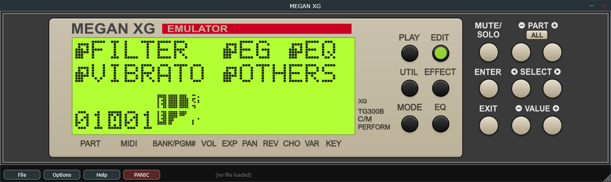
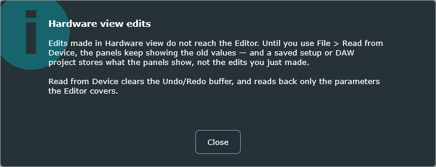

# 17 The Hardware view

**Options ▸ View ▸ Hardware** shows a picture of the MU100's front panel, with
a working LCD and buttons you can click.

<!-- CAPTURE: Hardware view, LCD showing an edit page (not the plain play screen),
     one of the mode LEDs lit. Full window. -->

This is not decoration. The buttons drive the real firmware, the LCD is the real
display, and every menu, page and parameter the hardware has is reachable through
it — including things the editor deliberately does not cover.

> **The LCD is not 100% faithful.** Some elements of the real display are missing
> from it. Text, values and the pages you navigate are all there and correct, but do
> not treat the panel as a pixel-accurate reproduction of the hardware's screen. The
> Hardware view is here primarily for people who want to reach functions the editor
> does not offer — Performance mode, UTIL settings, and firmware-generated bulk
> dumps — not as a display replica.

## The panel

> **The Hardware view is mouse-only.** Its buttons are painted onto the picture
> rather than being controls in their own right, so they cannot be reached from the
> computer keyboard and a screen reader cannot see them. Everything the front panel can
> do to a *sound* the Editor view can do too, and that view is fully keyboard-operable
> — see [Using the controls from the computer keyboard](#using-the-controls-from-the-computer-keyboard).
> What is only here is the panel *itself*: its pages, its LEDs and its LCD.

The buttons are the module's own, and behave exactly as they do on the hardware:

| | |
|---|---|
| **PLAY · EDIT · UTIL · EFFECT · MODE · EQ** | Mode buttons, each with its LED |
| **PART −/+** | Step through parts |
| **SEL ◄ ►** | Move between fields on the current page |
| **VAL −/+** | Change the value under the cursor |
| **ENTER · EXIT** | Confirm, and go back |
| **MUTE/SOLO** | Mute and solo |

The small tan **ALL** button under **PART**, between the two PART buttons, is the
same as pressing **PART −** and **PART +** together on the hardware (where ALL is
only a label, since there you can press both keys at once): it switches
between All Part control (settings that apply to every part at once) and Single
Part control (one part at a time). Click it once to select all parts and again to
go back to a single part.

**This manual does not document the panel's own screens.** They are the MU100's,
they are unchanged, and the Yamaha MU100 owner's manual describes all of them
properly. Use it; everything in it applies.

## What the Hardware view is for

Nearly all of the time, the editor is the better tool: everything at once, a
mouse, undo. There are three things the front panel does that the editor does
not.

**Performance mode.** The MU100's Performance mode — its four-part layered
performances, with their own edit pages — is a whole area of the machine the
editor does not cover. The panel is the only way in.

**Utility settings.** The genuinely device-level settings live under UTIL.

**Making bulk dumps that are faithful to the hardware.** This is the important
one, and it deserves its own section.

## Making faithful bulk dumps

The editor covers what the editor covers. When you need a `.syx` that contains
*everything a real MU100 would send*, including areas the editor never touches,
you can drive the module's own bulk-dump function from the panel exactly as you
would on the desk.

The procedure is the hardware's own — see the owner's manual under Utility mode.
The plugin's MIDI output carries the result, so:

> **VST only** — set a MIDI track's input to the plugin's MIDI output, record-arm
> it, and trigger the dump. The whole dump lands in your project as SysEx, and can
> be exported as a `.syx` from there.

> **Standalone only** — enable a MIDI output under **Options ▸ MIDI Output...** and
> the dump goes to it, so you can capture it in any MIDI utility, or send it
> straight to real gear.

The dump is what the firmware itself produces, so it is byte-faithful in a way
that the editor's own export — which composes a dump from what the editor models —
cannot claim to be for the areas the editor does not cover.

For the ordinary case of "give me my 32 parts and effects as XG data",
**File ▸ Export Multi 32-Part Syx...** is simpler and is what you want.

## Using both views on one project

The two views work on the same device but **do not share edits**, and this is the
one genuine trap in the plugin.

**Front-panel edits do not reach the editor.** Press EDIT on the panel and change
a part's cutoff, and the device does change — you can hear it. But the editor's
Part module still shows the old value, because nothing tells it. The emulated
module transmits nothing back when its own panel is used, exactly as the hardware
transmits nothing when you turn its knobs.

That matters when you save:

> **Watch out** — a `.mss` file, and your DAW project's copy of the editor's
> settings, store **what the editor thinks**, not what the panel changed. Panel
> edits can be silently lost.

<!-- CAPTURE (done): the "Hardware view edits" dialog, shown after pressing a
     front-panel button and switching back to the Editor view. -->

The plugin warns you the first time you switch from Hardware back to Editor after
touching the panel. The warning is armed by any front-panel press and cleared by
anything that replaces the whole setup — Read from Device, File ▸ New, File ▸
Open, or reopening a project. If it appears, it is because something really did
happen.

### The safe pattern

**Do panel work first, then Read from Device, then edit.**

**File ▸ Read from Device** pulls the module's current state back into the editor,
so everything you did on the panel is reflected in the panels — and will be saved.
Do that before you touch the editor again and the problem never arises.

Two things to know about it: it **clears the undo history**, and it reads back
only the parameters the editor covers. It is the right tool after panel work; it
is not a general "refresh".

### The other direction

Editor edits *do* reach the device — that is all the editor does — so the panel
always shows the truth. There is no trap in that direction.

The one asymmetry worth knowing: in a DAW, reopening a project restores the
**device** from a snapshot of its memory, which does include panel edits, while it
restores the **editor** from the saved editor state, which does not. So a project
saved after panel work can come back with the device right and the panels wrong.
Read from Device fixes it.

### If you only use the editor

None of this applies. Stay in the Editor view and there is nothing to think
about.
