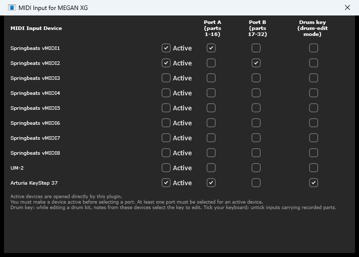

# 19 Running standalone

> **Standalone only** — this whole chapter.

The standalone runs the same plugin without a DAW: a sound module on your desktop,
played from a MIDI keyboard or fed by any program that can send MIDI. It is the
easier way to explore the editor, and the right tool when you want the MU100 as an
instrument rather than as part of a project.

Everything in the rest of the manual applies. This chapter is the differences.

## Audio

**Options ▸ Audio...** — the top of the window is your sound card, sample rate and
buffer size, the same panel every JUCE application uses. Choose an **ASIO** driver
if you have one; it is the difference between playable and not.

Below it are the plugin's own buffer threshold and PDC trim. The trim does nothing
here, since there is no host to compensate.

The per-part output checkboxes are absent. The standalone opens one stereo output
and cannot do more.

## MIDI input

**Options ▸ MIDI Input...**

<!-- CAPTURE: Standalone, Options > MIDI Input... window, at least two devices
     listed, one Active with Port A and Drum key ticked. -->

A row per device, with four checkboxes:

| | |
|---|---|
| **Active** | Use this device at all |
| **Port A (parts 1-16)** | Route it to port A |
| **Port B (parts 17-32)** | Route it to port B |
| **Drum key (drum-edit mode)** | Let notes from it pick the drum key you are editing |

Two rules the window states at the bottom, and enforces:

- **Make a device Active before choosing a port.** The port checkboxes do nothing
  until it is.
- **An active device must have at least one port**, or it has nowhere to send
  what it receives.

**One port per device is almost always right.** A device on both ports plays
everything twice: a note on channel 12 sounds Port A's part 12 *and* Port B's
part 28 — two different parts, two different voices.

The usual setup is one keyboard, Active, Port A. If you have a second controller
for the upper parts, give it Port B.

Your choices are remembered by device name, so unplugging and replugging an
interface does not lose them.

### Which devices pick drum keys

In [drum-edit mode](#13-drum-editing) a played note selects the drum key you are
editing. The **Drum key** column decides which devices are allowed to do that.

Tick your keyboard. Untick anything carrying recorded parts — a drum track playing
back would otherwise walk the selection around the kit while you are trying to edit
one sound. Unticking stops only the *selection*: the device still plays normally.

New devices arrive ticked, so this needs attention only when something other than a
keyboard is coming in.

**The VST version needs no such setting.** It cannot see its MIDI devices — the DAW
owns them — but it can see the transport, so it accepts drum-key selection from any
input while the transport is stopped and from none while it rolls: pick keys by hand
between takes, no jumping during playback. (Options ▸ [Enable MIDI drum key selection
during DAW playback](#enable-midi-drum-key-selection-during-daw-playback) lifts that
if you want it, in a sparse passage say.) The standalone has no transport to watch,
which is why it asks per device instead.

### Reconnect MIDI Inputs

Windows occasionally stops delivering MIDI to a running application while
everything still looks connected — a USB interface glitches, or another program
grabs the port. **Options ▸ Reconnect MIDI Inputs** closes and reopens the inputs.

It sends nothing to the sound module; it only fixes the connection. If a note was
held when you use it, its note-off may be lost — press PANIC afterwards.

## MIDI output

**Options ▸ MIDI Output...**

Pick devices, and every edit the editor makes is echoed to them as SysEx. Two
uses:

- **Capture your editing** in any MIDI utility, to build a setup block for a song
  file.
- **Drive real hardware in parallel.** Point it at a real MU100 or another XG
  module and the editor edits both at once — which makes this a rather good
  general-purpose XG editor, not just an editor for its own sound engine.

## Your setup is not saved

This is the important one.

> **Watch out** — **the standalone opens at factory defaults every time.** It does
> not remember the sounds you were working on between sessions. If you want to
> keep a setup, **File ▸ Save Setup As... ▸ System Setup (.mss)**.

That is deliberate rather than an oversight. Half-restoring a session — the sound
engine coming back with the last session's voices while the editor came back at
defaults — is worse than not restoring at all, and that is what the honest
alternative amounted to.

It applies only to the standalone. In a DAW the setup belongs to the song and is
saved with it.

You will be asked before losing anything: closing the window, or **File ▸ Exit**,
prompts if you have unsaved changes.

**What does persist:** every preference under Options, your recent files list,
your MIDI routing, your window size, and your audio device choice. Only the
*sound* is not carried over.

## Tempo

The System module's **TEMPO** knob is live in the standalone, and is what the
effect tempo-sync feature works from. In a DAW it follows the project instead.

## What the standalone does not have

Three features need a host and are absent here:

- **Per-part stereo outputs** — no host to route them to.
- **Native automation and its markers** — no host, no lanes. Everything is still
  editable; there is simply nothing to automate from.
- **Name All Output Tracks from Voices** — no tracks.

The Options menu simply does not show them, rather than showing them grayed.

## Exiting

**File ▸ Exit**, or the window's close button — the same path either way, with the
same unsaved-changes prompt.
