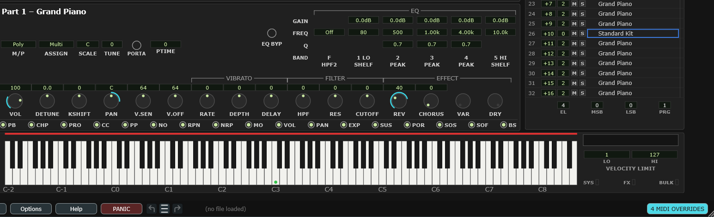

# 20 Workflows

Recipes for the things people actually sit down to do.

## Loading a `.syx` file from XGEdit or hardware

You have XG bulk dumps — saved from XGEdit, dumped off an MU-series module or an
SW1000XG, or extracted from a song file. This is the fastest route to hearing them
again.

> **It has to be a `.syx` bulk dump.** XGEdit's own native setup files are not
> read, and neither is any other editor's own format. If that is what you have,
> open it in the program that wrote it and save or transmit it as an XG bulk dump.

1. **File ▸ Open File...**
2. Choose the `.syx`. The plugin works the format out from the contents, so a
   dump saved under any extension will load.
3. Wait for it. A full 32-part dump takes a few seconds to send, at exactly the
   speed a real MIDI cable would take, and you will see a busy indicator.
4. Every panel in the editor fills in with what was in the file.

**What survives:** everything the file contains — voices, channel assignments, all
the part settings, all five effect units, the Multi EQ, the drum setups. It is the
same data the hardware would have loaded.

**What is not there:** the plugin's own additions — HPF2, EQ bands 2–4, tempo-sync
— have no place in an XG file, so they start at their neutral settings. Nothing is
lost, because they were never in the file.

**Then save a `.mss`.** From this point on, work in the plugin's own format;
export a `.syx` again only when you need to hand something to other gear.

> **Watch out** — files written for an MU80 or MU90 load fine, but they will not
> call for any of the MU100's own voices. Files written for a **different** XG
> device family, or for something that only claims XG compatibility, may set
> parameters this module does not have; those are simply ignored.

## Setting up a song in a DAW

The straightforward workflow, and the one to start with.

1. Add the plugin to an instrument track.
2. Build your sounds in the editor — voices in the Voice module, then each part's
   channel strip and effects.
3. Write your MIDI parts on tracks pointed at `MEGAN XG - A` (and `- B` for parts
   17–32).
4. Save the project. Everything comes back next time.

That is all. You do not need a `.mss` file, and you do not need to record any
SysEx. The project holds it.

Save a `.mss` anyway if the setup is one you might want in another song.

## Recording your setup into the song itself

Worth doing if you want the song to be self-contained — playable on a real MU100,
or by someone who does not have your project.

1. New MIDI track, **input** = the plugin's MIDI output, **output** = `MEGAN XG - A`.
2. **Turn input monitoring off** on that track.
3. Record-arm, start recording at bar 1, and go through the editor setting
   everything up.
4. Stop. Your edits are SysEx events on that track.

Now the module configures itself from the timeline. Put a second block of edits
halfway through the song and the sound changes there.

This is exactly how XG MIDI files have always worked, and it is why XGEdit had a
"merge to MIDI file" feature. Here your DAW's own editing does the same job.

## Changing sounds from a MIDI track

**Nothing arriving over MIDI changes your setup.** A program change, a controller
or an XG parameter message moves the *device* — you hear it — and the editor's
panels go on showing the values you set. That is deliberate, and it is what makes
saving safe: a project, a `.mss` or a partial setup always stores what the panels
show, never what the song did to the module in passing.

What the editor does instead is **tell you the device has moved**. Any control
whose value on the device no longer matches yours is marked in cyan, and the
bottom bar keeps a running count.

<!-- CAPTURE: Editor view, dark theme, window 1636x1000, crop x85 y530 w1545 h470.
     Overrides standing on part 1 (CC7, CC10 and CC91 on port A channel 1, so VOL,
     PAN and REV each show a dial arc at the default mark style, with PAN's growing
     from the centre) and on part 26 (a program
     change on port B channel 10, so its voice row shows the tab). The crop reaches
     the bottom bar, where the count reads 4 MIDI OVERRIDES. Two parts on purpose:
     overrides are per part, and part 26's row is the one that falls in this crop. -->

**How to read the marks.** Your value never moves; the cyan says where the device
is.

- **A value box** grows a cyan bar reaching toward the device's value — under the
  box, or down its right inside edge in the compact style. Either way it is clear
  of the yellow changed-from-default tab on the left, so the two never crowd each
  other.
- **A knob** is marked on its dial: an arc from the parameter's rest point to where
  the device is, or, in the compact style, a hollow cyan ring at that position
  beside the filled dot that is still yours. Which of the three forms you get is
  **Options ▸ Display Animation… ▸ Mark them with**; see
  [MIDI override marks](#midi-override-marks).
- **A voice row** takes a full-height tab at the right end of the row. A voice is
  a bank and a program rather than a position in a range, so there is no height
  that would mean anything. Hover the row and the tooltip names the voice the
  device is actually playing.
- **A name picker** takes the same full-height tab down its right inside edge, for
  the same reason: the effect program, the Multi EQ program and the two controller
  assignments. Hover it and the bottom bar names what the device is on. Worth doing
  for the effect program in particular, because the type selects the whole effect:
  while it is overridden, every knob in Effect Parameters is labelled for *your*
  program while the device is running another one. The knobs go on reporting your
  effect, because that is what they edit and what will be saved, and the editor does
  not follow the device onto the other program. Whether the knobs carry marks of
  their own then depends on the two effects sharing a layout; see
  [The Effect Parameters module](#8-the-effect-parameters-module).
- **A part, as a whole** takes a tab just right of its number in the Voice module,
  whenever anything on it has been overridden that the row does not already show.
  That is the overview: it tells you which parts to look at before you select them.
- **A switch** draws its ring in cyan and a little thicker. A switch has two
  states, so "the device differs" already says which one it is on.
- **The amp envelope** shows a hollow cyan node where the device has that point.
- **A drum key** is marked the same way while you are editing one, and the
  [strip above the keyboard](#which-drum-keys-have-been-touched) shows which keys of
  the kit are overridden without your having to select each one.

**The bottom bar** shows a count — `6 MIDI OVERRIDES` — whenever any are standing.
**Hover it and it says where they are**, grouped: `2 on Pt 10, 1 on Pt 12, 2 on DRUMS1
(C1, D1), 1 on System / Effects`. That matters most for a drum buffer no part on
screen is using — there is no knob and no key to mark, so the count is the only place
it can show. A buffer with more overridden keys than a list can carry says how many
instead (`11 on DRUMS1 (11 keys)`).
Click it to put the device back on your values. To keep what arrived instead, use
**Options ▸ Keep MIDI overrides**, which folds the device's values into your setup
as a single undoable step. If you would rather the editor did not watch the device
at all this session, untick **Options ▸ Follow MIDI changes to the device** — the
marks and the count stop, and nothing else about the plugin changes.

**The one thing this cannot protect.** A program change on a drum part
**re-initializes that buffer's per-key settings on the device**, and it does so
even when the program is the one already loaded — which is what a sequencer sends
at the top of every take. Your copy survives, so saving is still safe and Options ▸
Clear MIDI overrides will push it back. What you must not do is run **File ▸ Read
from Device** after such a pass: that reads the device's freshly reset values over
your work. Save a `.mds` first if the per-key work matters.

**Which messages are followed.** Program change and bank select, the controllers
that move a stored setting (volume, pan, the three effect sends, filter cutoff and
resonance, envelope attack and release, portamento), and single XG parameter
messages — including the ones that address a **drum key**, which no controller and
no automation lane can reach. A **bulk dump** is treated as a file being opened
rather than as an override: it replaces your setup, because a whole block arriving
at once is something a person meant.

**An XG parameter message names its own target**, so which port and channel it
arrives on makes no difference to which part it moves — see
[The two MIDI inputs](#the-two-midi-inputs). Program changes and controllers are the
opposite: those are addressed by port and channel like the notes beside them.

Two notes on the controllers, both measured on the device rather than taken from
the specification. The MU100 does not implement CC75, decay time, at all, so it is
not marked. CC94, variation send, does nothing while the variation block is wired
as an insertion effect, because there is no per-part send for it to move.

**Automation lanes are not marked, deliberately.** A lane is part of your project,
you authored it, and it replays identically every time, so it moves your values
exactly as it does in any other plugin. The cyan marks mean one specific thing:
something from outside the project moved the module.

## Turning recorded SysEx into DAW automation

You recorded a filter sweep as SysEx, and now you would rather have it as an
automation lane you can draw on.

1. Find the control in the editor. If it has an orange triangle by its name, it
   has a DAW lane.
2. Arm that parameter's lane in **Write** or **Touch**.
3. Play back the SysEx track.
4. The incoming SysEx moves the parameter, and the armed lane records it.

Then mute the SysEx track.

> **Watch out** — the same mechanism is a nasty surprise if you leave a lane armed
> in Write by accident: any SysEx arriving, or any knob you turn in the editor,
> gets recorded. Disarm when you are done.

## Getting a patch onto real hardware

1. **Before you start**, untick **Options ▸ Enable plugin-only parameters**. The
   four controls a `.syx` cannot carry gray out, so the session cannot produce
   anything that will not survive.
2. Build the patch.
3. **File ▸ Export Multi 32-Part Syx...**
4. Send the file to the hardware with any SysEx utility, or from a MIDI track.

If you did not do step 1 and want to check what you might lose, look for HPF2 and
EQ bands 2–4 in the [EQ display](#important-what-saves-where) — they are the
plugin's only additions to the sound, along with the tempo-sync links, which only
cost you the tempo-following, not the delay time.

## Copying one part onto another — and the same trick for effects and drums

There is no "copy part" command, because there does not need to be one: **saving a
partial setup and loading it back onto a different target is the copy**. The same
three steps work for a part, for the whole effects rack, and for a drum treatment.

**Copying a part to another part:**

1. Select the part you want to copy.
2. **File ▸ Save Setup As... ▸ Part Setup (.mps)** and give it a name — a scratch
   name is fine, this file is usually rubbish afterwards.
3. Select the part you want to copy it *to*.
4. **File ▸ Open Recent...** and pick the file you just saved. (**File ▸ Open
   File...** does the same thing with more clicking.)
5. If you are asked about unsaved changes, choose **Discard**.

> **Discard sounds worse than it is.** That prompt appears before *any* file is
> opened; it is asking about the edits you have not saved to a `.mss`, not about
> the part you are pasting into. A `.mps` only rewrites the one part, so the rest
> of your setup is untouched either way. If you did want those edits kept, cancel,
> save your `.mss` first, and come back.

> **Watch out — change the MIDI channel.** A `.mps` carries the part's whole
> channel strip, and that includes its **CH**. So the new part arrives on the
> *original* part's channel and the two will play in unison. Set **CH** in the
> Voice module to whatever the new part should answer to, unless a deliberate
> layer is what you were after.

**Copying the effects rack** is the same, with
**Save Setup As... ▸ Effect Setup (.mes)** — all five units and the Multi EQ in one
go. There is no target to select first, because there is only one effects rack:
loading it replaces the lot.

**Copying a drum treatment** is the same again, with
**Save Setup As... ▸ Drum Setup (.mds)**, and this one is the special case: it
carries no program change, so it can land on a *different* kit without resetting
it. See
[Moving a drum treatment to another kit](#moving-a-drum-treatment-to-another-kit).

All three files are equally good for carrying a sound **into another song** — save
it in one project, open it in the next. The `.mps` is stored without a part number,
so a sound saved from part 12 loads onto part 3 just as happily.

> **If the part is playing a drum kit**, a `.mps` brings its whole drum buffer with
> it and the plugin will ask which buffer to put it in. See
> [the drum buffer chooser](#the-drum-buffer-chooser) — a buffer is shared, so the
> answer can affect parts you did not select.

## Mixing the parts in your DAW

Instead of using the MU100's own effects and balance:

1. **Options ▸ Audio... ▸ Separate stereo output per part**, and tick **…and remove
   them from the main output**.
2. Enable the extra outputs in your DAW.
3. **File ▸ Name All Output Tracks from Voices** so the tracks are labeled. The
   order of steps 2 and 3 depends on your DAW — see
   [Naming the output tracks](#naming-the-output-tracks).
4. Mix and process with your DAW's own tools.

Remember the outputs carry the **dry** part signal. See
[Per-part stereo outputs](#per-part-stereo-outputs) before you build a mix around
this — and set it up before you press play, not during.

## Building a split or layered keyboard

Both live in the [Keyboard module](#12-the-keyboard-module).

**A split:** put two voices on two parts, set both parts to the same **CH** in the
Voice module, then left-drag the keyboard to give each part its half of the range.

**A layer:** the same, but overlap the ranges. Detune one slightly with the Part
module's **DETUNE** for thickness.

**A velocity switch:** same channel again, and give each part a complementary
range in the **VELOCITY LIMIT** boxes — one below 80, one above.

## Finding the part that is making a sound

You can hear what you want to change, but with 32 parts running you do not know
which one it is.

1. Put the Graphic Display on **VOLUME**. The meters are on by default; if the bars
   are plain and solid, turn them on under **Options ▸ Display Animation... ▸
   Animated volume level meters**.
2. Play the passage and watch which bar moves in time with the sound.
3. **Click the part number under that bar.** That part is now selected everywhere
   — Part module, Controllers, Keyboard, Voice module.
4. Edit it.

The Voice module's activity tabs answer the same question, but they only flash as
notes start and stop; a meter stays up for as long as the sound does, which is
easier to match against what you are hearing.

**If the meters are not enough, use your ears.** Click the **S** cell on a
candidate part's row in the Voice module and everything else drops away. Click the
next row's **S** to move the solo along, or **Ctrl+click** to jump straight to one
part and clear the rest. Nothing is transmitted and nothing is saved, so this
cannot damage the patch you are working on — and the badge at the right of the
bottom bar clears it all when you are done. See
[mute and solo](#m-and-s-mute-and-solo).

Note that a muted or un-soloed part's **meter keeps moving**, so the two techniques
work together: solo to confirm what you are hearing, and read the meters to see
what is still playing underneath.

## Finding a free insertion slot

There are only two insertion effects, plus the variation when you put it in
insertion mode, so on a busy setup the first question is usually "have I got one
left?".

1. Look at the **routing strip** along the top of the Effect module. It reads
   `V ... · I1 ... · I2 ...` and is showing whatever unit you are editing.
2. **OFF** on one of them means that slot is free. A part number means it is
   taken, and tells you by which part. **SYS** on the variation means it is a
   system effect and is not using a slot at all.
3. To see what is actually loaded in those three units, hover the strip: the
   bottom bar names each one's effect.

If all three are taken and you need another, the choices are to move one of them
onto a part that no longer needs it, or to use a send effect instead — the
variation in **SYS** mode reaches every part at once, which is often what was
wanted anyway.

## Auditioning an arrangement part by part

Mute and solo are the fastest way to answer "what is this part contributing?"
without touching the arrangement.

1. Play the passage in a loop.
2. **Ctrl+click** a part's **S** cell — only that part sounds.
3. Plain-**click** another part's **S** to add it to the solo, and again to take
   it away.
4. **Ctrl+click** any soloed part to collapse the solo onto it, then **click** it
   to turn it off. (Or just click the badge on the bottom bar.)

Use **M** the other way round: mute one part to hear what the arrangement is like
without it.

> **Watch out** — these are cleared when the plugin window closes and are never
> saved. If you want a part silent *in the arrangement*, mute the MIDI track that
> feeds it, or automate that part's **VOL** to zero.

## When something sounds wrong

See [Troubleshooting](#22-known-issues-and-troubleshooting). The single most
common cause of a silent part is a receive switch.
